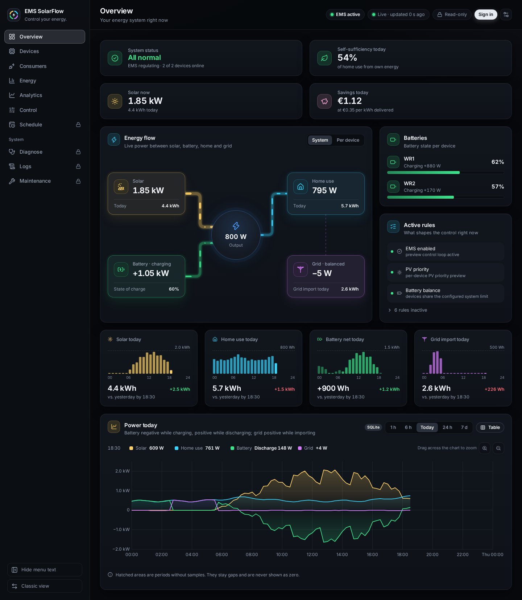
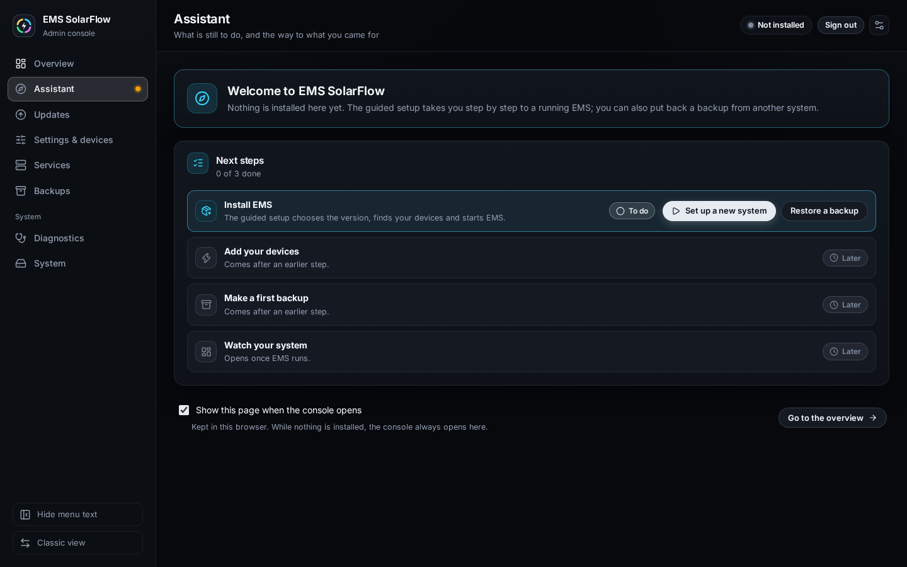

# ems-solarflow-api-control

[](https://github.com/basecubedev/ems-solarflow-api-control/actions/workflows/simulated-regression-tests.yml)
[](https://github.com/basecubedev/ems-solarflow-api-control/actions/workflows/playwright-e2e.yml)
[](https://github.com/basecubedev/ems-solarflow-api-control/actions/workflows/github-code-scanning/codeql)
[](.github/dependabot.yml)

[](docs/developer/testing.md#development-approach)

[](LICENSE)
[](docs/user/dashboard/appearance.md)

Local-first EMS control for Zendure SolarFlow systems.
It reads local grid meter and Zendure telemetry, controls inverter output,
and provides a local dashboard — including where the house's power goes, for
every consumer a plug or meter measures over MQTT.

The dashboard, the Admin Console and the Appliance Manager speak
**English, Deutsch, Nederlands and Français** — pick yours under Appearance at
the top right, or below the sign-in form.

> [!NOTE]
> **An independent community project.** EMS SolarFlow is not developed, endorsed or supported by Zendure, and it is not a Zendure product. Zendure, SolarFlow and the other product names mentioned here are trademarks of their respective owners; this project uses them only to say which hardware it works with. For help with this software, open a [GitHub issue](https://github.com/basecubedev/ems-solarflow-api-control/issues), not a ticket with Zendure support.

> [!TIP]
> **New to EMS SolarFlow?** Start with the [Project Overview](docs/user/project-overview.md), read the docs online at <https://basecubedev.github.io/ems-solarflow-api-control/>, or watch the [videos](docs/user/videos.md) on [YouTube](https://www.youtube.com/channel/UCk7i1JfCVML8hqlvzenCJBg).

> EMS controls real power hardware.
> Read the [safety guide](docs/user/safety.md) before enabling live writes.

[](docs/dashboard.md)

## Supported hardware at a glance

Each device has one status — **Validated** (on the maintainer's 800 Pro 2 and Shelly Pro), **Family-supported**,
**Reverse-engineered** or **User-reported** — explained with the full list in the [supported setups](docs/user/supported-setups.md).

<table><thead><tr><th align="left">Device</th><th align="left">Connection</th><th align="left">Status</th></tr>
<tr><td colspan="3"><strong>Inverters and batteries the EMS controls</strong></td></tr></thead>
<tbody><tr><td>Zendure SolarFlow 800 Pro 2</td><td>Local API or Zendure cloud MQTT</td><td>Validated</td></tr></tbody>
<tbody><tr><td>Zendure SolarFlow 800, 800 Plus, 800 Pro, 1600 AC+, 2400 AC, 2400 AC+, SolarFlow 2400 Pro, 3000 Mix AC+, 4000 Mix AC+</td><td>Local API or Zendure cloud MQTT</td><td>Family-supported</td></tr></tbody>
<tbody><tr><td>Zendure Hub 1200/2000, Hyper 2000, AIO 2400</td><td>Local broker or Zendure cloud MQTT</td><td>Reverse-engineered</td></tr>
<tr><td colspan="3"><strong>Grid meters, only read</strong> (<a href="docs/user/supported-setups.md#grid-meters-by-country">which fits in which country</a>)</td></tr></tbody>
<tbody><tr><td>Shelly Pro (current clamps)</td><td>HTTP</td><td>Validated</td></tr></tbody>
<tbody><tr><td>Shelly Plus / Gen2 / Gen3, Shelly 3EM Gen1, Zendure Smart Meter 3CT (current clamps)</td><td>HTTP</td><td>Family-supported (3EM Gen1, 3CT: Reverse-engineered)</td></tr></tbody>
<tbody><tr><td>Readers on the electricity meter's P1 or infrared port: HomeWizard P1 Meter, powerfox poweropti, everHome EcoTracker, Zendure Smart Meter D0, Tasmota readers (Hichi, bitShake, …), DSMR P1 bridges, Tibber Pulse IR (experimental, <a href="docs/user/tibber-pulse.md">better pick another</a>)</td><td>HTTP or TCP</td><td>Reverse-engineered</td></tr></tbody>
<tbody><tr><td>Meters read over Modbus, through the inverter or their own interface: SunSpec (Fronius, Kostal, SolarEdge), Huawei, Sungrow, E3/DC, Victron GX, Carlo Gavazzi EM24, smart-me, IAMMETER, Circutor Wibeee</td><td>Modbus TCP</td><td>Reverse-engineered</td></tr></tbody>
<tbody><tr><td>Meters that publish over MQTT: Linky through a ZLinky_TIC, Swiss CH-SMR readers, ESPHome readers, Zendure D0, any meter that publishes its power</td><td>MQTT</td><td>Reverse-engineered</td></tr>
<tr><td colspan="3"><strong>Devices the EMS shows but never controls</strong></td></tr></tbody>
<tbody><tr><td>Zendure Ace 1500, SuperBase V, and any other Zendure device reached with an API key</td><td>Local broker or Zendure cloud MQTT</td><td>Telemetry only</td></tr></tbody>
<tbody><tr><td>E3/DC storage system (S10 family): its PV, battery and grid</td><td>Modbus TCP</td><td>Reverse-engineered</td></tr></tbody>
<tbody><tr><td>Inverters and batteries of other makers, as FHEM, ioBroker, Node-RED or a script publishes them (<a href="docs/user/external-devices.md">guide</a>)</td><td>Local MQTT</td><td>Reverse-engineered</td></tr></tbody>
<tbody><tr><td>Devices that publish in a format of their own, such as OpenDTU or AhoyDTU, through the <a href="docs/user/admin/mqtt-mapping.md">MQTT mapping</a> and its optional built-in broker, and household consumers behind a Shelly or Tasmota plug (<a href="docs/user/dashboard/consumers.md">guide</a>)</td><td>Local MQTT</td><td>Reverse-engineered</td></tr></tbody></table>

**MQTT control is an implemented EMS transport** with the Local API's control
loop and safety gates: Validated on the 800 Pro 2 over ZenSDK cloud MQTT,
Family-supported on the other ZenSDK models, Reverse-engineered on the older
devices' legacy JSON. A write needs an exact supported model, a verified write
protocol, the device's control capability, a broker carrying its write route
and the transport's write gate. Most devices wait for a hardware confirmation:
[reports](https://github.com/basecubedev/ems-solarflow-api-control/issues/new?template=device_compatibility_report.yml) (working *or* broken) are welcome.

## Hardware requirements

The machine EMS runs *on* — 64-bit `arm64` or `amd64`.

| RAM | Recommended configuration |
|-----|---------------------------|
| 512 MB | EMS without InfluxDB |
| 1 GB | EMS with InfluxDB |
| >1 GB | Additional headroom |

InfluxDB stores energy history and is optional — control does not need it. [Pi matrix](docs/user/hardware-requirements.md).

## Get started

### On a dedicated Raspberry Pi

The **appliance image** turns the board into a box that runs EMS and nothing
else: flash one card, plug in Ethernet, power on. No shell to learn and no
operating system to maintain by hand.

One writable root, patched in place by `apt`, on a 16 GB card or larger. Built
for the **Raspberry Pi 3, 3B+, 4 and 5** — one image file per board. A failed
operating-system update is recovered by you, at the machine, or by writing the
card again and restoring a backup, which is why the backup matters more than the
update does.

The image is **partly confirmed on physical hardware** (one Pi 3B+, without
EMS); read what that means before you rely on it.

**[Download the newest image →](https://github.com/basecubedev/ems-solarflow-api-control/releases/tag/appliance-image-latest)**
— one file per board, always the current build. Not under *Packages*: that
holds the container images the appliance fetches by itself.

[Flashing the card](docs/user/appliance/install.md) · [First start](docs/user/appliance/first-start.md) · [The assistant](docs/user/appliance/assistant.md) · [All appliance guides](docs/user/appliance/index.md)

### On a machine you already run

> [!TIP]
> **New here? Start with the Admin Console — the recommended path for most
> users.** Browser-guided setup, hardware discovery, updates, backups and
> maintenance, with no shell or config-file editing. It finds your devices and
> sets up the connection for you.

**Docker is required first.** The script installs no runtime of its own: it
writes a compose file and starts a container, so the machine needs Docker
Engine with the Compose v2 plugin (2.24.0 or newer) and a daemon your user can
reach. Without it the script stops and names what is missing.
[What the host needs](docs/user/hardware-requirements.md#software)

Install and start it in a local EMS folder:

```bash
mkdir -p ems-solarflow-api-control
cd ems-solarflow-api-control
curl -fsSLO https://raw.githubusercontent.com/basecubedev/ems-solarflow-api-control/main/deploy/admin/install-admin-console.sh
sh install-admin-console.sh
```

Then open `http://127.0.0.1:8090` — or `http://<host-ip>:8090` from another
machine, which is the usual case on a headless Pi — and create the
shared EMS/Admin password in the browser. **That sign-in page is how you know
the install worked**; if it does not appear,
`docker compose -f docker-compose.admin.yml ps` says whether the container
came up. Host networking is the default (best for local discovery); add
`--bridge --bind 0.0.0.0` only if you need Docker bridge networking.

The console then opens on its assistant, which says what is still to do —
on a fresh host, **Set up a new system** starts the guided setup — and leads
to the page for it.



Full guide, with screenshots and demo videos of a fresh install and a guided
update:
[docs/user/admin-console.md](docs/user/admin-console.md#what-the-admin-console-looks-like)

### Other ways to install

Prefer the shell? [Docker Bootstrap](docs/user/docker-bootstrap.md) is a shell-only Docker setup;
[Developer Setup](docs/developer/developer-setup.md) is for developing or building from source. Both
converge on the same `config/config.json`, so you can switch later.

### Connection types (reference)

The Admin Console picks the right one during discovery — you don't choose
upfront. EMS reaches your devices over any one of:

- **[Local API (ZenSDK)](docs/user/connection-types.md#local-api-zensdk)** — newer SolarFlow / ZenSDK models on your LAN. Fastest, fully local.
- **[Local MQTT](docs/user/connection-types.md#local-mqtt)** — devices re-pointed to your own broker. Low latency, no cloud.
- **[Zendure MQTT (cloud)](docs/user/connection-types.md#zendure-mqtt-cloud)** — any Zendure device via your Zendure API key. Higher latency over the internet.

## Documentation

- Step-by-step guides: [Admin Console](docs/user/admin/index.md) · [EMS Dashboard](docs/user/dashboard/index.md)
- [How it fits together](docs/user/how-it-fits-together.md) · [Hardware requirements](docs/user/hardware-requirements.md) · [Raspberry Pi compatibility](docs/user/hardware-requirements.md#raspberry-pi-compatibility)
- [Appliance installation](docs/appliance/installation.md) · [Administration](docs/user/admin-console.md) · [Troubleshooting](docs/user/troubleshooting.md)
- [User documentation](docs/user/) · [Technical reference](docs/technical/) · [Developer documentation](docs/developer/) · [Full documentation map](docs/README.md)

## Getting help

[FAQ](docs/user/faq.md) · [Troubleshooting](docs/user/troubleshooting.md) · [GitHub issues](https://github.com/basecubedev/ems-solarflow-api-control/issues)
