# EMS SolarFlow Admin Console

> **Video:** [Install Without Pi](https://www.youtube.com/watch?v=rx4xNv-EDIE)

The Admin Console (product name **EMS SolarFlow Admin**) is the local browser UI
for setup and maintenance. It runs next to EMS, not inside the control loop. EMS
still owns the control logic; the Admin Console is UI and orchestration only.

The Admin Console is a Docker path: Docker has to be installed on the host
before the installer is run — see [Before you start](#before-you-start). Run it
only on a trusted local machine.

## Use it for

- first setup
- device discovery
- settings and devices
- diagnostics
- updates
- backups
- restore

## Where to start

Opened at its address, the console starts on its **assistant**: it says what
kind of installation the host has, lists what is still to do — install EMS,
add your devices, make a first backup — with the button for the next step, and
links to the page for anything else you came to do. See
[The assistant](admin/assistant.md).

- **Set up a new system** — for a fresh install or a deliberate reinstall: the
  guided setup. See the [Guided setup](admin/guided-setup.md) and the
  [setup reference](admin-setup.md).
- **An existing system** — updates, settings and devices, services,
  diagnostics, backups and restore each have a page of their own. See
  [Maintenance](admin/maintenance.md) and the
  [maintenance reference](admin-maintenance.md).

The console works in English, German, Dutch or French, and on a phone. Its
previous design, **Classic**, is deprecated and still answers at `/classic/`
until a later release removes it; **Classic view** at the foot of the side menu
opens it. Every workflow, the guided setup and the guided upgrade included,
runs in the current design; see the
[step-by-step guides](admin/index.md).

Changing actions show what they will do and ask for confirmation. Saving
settings, the guided upgrade and a restore back up what they replace first.

When the Admin Console updates itself during a guided upgrade, the page loses
contact for a moment, reconnects by itself and follows the update on.
Updating the Admin Console is a step of the upgrade — see
[Admin alignment (automatic)](admin-maintenance.md#admin-alignment-automatic).

## What the Admin Console looks like

Every screenshot on this page shows the current console, with demo data only
(fake devices, addresses, serials and versions). The step-by-step guides in
[docs/user/admin/](admin/index.md) walk through each page in detail.

### The side menu, the top bar and the Overview


The side menu lists the pages in two groups, in this order:

```text
Overview · Assistant · Updates · Settings & devices · Services · Backups
System: Diagnostics · System
```

Its foot holds **Open the dashboard**, **Hide menu text** and **Classic view**.
The top bar names the page and says in one word how the installation is —
**All good**, **A note**, **Needs a look**, **Needs attention**, **Not
installed**, **Checking…** or **Unknown state** — a pill that leads to the
Overview, beside **Sign out** and the **Appearance** button.

The **Overview** answers whether everything is in order: one verdict, what
needs your attention, ranked and with the way out of each, tiles for EMS, the
analytics database, control and the last backup, **Control & safety** — what
your saved settings allow EMS to do — and **Versions**. See
[Maintenance](admin/maintenance.md#1--read-the-overview).

### The assistant


Opened at its address, the console starts on the **Assistant**: what kind of
installation the host has, the next steps — **Install EMS**, **Add your
devices**, **Make a first backup**, then **Watch your system** — each **Done**,
**To do**, **Later** or **Unknown**, the next one highlighted with its button,
and six tiles to the pages for what you came to do. Untick **Show this page
when the console opens** and the console opens on the Overview instead; while
nothing is installed it always opens here. See
[The assistant](admin/assistant.md).

### The guided setup

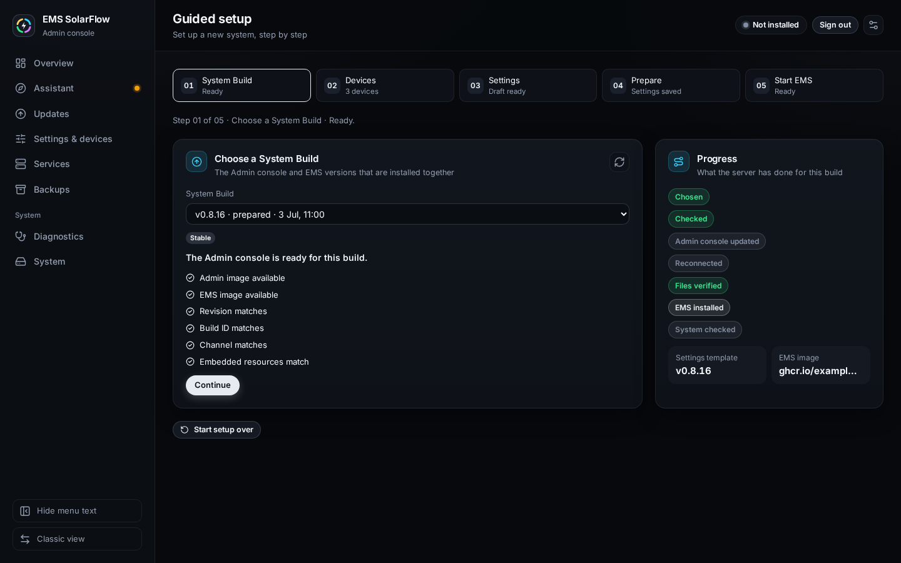

The **Guided setup** installs EMS in five steps — **System Build**,
**Devices**, **Settings**, **Prepare**, **Start EMS** — and installs nothing
until the last ones. It has no place in the menu: the assistant's **Set up a
new system**, the Overview of an empty host and the System page open it. See
[Guided setup](admin/guided-setup.md).

### Updates

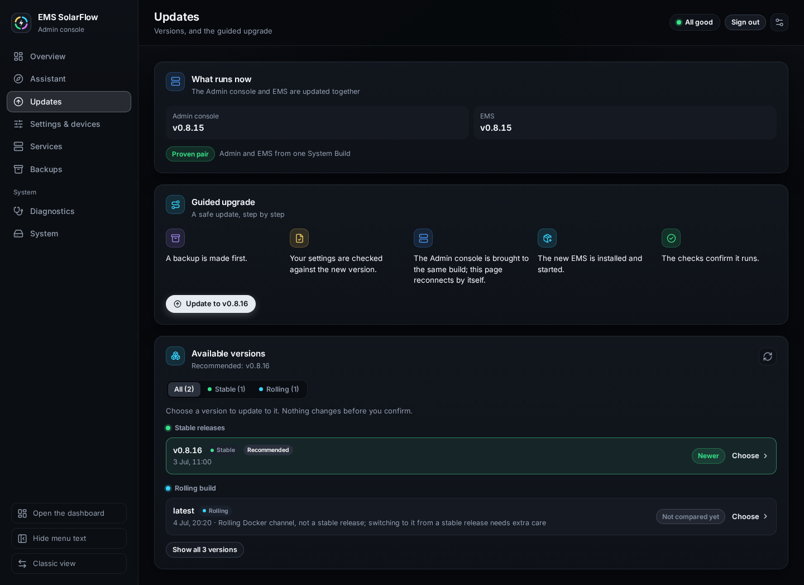

**Updates** shows what runs now at the top, recommends a version and runs the
guided upgrade: choosing a version checks it at once in a card right below,
one confirmation starts it, and the page follows it to **Update complete**. See
[Guided Upgrade](admin/guided-upgrade.md).

### Settings & devices

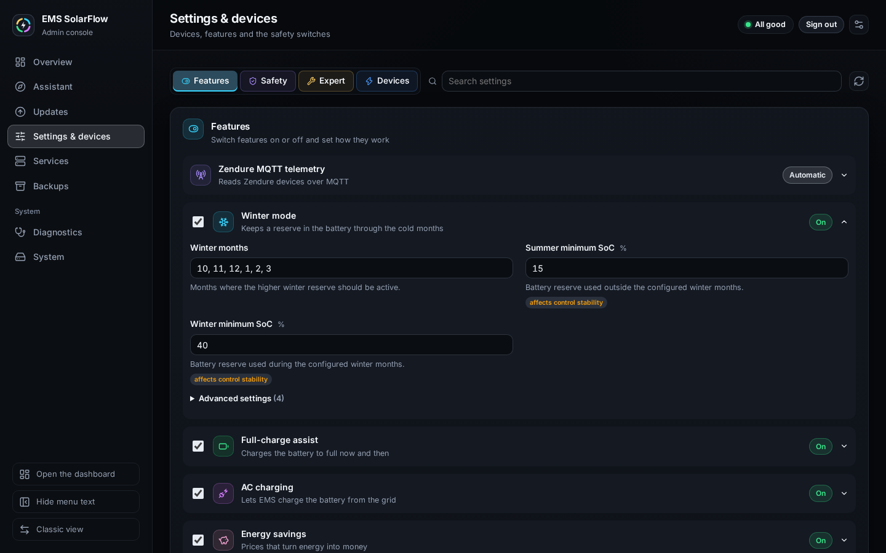

**Settings & devices** has four tabs — **Features**, **Safety**, **Expert** and
**Devices** — and **Search settings** across all of them. There is no
Basic/Expert switch as on the dashboard: everyday settings are on
**Features** and **Safety**, the system basics and control tuning on
**Expert**, and each feature folds its rarer fields away under **Advanced
settings** and **Expert settings**. A bar at the foot of the page counts your
unsaved changes; **Check changes** shows what would change, **Save and apply**
writes it after a backup. The **Devices** tab holds the grid meter, the broker,
every device and **Search my network**. See
[Maintenance](admin/maintenance.md#3--change-settings) and
[Device management](admin/device-management.md).

### Services

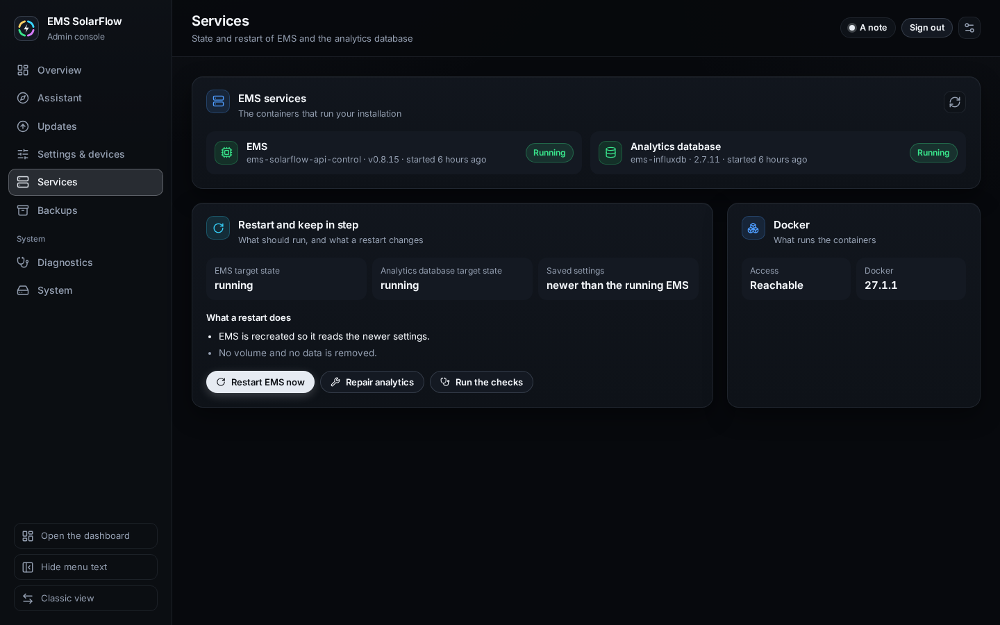

**Services** shows EMS and the analytics database as they run, what a restart
changes, **Restart EMS now** and **Repair analytics**. See
[Maintenance](admin/maintenance.md#2--restart-ems-or-repair-analytics).

### Backups

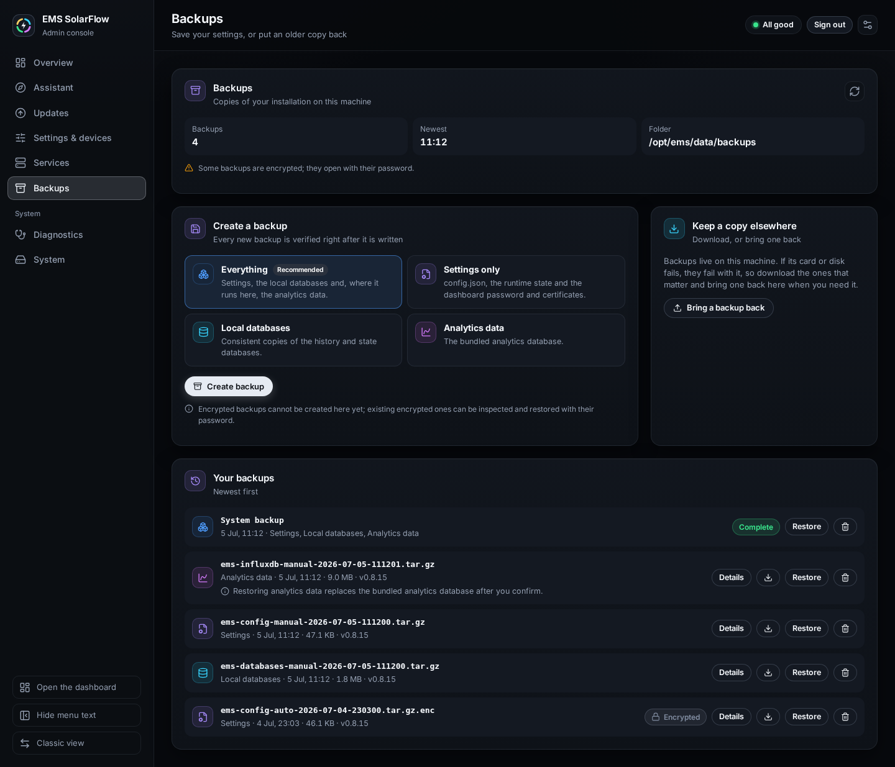

**Backups** creates a backup, shows what is in one, downloads it, brings one
back and restores it after a preview. See
[Backup and restore](admin/backup-restore.md).

### Diagnostics

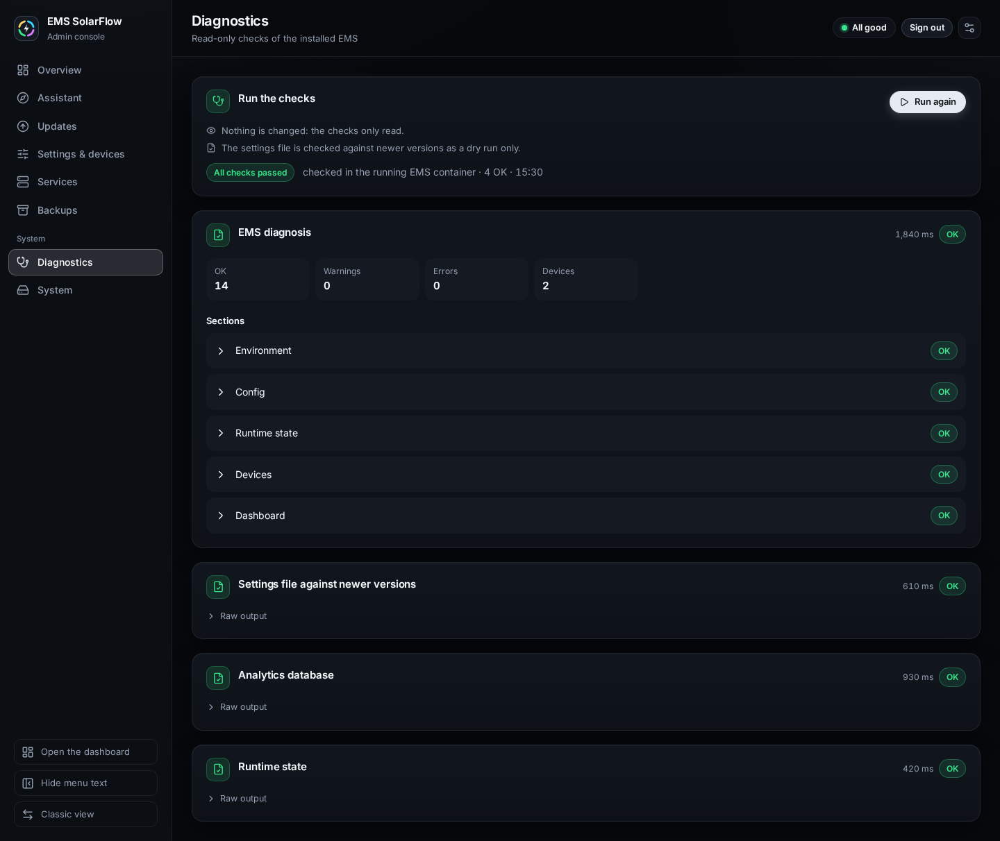

**Diagnostics** runs the read-only checks of the installed EMS, the EMS
diagnosis included. See
[Diagnostics and recovery](admin/diagnostics-recovery.md).

### System

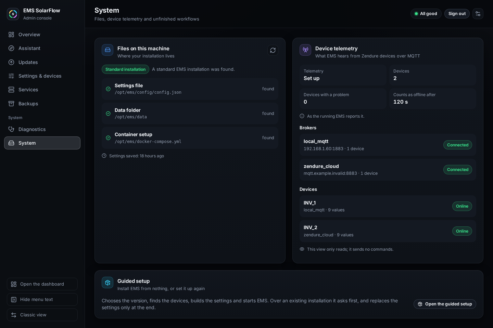

**System** shows the installation's files, the device telemetry over MQTT, an
older MQTT setup that waits for migration, a guided workflow that can no longer
finish, and the way into the guided setup. See
[MQTT](admin/mqtt.md) and
[Diagnostics and recovery](admin/diagnostics-recovery.md#unfinished-setup-or-update).

### Language, colour scheme and density

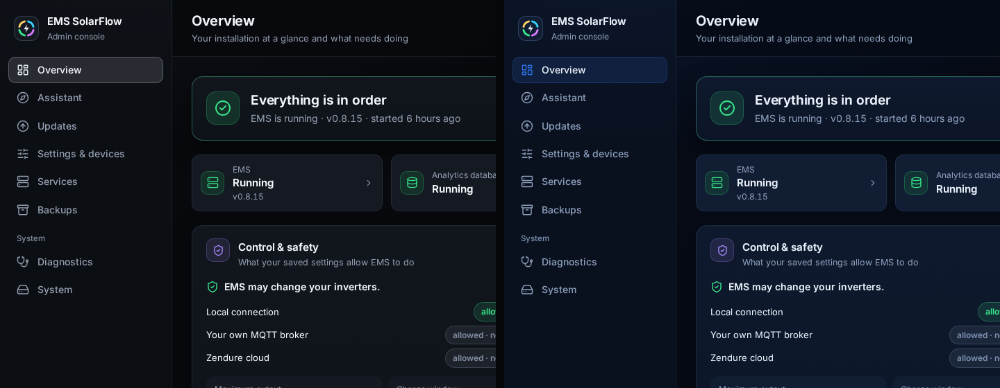

The **Appearance** button at the right end of the top bar holds the colour
scheme (**Graphite** or **Midnight**, above), the language (**EN**, **DE**,
**NL**, **FR**), the density (**Normal** or **Compact**), the side menu and
motion. The language can also be chosen on the sign-in card. The choices are
stored in your browser, so they follow neither your sign-in nor the host:
another browser starts at the defaults again. The EMS Dashboard offers the same
choices and keeps its own. See
[Appearance, language and phone](admin/appearance.md).

### On a phone

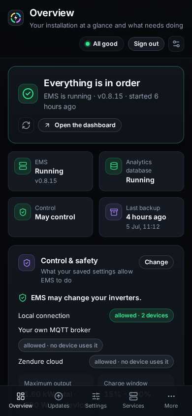

On a narrow screen the side menu gives way to a bar at the bottom with four
pages — Overview, Updates, Settings and Services until you choose others — and
**More** for the rest, the language, the colour scheme, signing out and the
switch to Classic. See
[Appearance, language and phone](admin/appearance.md#on-a-phone).

### Demo videos (Classic view)

Two short demos (no audio, demo data only) show the two main workflows. They
show the Classic view: they were recorded in the deprecated **Classic**
console, before the current design became the default. The workflows are the
same, the screens look different. Each demo ships in two formats — MP4/H.264
(best for forums and mobile browsers) preferred, with WebM as a fallback. If
your Markdown viewer does not play a video inline, use a download link under
it; the screenshot under each video shows the same workflow in the current
design.

#### Fresh install — Guided Setup with hardware discovery (Classic view)

Pick a release → discover devices → review the generated settings and features
→ start EMS and open the dashboard.

<video controls muted playsinline width="880">
  <source src="../assets/videos/admin/admin-guided-setup-demo.mp4" type="video/mp4">
  <source src="../assets/videos/admin/admin-guided-setup-demo.webm" type="video/webm">
  Your browser does not support embedded videos.
</video>

[Download MP4](../assets/videos/admin/admin-guided-setup-demo.mp4) ·
[Download WebM](../assets/videos/admin/admin-guided-setup-demo.webm)

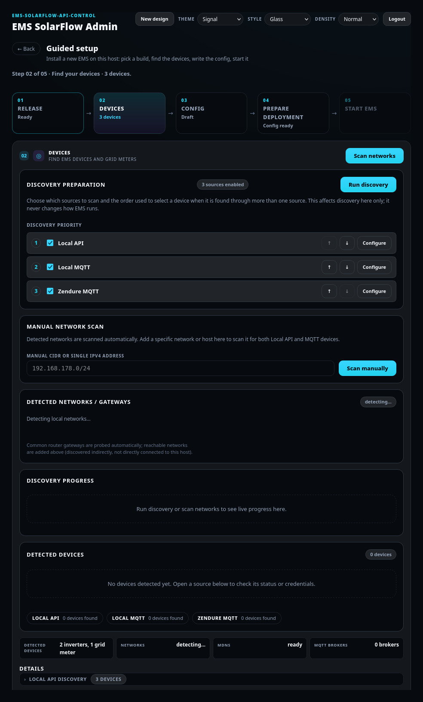

#### Software update — Guided Upgrade with live validation (Classic view)

Choose a version → start the update → each step is ticked off (backup,
settings, Admin Console, EMS install, checks) until the update completes.

<video controls muted playsinline width="880">
  <source src="../assets/videos/admin/admin-guided-upgrade-demo.mp4" type="video/mp4">
  <source src="../assets/videos/admin/admin-guided-upgrade-demo.webm" type="video/webm">
  Your browser does not support embedded videos.
</video>

[Download MP4](../assets/videos/admin/admin-guided-upgrade-demo.mp4) ·
[Download WebM](../assets/videos/admin/admin-guided-upgrade-demo.webm)

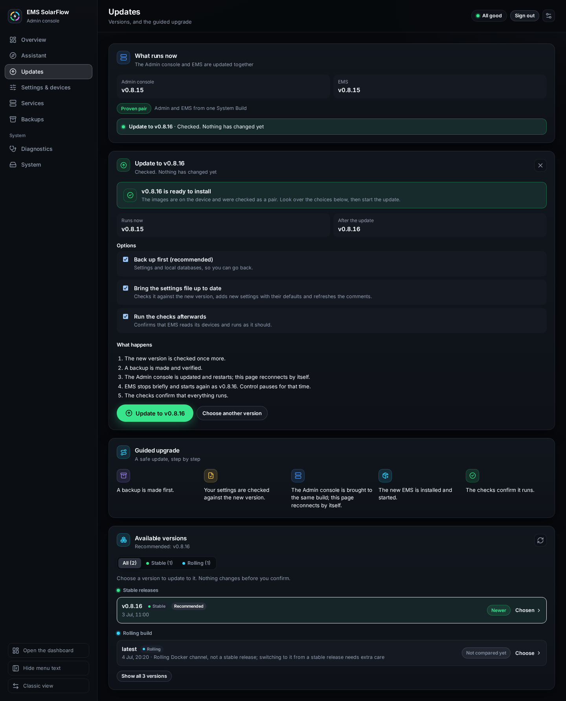

Individual per-screen images live in
[docs/assets/screenshots/admin/](../assets/screenshots/admin/); to refresh them
for a new release, see the
[capture guide](../assets/screenshots/admin/README.md). How the videos are made:
[docs/assets/videos/admin/README.md](../assets/videos/admin/README.md).

## It does not replace EMS

- EMS still runs the control loop and remains the source of truth.
- EMS owns config semantics and backup/restore behavior — every backup is a
  normal EMS backup archive.
- Docker is the runtime. The Admin Console orchestrates EMS containers; it does
  not replace them.

## Files

| Path | Purpose |
| --- | --- |
| `config/config.json` | EMS config |
| `data/` | EMS runtime data (state, history, optional analytics) |
| `data/backups/` | EMS backup archives |
| `data/admin/` | Admin Console state, temporary files and logs |

## Start

### Before you start

The Admin Console runs as a container and orchestrates more of them, so Docker
has to be there first — the installer brings none of its own. You need **Docker
Engine with the Compose v2 plugin, v2.24.0 or newer**, and a daemon your user
can reach; on Windows, Docker Desktop with Linux containers. The installer
checks this before it writes anything and stops with the reason if something is
missing, so an install never gets half-way on a host without Docker.

```bash
docker compose version    # expect v2.24.0 or newer
docker info               # must succeed as the user who will install
```

Full host requirements: [hardware-requirements.md](hardware-requirements.md#software).

### Install

Install and start the Admin Console in a local EMS folder:

```bash
mkdir -p ems-solarflow-api-control
cd ems-solarflow-api-control
curl -fsSLO https://raw.githubusercontent.com/basecubedev/ems-solarflow-api-control/main/deploy/admin/install-admin-console.sh
sh install-admin-console.sh
```

### Check that it worked

Open:

```text
http://127.0.0.1:8090
```

From another machine — the usual case when EMS runs on a headless Pi — use the
host's address instead: `http://<host-ip>:8090`. The sign-in card appearing —
on a first start *Protect your Admin console*, which creates the password — is
the confirmation that the install succeeded; once signed in, the console opens
on its [assistant](admin/assistant.md). If the card does not appear:

```bash
docker compose -f docker-compose.admin.yml ps      # is the container up?
docker compose -f docker-compose.admin.yml logs -f # why it is not
```

An Admin Console installed this way comes back by itself after a reboot or a
Docker restart (`restart: unless-stopped`). If you stopped it yourself, it
stays stopped until you start it again. A `docker-compose.admin.yml` written by
an older installer says `restart: "no"` instead, and the installer keeps an
existing file. Change that one line to `restart: unless-stopped`, then run
`docker compose -f docker-compose.admin.yml up -d`. The Raspberry Pi appliance
makes this change itself (see
[Admin recovery](../appliance/admin-recovery.md#restart-start-stop)).

## Sign-in

The Admin Console uses the same password as the EMS Dashboard.

On the first start, if no password exists yet, the first browser user creates
it: *Protect your Admin console*. The password is stored in
`config/dashboard-auth.json` and is shared with EMS.

After that, sign in with the EMS Dashboard password. See
[First start and sign-in](admin/first-start.md).

### Networking

The default uses **host networking**. EMS SolarFlow is a local LAN system, so
host networking lets discovery see the LAN more like a local host process, which
is the most reliable mode. The UI is then also reachable from another device on
your LAN at `http://<host-ip>:8090`.

Bridge networking is available with `--bridge`:

```bash
sh install-admin-console.sh --bridge
```

In bridge mode the container is isolated from the host network, Docker port
publishing controls how the UI is reached (`127.0.0.1:8090` by default), and
automatic LAN discovery can be less reliable — enter your LAN CIDR manually if a
scan sees only Docker networks.

Contributors who build from source use `deploy/admin/start-admin-setup.sh`.
See the [Developer Setup guide](../developer/developer-setup.md).

## Optional HTTPS

The Admin Console uses HTTP on port `8090` by default.

You can optionally enable a second HTTPS listener on port `8091` with `--https`:

```bash
sh install-admin-console.sh --https
```

HTTP stays available, so you are not locked out if your browser does not trust
the generated certificate. HTTPS is an additional URL
(`https://<host>:8091`), never a redirect.

If the Admin Console generates a self-signed certificate, your browser will show
a certificate warning. This is expected for local installations. Use HTTPS only
if you understand this warning or provide your own trusted certificate.

Do not expose the Admin Console HTTP or HTTPS ports to the internet.

## Safety

The Admin Console is designed for a trusted local EMS host or trusted LAN. The
Zendure local APIs are not encrypted. Do not expose the Admin Console — or the
EMS ports — to the internet. A deployment-capable Admin container controls the
host Docker engine, which is effectively root-equivalent.

Full technical reference: [admin-discovery.md](../technical/admin-discovery.md).
