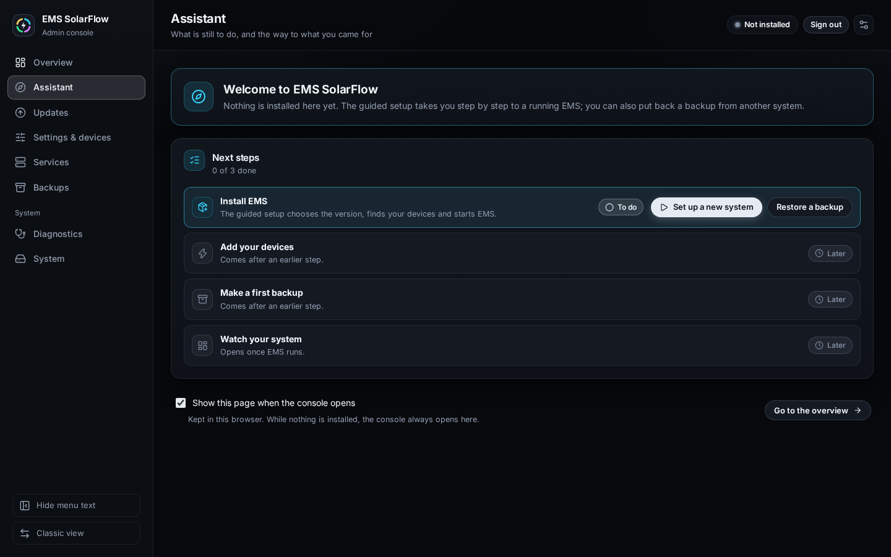
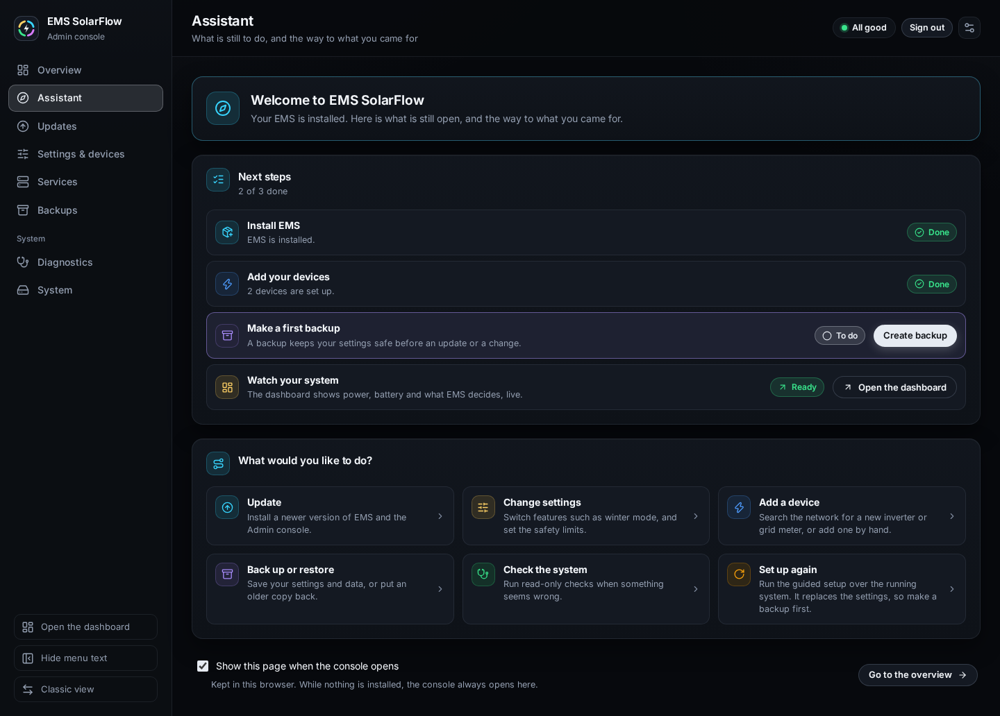

# The assistant

## Purpose

The assistant is the Admin Console's starting page. It answers two questions
for someone who opens the console and is not sure what to do: **what is still
to do on this installation**, and **where do I go for what I came to do**. It
lists the next steps of an installation with a state each, highlights the one
to do next, and links to the page that does it.

It exists for three moments:

- **You do not know where to start.** The console has eight pages; the
  assistant tells you which one matters now and why.
- **A first installation.** On a host with nothing installed it leads, step by
  step, from installing EMS to the first backup and the dashboard.
- **Coming back later.** Months after the setup it shows at a glance whether
  anything is left open — a device still on the template's example values, no
  backup yet — and keeps the common tasks one click away.

The assistant only reads and links. It never installs, saves, restarts or
deletes anything by itself.

## When to use this workflow

- The console opens on it: that is the normal start, see
  [When the assistant opens](#when-the-assistant-opens).
- You want to check that an installation is complete.
- You know what you want to do (update, change a setting, add a device) but not
  which page does it.

## Prerequisites

- The console is signed in — see [First start and sign-in](first-start.md).
- Nothing else. The assistant works on a host with nothing installed, on a
  half-finished installation and on a running one.

## When the assistant opens

| You open | The console shows |
| --- | --- |
| The console's bare address, `http://<host>:8090/` | The assistant, while **Show this page when the console opens** is ticked (it is, until you untick it) |
| The bare address with the box unticked | The **Overview** — except while nothing is installed, see below |
| The bare address on a host with nothing installed | Always the assistant, whatever the box says |
| The bare address while a guided setup is unfinished | The unfinished **Guided setup**, in place of the assistant and the overview |
| An address that names a page, such as `…/#/updates` | That page. A deep link or bookmark is not redirected, except that an unfinished guided setup also takes the place of the Overview's and the assistant's own addresses |

Some details worth knowing:

- **The choice belongs to the browser.** It is kept in this browser only. A
  second browser, a phone or a private window starts with the box ticked again.
- **Nothing installed overrides the choice.** While the host has no EMS
  installation at all, the console always opens on the assistant. A
  half-finished installation does not count as "nothing installed".
- **An unfinished setup wins.** When the server still holds a guided setup that
  has not finished — after a sign-in, a reload or an Admin Console restart —
  the console opens that setup instead, so it can continue. See
  [Guided setup](guided-setup.md).
- **It happens once per load, without a history entry.** The console replaces
  its bare address with the assistant's, so the browser's Back button leaves
  the console rather than bouncing you back to it. Moving between pages
  afterwards never sends you to the assistant again.
- **You can always open it from the menu.** **Assistant** is the second entry
  of the side menu, right below **Overview**. On a phone it is under **More**.

## Step-by-step instructions

### 1 — Read the welcome

**What you see:** *Welcome to EMS SolarFlow*, and one sentence that says what
kind of installation this host has:

| The host has | The welcome says |
| --- | --- |
| Nothing installed | *Nothing is installed here yet. The guided setup takes you step by step to a running EMS; you can also put back a backup from another system.* |
| Parts of an installation | *Parts of an installation were found, but it is not complete.* |
| Settings, but no EMS container | *Your settings are in place, but EMS itself is not installed yet.* |
| Settings in the old place | *Your settings are still in the old place, a config.json beside the installation.* |
| A complete installation | *Your EMS is installed. Here is what is still open, and the way to what you came for.* |

**The attention line.** When the [Overview](maintenance.md#1--read-the-overview)
lists a warning or an error, a line under the welcome says so — *One thing
needs your attention* or *3 things need your attention* — and **Go to the
overview** leads there. Notes alone do not raise it.

**What it changes:** nothing.

### 2 — Work through the next steps

**What you see:** the **Next steps** card with four rows. The first three are
the installation's own steps; the fourth is where they lead. The card's
subtitle counts the first three: *2 of 3 done*, or *Everything is set up.* once
all three are done. While a step cannot be told yet, no count is shown at all,
so a count never claims more than the console knows.

Each row has a state on its right:

| State | Meaning |
| --- | --- |
| **Done** | The fact the step checks is true on this installation |
| **To do** | It is not, and the row carries the button that does it |
| **Later** | It waits for an earlier step: there is nothing to check before EMS is installed |
| **Unknown** | The fact could not be read just now, or is still loading. Never shown as done |
| **Ready** | Only for *Watch your system*: the dashboard can be opened |
| **Off** | Only for *Watch your system*: the dashboard is switched off in the settings |

**The next step** is the first row that is **To do**. It is highlighted with a
coloured frame, and its button is the primary one. Rows further down that are
also **To do** keep their buttons, in the quieter style.

**What you select:** the button of the highlighted step.

**What it changes:** nothing yet. Every button opens the page where the work is
done; nothing happens until you act there.

**Expected result:** after you finish the work and come back, the row reads
**Done** and the next row is highlighted.

### 3 — Know how each step decides

Each step looks at one fact the console already reads for the
[Overview](maintenance.md#1--read-the-overview), and nothing else.

**Install EMS** is **Done** when the installation is complete: the standard
settings file and container setup are found, and — where Docker can be asked —
the EMS container exists. Otherwise it is **To do**, with the button that fits
what is missing:

| What the console found | The row says | The buttons |
| --- | --- | --- |
| Nothing | *The guided setup chooses the version, finds your devices and starts EMS.* | **Set up a new system** opens the [Guided setup](guided-setup.md); **Restore a backup** opens Backups with **Bring a backup back** ready to press |
| Part of an installation | *Finish it with the guided setup, or see in the overview what is missing.* | **Set up a new system** and **See what is missing**; the one the console recommends for this host comes first |
| Settings, no EMS container | *The settings are in place, but the EMS container does not exist. Install EMS from Updates.* | **Open updates**, where the [Guided Upgrade](guided-upgrade.md) installs EMS |
| Settings in the old place | *The System page moves them to config/config.json, where this console reads them.* | **Move the settings** opens the System page |

When Docker cannot be asked, the step goes by the files alone: an installation
whose files are complete counts as installed.

**Add your devices** is **Done** when the settings name at least one device and
none of them still carries the settings template's example values. It is
**To do** when there is no inverter yet — *No inverter is set up yet. Search the
network for your devices, or add one by hand.* — or when a device, the grid
meter or the broker still has a template value; the row then names those
fields. **Open the devices** opens **Settings & devices** on the **Devices**
tab, with **Search my network** at the top. Until the installation's settings
and container setup are in place, the step reads **Later**.

**Make a first backup** is **Done** when at least one backup the console can
read exists, and says when the newest was made: *Last backup: 11:12.* A backup
the server marks as damaged or unreadable does not count. **Create backup**
opens Backups with its **Create backup** button ready to press; nothing is
created until you press it there. Until the installation's settings and
container setup are in place, the step reads **Later**.

**Watch your system** is where the steps lead: the EMS dashboard. It is
**Ready**, with **Open the dashboard**, once EMS runs and its address is known.
It reads **Later** — *Opens once EMS runs.* — while EMS is not running, and
**Off** with **Change settings** when the dashboard is switched off in the
settings. If Docker cannot be asked whether EMS runs, the row says so and
offers the address anyway, because the dashboard may still answer; if the
settings do not give the dashboard's address, the row reads **Unknown** and
says that.

### 4 — Go where you came for

**What you see:** **What would you like to do?**, six tiles that lead straight
to the page for each task:

| Tile | Opens |
| --- | --- |
| **Update** | **Updates** — install a newer version of EMS and the Admin Console |
| **Change settings** | **Settings & devices** — features such as winter mode, and the safety limits |
| **Add a device** | **Settings & devices** on the **Devices** tab |
| **Back up or restore** | **Backups** |
| **Check the system** | **Diagnostics** — read-only checks |
| **Set up again** | **Guided setup** over the running system. It replaces the settings, so make a backup first |

The tiles appear once the settings are in place; on a host with nothing
installed the first step is the way in instead. **Set up again** is left out
while no EMS container exists to set up over.

### 5 — Keep the assistant, or turn it off

**What you see:** at the foot of the page, the box **Show this page when the
console opens** with the hint *Kept in this browser. While nothing is
installed, the console always opens here.*, and **Go to the overview**.

**To turn it off:** untick the box. From the next time you open the console at
its bare address, it opens on the **Overview** instead.

**To turn it back on:** open **Assistant** from the menu and tick the box again.

**What it changes:** only this browser's choice. Nothing is saved on the host,
and other browsers keep their own choice.

## What happens in the background

- The assistant asks the server nothing of its own. It reads the same answers
  the Overview reads — the installation overview, the settings and the backup
  list — and turns them into steps.
- A step is never shown as done on missing information. An answer that is
  still loading or could not be read makes the step **Unknown**, and the count
  is left out until every step is known.
- When the overview cannot be read at all, the page says so at the top. If an
  earlier answer exists, the steps below show that one, with the time it was
  read.
- Its buttons are links. The guided setup, an update, a backup and every other
  change still go through their own page, with their own preview and
  confirmation.

## Expected result

You know what is left to do on this installation and have the button for it,
and the page for anything else you came to do is one click away.

## Warnings and common problems

| Symptom | Meaning | What to do |
| --- | --- | --- |
| The console opens on the Overview, not the assistant | The box was unticked in this browser | Open **Assistant** from the menu and tick **Show this page when the console opens** |
| The console opens on the assistant although the box is unticked | Nothing is installed on this host | Expected; it opens there until EMS is installed |
| The console opens on **Guided setup** | A guided setup is unfinished on the server | Continue it, or start it over on that page |
| A bookmark opens another page, not the assistant | The address names a page | Expected; open the bare address, or **Assistant** from the menu |
| A step stays **Unknown** | Its answer is loading or could not be read | Wait, or refresh the [Overview](maintenance.md#1--read-the-overview); if it stays, run the checks under [Diagnostics](diagnostics-recovery.md) |
| **Add your devices** stays **To do** although devices are set up | A device, the grid meter or the broker still carries a template example value | Replace the fields the row names, then **Save and apply** |
| **Make a first backup** stays **To do** after a backup | The backup could not be read | Look at it under [Backups](backup-restore.md); create a new one |

## Recovery or next steps

- Install EMS → [Guided setup](guided-setup.md)
- The page behind the attention line → [Maintenance](maintenance.md)
- Add your devices → [Device management](device-management.md)
- Make a first backup → [Backup and restore](backup-restore.md)
- What the dashboard shows → [EMS Dashboard guides](../dashboard/index.md)
