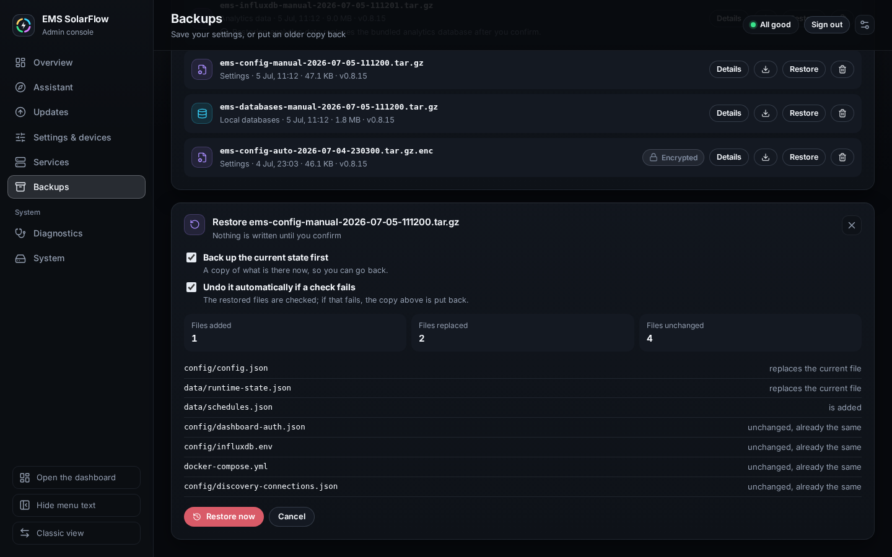

# Backup and restore

## Purpose

Save a copy of your installation, take it off the machine, and put an older
copy back — with a preview before anything is written and a copy of the
current state made first.

## When to use this workflow

- Before an update or a bigger settings change (the
  [Guided Upgrade](guided-upgrade.md) makes one by itself).
- After a first installation — the [assistant](assistant.md) shows it as the
  last of its steps.
- To roll back a change, or move an installation to a new card or disk.

## Prerequisites

- An installed EMS, and the console signed in.
- Disk space under `data/backups/`.

## Step-by-step instructions

### 1 — Read the backups card


**Where:** **Backups**; the **Last backup** tile on the Overview, the **Back up
or restore** tile and **Make a first backup** of the assistant lead here too.

**What you see:** **Backups** — how many, the **Newest**, and the **Folder**
they live in. A note warns when some backups are encrypted, when an archive
cannot be read, or when the folder is outside the EMS installation. The
refresh button reads it again.

### 2 — Create a backup

**What you see:** **Create a backup** — *Every new backup is verified right
after it is written* — with four kinds:

| Kind | Contents |
| --- | --- |
| **Everything** (Recommended) | Settings, the local databases and, where it runs here, the analytics data — kept together as one backup set |
| **Settings only** | `config.json`, the runtime state, the dashboard password and certificates, and the MQTT broker, mapping and saved MQTT passwords |
| **Local databases** | Consistent copies of the history and state databases |
| **Analytics data** | The bundled analytics database |

A kind you cannot use is greyed out with the reason — for example *Analytics
are switched off in the settings.*, or that an external InfluxDB is backed up
where it runs.

**What you select:** a kind, then **Create backup**.

**What it changes:** new archives are written under the backup folder.
**Nothing in your running system is modified** — creating a backup is not a
write to settings, containers or hardware.

**Expected result:** each step is shown as it runs, then *The backup was
created and verified.* The new backup appears at the top of **Your backups**.
*The backup was created, but without the analytics data.* means the analytics
part failed; the warning below it says why.

> **Backups may contain secrets and private energy data.** Backups created
> here are not encrypted (*Encrypted backups cannot be created here yet;
> existing encrypted ones can be inspected and restored with their password.*).
> Copy them somewhere safe off this host, and treat them like credentials.

### 3 — Keep a copy elsewhere

A backup that only exists on this machine does not survive the machine. If the
disk or SD card fails — the situation a backup is for — it fails with it.

**Download** (the arrow on any backup) hands you that archive byte for byte.
Keep the ones that matter somewhere else.

**Bring a backup back**, in **Keep a copy elsewhere**, uploads such a file into
the backup folder, where the normal flow finds it: look at it, preview a
restore, restore it. *ems-config-manual-… is here now. Use Restore to put it
back.* Bringing one back only adds the file; it never restores anything on its
own.

The file is refused unless it is what its name says it is. It must carry the
name a backup was created under (`ems-<type>-<purpose>-<timestamp>.tar.gz`,
optionally `.enc`), and an unencrypted archive must contain a manifest of that
type — the restore path reads the type from the name, so a renamed archive
would be restored the wrong way. It never overwrites a stored backup: a name
that already exists is kept beside it. Encrypted archives come back as they
are; unlocking one still needs its password.

### 4 — Look inside a backup

**What you see:** **Your backups**, newest first. A backup set (**System
backup**) shows its members and **Complete**, **Without analytics** or
**Incomplete**; each archive shows its kind, time, size and EMS version, and
**Encrypted** where it is.

**What you select:** **Details**.

**What it changes:** nothing. **Details** shows the kind, when and why it was
made (*By hand*, *Automatic*, *Before a restore*), the version it came from,
the files and how many are sensitive — *This backup holds passwords or keys.
Keep its copies somewhere safe.* An encrypted backup asks for its password
first.

### 5 — Preview the restore



**What you select:** **Restore** on a backup or a set.

**What it changes:** **nothing.** The panel *Restore …* — *Nothing is written
until you confirm* — prepares a preview at once: **Files added**, **Files
replaced** and **Files unchanged**, and each file with what would happen to it
(*is added*, *replaces the current file*, *unchanged, already the same*, …).

**The two options**, both on by default:

- **Back up the current state first** — *A copy of what is there now, so you
  can go back.*
- **Undo it automatically if a check fails** — *The restored files are
  checked; if that fails, the copy above is put back.*

Changing an option prepares a new preview; what you confirm is always what is
on screen.

**If it differs:** an encrypted backup asks for its password first — **Unlock
and preview**. Without it, the archive cannot be read; there is no recovery
path for a lost backup password. *This restore is blocked.* names what blocks
it.

### 6 — Restore

**What you select:** **Restore now**, and confirm in *Restore this backup?*.

**What it changes:** the previewed files are written back — after a copy of
the current state, unless you switched that off.

**Expected result:** each step is shown as it runs, then *Restored. Restart EMS
so it uses the restored files.* with **Restart on the Services page**. A
settings restore ends with *Apply the built-in MQTT broker's restored
settings*: where the broker is switched on it runs again with the restored
passwords, so its devices need no new one.

**If it differs:**

- *The restore did not start.* — the preview had expired or was already used,
  or another job holds the backups. Nothing changed; a fresh preview is below.
  Check it and confirm again.
- *Your session ended while the restore ran, most likely because it restored
  the password file.* — sign in again, with the password from the backup if it
  differs.
- *Contact with the Admin console broke off.* — the job may still be running
  there. **Check again** once the console answers.

## No hidden EMS downgrade

**A restore never silently changes your EMS image.** EMS version downgrade,
image switching and container restart are intentionally **not** performed by a
restore. It puts back data and settings files, after compatibility checks; a
backup's recorded version is informational only. After a restore, restart EMS
on the **Services** page so it uses the restored files.

If you need to go back to an older EMS version as well, that is a separate,
deliberate operation — use the CLI for controlled offline operations. The
Guided Upgrade moves forward, or back by a patch inside the release line you
run; see [Guided Upgrade](guided-upgrade.md#recovery-or-next-steps).

## Deleting a backup

The bin icon on a backup asks *Delete this backup?* — it is deleted from this
machine and cannot be undone. A backup set asks whether to **Delete the set and
its archive files** or **Delete only the set and keep its archive files**.
Only files inside the backup folder can be deleted.

## Encryption — what is available today

The Admin Console reads encrypted backups and does not create them yet. Create
an encrypted backup on the EMS host:

```bash
docker compose exec ems python3 emsctl.py backup create --password
```

It appears **Encrypted** in the list; **Details** and **Restore** ask for its
password, which is used for that request only and never logged or kept.

## Rollback and recovery

| Situation | What to use |
| --- | --- |
| A settings change went wrong | Restore the settings backup **Save and apply** made before the change |
| An update misbehaves | Restore the backup the update made (leave **Back up first** on so it exists) |
| An update stopped mid-way | The stopped update's **Try again** or **Go back to the version that runs** first — see [Guided Upgrade](guided-upgrade.md#recovery-or-next-steps) |
| A workflow was abandoned | **Unfinished setup or update** on the System page; it never deletes a file it cannot prove it owns |

- A **copy of the current state** is made before any file is written. If it
  cannot be made, the restore does not start.
- **Undo it automatically if a check fails** returns the system to its state
  before the restore when a check afterwards fails. Files the restore added are
  removed again; one that changed since, or a database in use, is left in place
  and named. If the undo itself fails, the result says so and names the copy to
  restore by hand.
- For the bundled **analytics data**, the EMS CLI makes and owns that copy;
  *The bundled analytics database may be replaced by the data in the backup.*

## What happens in the background

- Every archive is a normal EMS backup archive, the same format
  `emsctl.py backup` produces. The Admin Console orchestrates; EMS owns the
  format. A backup set is Admin metadata that groups such archives.
- A backup and a restore run on the server. Leaving the page does not stop
  them; the page follows them again when you come back.
- A restore is bound to the preview you confirmed. If that preview expired or
  the state changed, it is refused rather than applied to a state you did not
  review.

## Expected result

A verified backup you can download, and a restore that shows exactly what it
will do before it does it, with a way back.

## Warnings and common problems

| Symptom | Meaning | What to do |
| --- | --- | --- |
| **Analytics data** greyed out | Analytics is off, or an external InfluxDB is used | Back an external one up where it runs |
| *Some backups are encrypted; they open with their password.* | An encrypted backup is in the list | Enter its password under **Details** or **Restore** |
| *This archive cannot be read and cannot be restored.* | The archive is damaged | Use another backup |
| The sign-in comes back after a restore | The restore put back the password file | Sign in with the password from the backup |
| *Contact with the Admin console broke off* | The page lost the console while the job ran | **Check again** once the console answers |
| *The restore did not start* | The preview expired or was used | Check the fresh preview and confirm again |

## Recovery or next steps

- Restart EMS after a restore → [Maintenance](maintenance.md#2--restart-ems-or-repair-analytics)
- A failed workflow → [Diagnostics and recovery](diagnostics-recovery.md)
- A backup from the dashboard →
  [Dashboard diagnostics](../dashboard/diagnostics.md#maintenance)
- Full behavioural reference → [Admin Console: Backup / restore](../admin-backup-restore.md)
- The CLI equivalents → [Backup and restore (technical)](../../technical/backup-restore.md)
