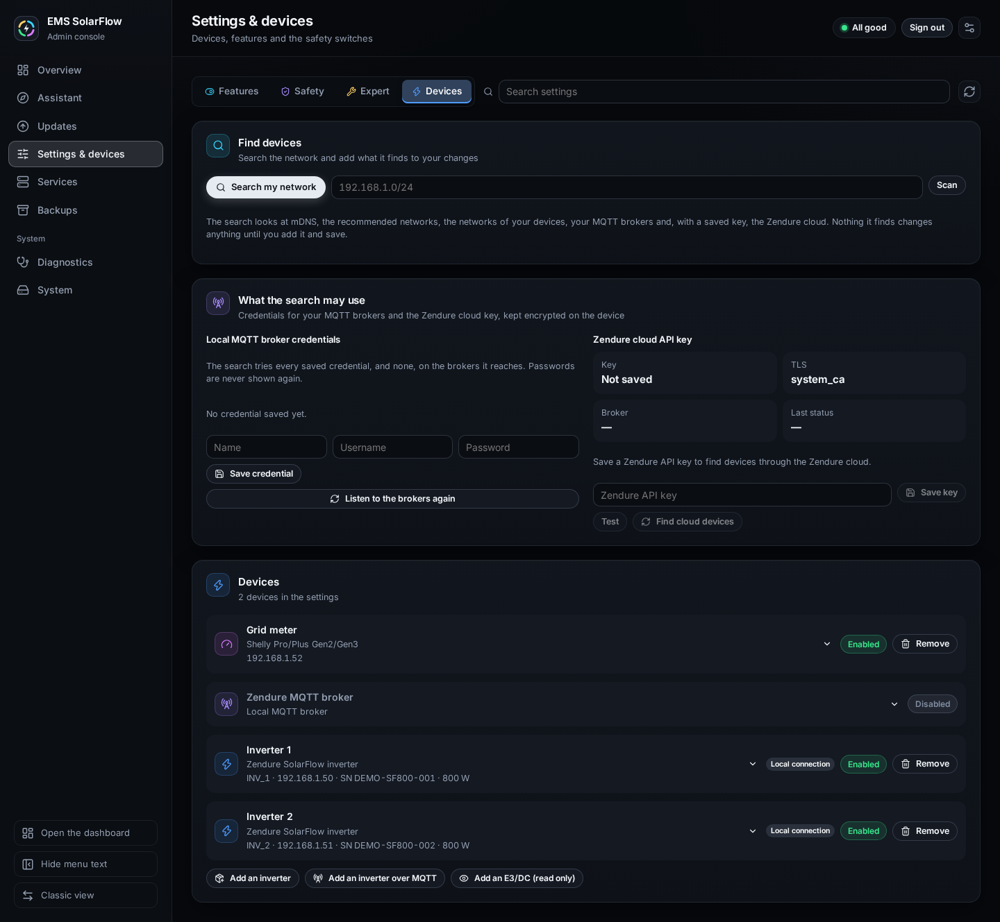
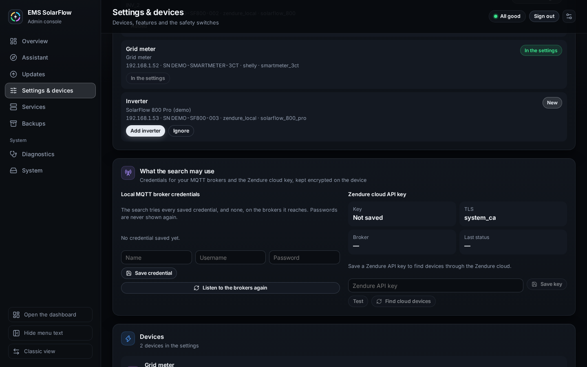
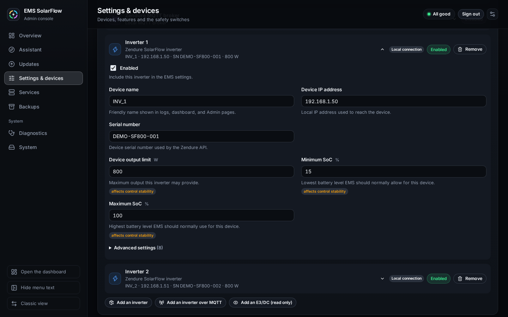

# Device management

## Purpose

Add, edit, disable, re-enable or remove inverters and grid meters, and switch
an inverter between its available connections — without hand-editing
`config.json`.

## When to use this workflow

- A new inverter arrived.
- You replaced or moved your grid meter.
- You want to take one inverter out of control temporarily.
- You want an inverter to run over a different connection (Local API ↔ Local
  MQTT ↔ Zendure MQTT).

## Prerequisites

- An installed EMS, and the console signed in — see
  [Maintenance](maintenance.md).
- For a new device: it is powered on and reachable (on the LAN, or publishing
  to a broker the search may use).

## Step-by-step instructions

### 1 — Open the devices

**Where:** **Settings & devices** → the **Devices** tab. The assistant's **Add
a device** tile and **Open the devices** lead straight here.

**What you see:** three cards.

- **Find devices** — **Search my network**, a field to **Scan** one address or
  range, and what the search looks at.
- **What the search may use** — the credentials for your own MQTT brokers and
  the Zendure cloud API key; see [MQTT](mqtt.md).
- **Devices** — one card per device: the **Grid meter**, the **Zendure MQTT
  broker**, and each inverter (*Inverter 1*, *Inverter 2*, …) with its model,
  EMS name, address, serial and power, its connection (**Local connection**,
  *Zendure via your own MQTT broker*, *Zendure via the Zendure cloud*) and
  **Enabled** or **Disabled**. Under them **Add an inverter**, **Add an
  inverter over MQTT** and **Add an E3/DC (read only)**.

**What it changes:** nothing. This is the saved configuration.

### 2 — Find a new device

**What you select:** **Search my network**.

**What it changes:** nothing. The search looks at mDNS, the recommended
networks, the networks of your devices, your MQTT brokers and, with a saved
key, the Zendure cloud. Nothing it finds changes anything until you add it and
save.

**Expected result:** *The search finished. Its results stay until you clear
them.*, a summary (*In the settings: 1 · new: 1 · not found: 0 · moved: 0*)
and one card per find, each with its state:

| State | Meaning | Its button |
| --- | --- | --- |
| **In the settings** | Saved as it is | — |
| **New** | Not in the settings yet | **Add inverter**, **Use as grid meter** or **Add as read-only device**; **Ignore** leaves it out of this search |
| **Not found** | In the settings, not found by this search | — |
| **Address changed** | The same device, found at another address | **Take the new address** |
| **Another connection** | A device you have, reachable another way | **Use this connection** — see step 5 |
| **Added to your changes** | Added in this session, not saved yet | — |
| **Identity conflict** | The find contradicts a device you have | — (refused on purpose) |

**What you select next:** the find's button, for example **Add inverter**.

**What it changes:** your unsaved changes only. The device appears under
**Devices**, opened, so you can check it.

**If it differs:** *The Zendure cloud was skipped: save an API key for it to
include cloud devices.* — see [MQTT](mqtt.md). **Clear results** forgets the
finds; your changes stay.

### 3 — Edit a device

**What you select:** a device's card, to open it.

**What you can change:** the **Enabled** switch, the **Device name**, the
address, the **Serial number**, the **Device output limit**, the **Minimum
SoC** and **Maximum SoC**; under **Advanced settings** the PV size, PV
priority, battery size, AC charging and the winter policy.

**What it changes:** your unsaved changes only. `config/config.json` is
untouched until you save.

**If it differs:** emptying a field **removes** that setting so EMS uses its
own default — that is intended. Leaving a password box blank **keeps** the
stored secret; **Clear the stored password** removes one.

### 4 — Disable, re-enable or remove

| Action | Effect | Reversible |
| --- | --- | --- |
| Untick **Enabled** | EMS stops regulating this device. It stays in the settings | Yes — tick it again |
| Tick **Enabled** | EMS regulates it again | Yes |
| **Remove** | The device leaves the settings | Only by adding it again |

> **Enabled belongs to the device, not to its connection.** Switching an
> inverter between Local API and MQTT **keeps** whether it is enabled: active
> stays active, and a device you switched off stays off. A connection change
> never silently turns a device on or off.

A device added through the guided setup or here is **enabled** from the start.

**An E3/DC shown read only.** **Add an E3/DC (read only)** creates a card for
an E3/DC storage system: name, host or IP, Modbus port (502) and unit ID (1),
and **Enabled** — no serial and no control values, because EMS only reads it
and shows its PV, battery, inverter and grid on the dashboard. The guided setup
adds it on its own when the E3/DC is the grid meter. It counts as a read-only
device, not as an inverter, and at least one Zendure inverter is still needed.
The search finds an E3/DC with the default unit ID 1 and offers it twice: as a
grid meter (**Use as grid meter**) and as a read-only device (**Add as
read-only device**); one set to another unit ID is added by hand.

### 5 — Change the grid meter, or an inverter's connection

**The grid meter:** open its card and choose the **Meter type** (Shelly,
everHome EcoTracker, Tasmota, Zendure D0 / Smart Meter 3CT over HTTP, an E3/DC
over Modbus TCP, or an MQTT meter), then its address or topic. Changing the
type removes the fields the new type cannot use — an HTTP meter's address does
not linger on an MQTT meter — while keys you added by hand stay. A port belongs
to its protocol: switching between two HTTP meters keeps it, switching to an
E3/DC sets the Modbus port 502, switching to an MQTT meter removes it. Only one
grid meter can be active; an MQTT grid meter the search found replaces a
configured one only after *Replace the grid meter?*.

**An inverter's connection:** the search is a list of *connections*, not just
of devices. A second connection for an inverter you already have shows
*Already set up as INV_1 via …* and offers **Use this connection**.

**What it changes:** that one logical inverter moves to the other connection in
your unsaved changes. Clicking it *is* the decision — there is no duplicate
device, and the EMS name, the enabled state and the common values are kept. The
connection you left stays listed, so you can switch back without removing the
inverter.

**If it differs:** a connection that would lose output control is offered as
**Replace the control connection**, with a warning naming why; the check before
saving shows the change too. A switch the backend refuses — two different
serials on one route, or an identity it cannot resolve — is an **Identity
conflict**, refused on purpose.

### 6 — Check and save

**What you select:** **Check changes** in the bar at the foot of the page, then
**Save and apply**. See [Maintenance](maintenance.md#5--check-and-save).

**What it changes:** `config/config.json` is written, after a backup of the
current settings.

**Expected result:** **Settings saved**. Adding, removing or moving a device
generally needs EMS to read the new settings: the result says *Some changes
take effect once EMS restarts.* and offers **Restart EMS now**.

**If it differs:**

- **Save and apply is not offered after an edit** → intended. Check the changes
  again; what you saw checked is exactly what gets saved.
- *The devices, grid meter or broker changed elsewhere since you began changing
  them.* → another session saved device changes. **Discard device changes**
  and make yours again.

Live-changeable runtime values are a different thing — see
[Dashboard runtime settings](../dashboard/runtime-settings.md).

## One inverter, several connections

A single physical inverter can be reachable over Local API, a local MQTT broker
and Zendure cloud MQTT at the same time. That is **three connections to one
device**, not three devices.

- The console keeps **one** logical inverter and shows the connection it uses.
- In the guided setup, the **Search order** picks the preferred connection, but
  moves a device on its own **only when the new connection keeps output
  control**. Otherwise you are asked, with both connections named.
- A serial-less Cloud MQTT inverter you selected before its serial was known is
  recognised as the **same** inverter once discovery reports that Cloud route
  carrying a physical serial. It keeps its name, stays one card, and is never
  offered as a second device to add.

## Why a device is read-only

Output control is **not a checkbox**. It follows the exact model and the write
route, and it fails closed. An MQTT inverter's card shows the **Write
protocol**, **Validation**, **Supported operations**, **Control readiness now**
and **Output control** — *Available*, or *Not available:* with the reason:

- **Unknown model, read only**, no model, or conflicting model evidence → the
  device stays read-only (*choose the exact model*).
- An **external device** (read over MQTT from the `ems-solarflow/<id>/…` topics)
  is read-only by design — see [External devices over MQTT](../external-devices.md).
- A hardware *generation* or topic family alone never authorises writes — but
  it never blocks one either.
- The write route is `iot/<productKey>/<deviceId>/…`. If the **Product key** or
  the **MQTT device ID** is missing, readiness names what is missing; the device
  reads values until the route is complete.
- The **broker source** matters too: a generation whose write route the broker
  does not carry reads *output control is not verified for this MQTT broker*,
  while the Zendure cloud carries it for a supported model.

See [Supported setups](../supported-setups.md) for what is validated on real
hardware.

## Two identity fields, and why

An MQTT inverter has two separate fields:

| Field | What it identifies |
| --- | --- |
| **Serial number** | The inverter itself — telemetry matching and duplicate detection |
| **MQTT device ID** | The exact device ID in the MQTT topics a control write targets |

**The serial number is never used as the MQTT route.** A device that only
reports values needs only the serial.

## What happens in the background

The backend — not the browser — decides:

- **Identity** — from the trusted serial and the scoped route, never from a raw
  Cloud route id or a display name.
- **Candidate state** — which connections genuinely exist right now.
- **Exact check authority** — that what is saved is what you saw checked.

The browser renders and collects input. It never authorises a device change.

## Warnings and common problems

| Symptom | Meaning | What to do |
| --- | --- | --- |
| **Identity conflict** | Two different serials on one route | Refused on purpose. Check which device really owns that route |
| **Not found** for a device you have | The search did not reach it this time | Check the device and the network, search again |
| **Address changed** for a device you have | The search found it at another address | **Take the new address** if the device really moved |
| Save refused, changes kept | The saved settings changed meanwhile | **Discard device changes**, make yours again, check and save |
| A device reads values only | Model or route not proven | See [Why a device is read-only](#why-a-device-is-read-only) |
| A device seems to have vanished after a switch | It did not — one device, new connection | Look at the connection on its card |

## Recovery or next steps

- MQTT specifics → [MQTT](mqtt.md)
- What the dashboard shows per device →
  [Dashboard devices](../dashboard/devices.md)
- Before enabling live writes → [Safety](../safety.md)
- Report hardware that works (or does not) →
  [Supported setups](../supported-setups.md)
