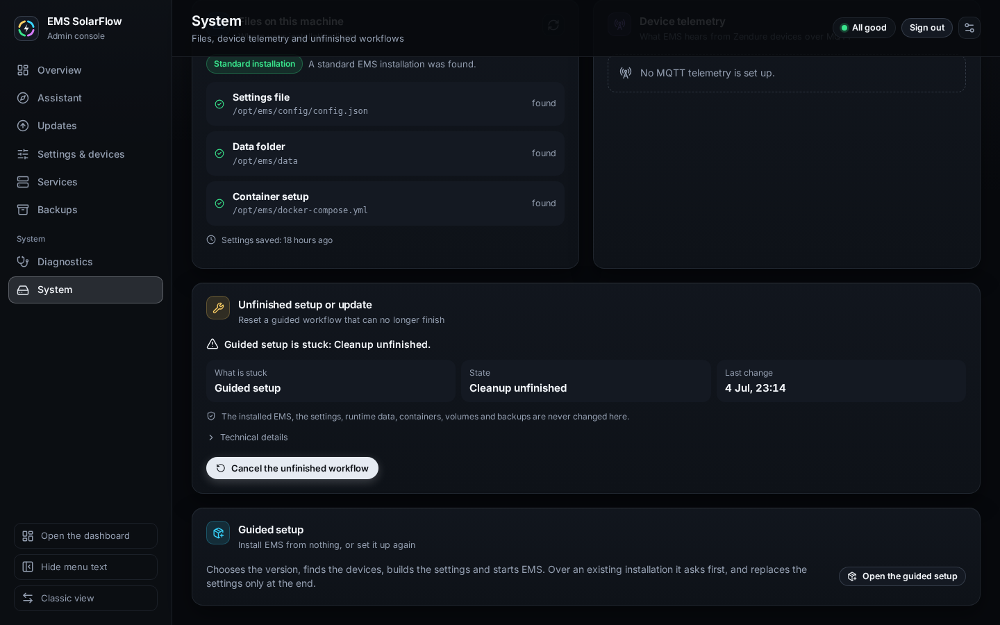

# Diagnostics, support bundles and recovery

## Purpose

Collect evidence when something is wrong, and get an interrupted or failed
workflow back to a clean state.

## When to use this workflow

- EMS is not controlling as expected.
- A device is offline, stale or read-only and you do not know why.
- A workflow failed or was interrupted.
- You want to open a bug report or a device compatibility report.

## Prerequisites

- For the Admin checks: the console signed in.
- For the CLI: shell access to the EMS host.

## Admin diagnostics (read-only)


**Where:** **Diagnostics**; **Run the checks** on Services and the **Check the
system** tile of the assistant lead here too.

**What you see:** *Run the checks*, with the two promises *Nothing is changed:
the checks only read.* and *The settings file is checked against newer versions
as a dry run only.*

**What you select:** **Run the checks** (**Run again** afterwards).

**What it changes:** nothing. The checks run read-only `emsctl.py` commands
against the installed EMS, and the settings file is checked in **dry-run mode
only** — no file is written.

**Expected result:** an overall verdict — **All checks passed**, **Warnings**,
**Problems found** or **Not available** — where it was checked (*checked in the
running EMS container*, or *checked with emsctl.py on this machine*), the
counts and the time. Then one card per check, each with its state (**OK**,
**Switched off**, **Warning**, **Failed**, **Timed out**, **Not available**)
and its time:

| Check | What it reads |
| --- | --- |
| **EMS diagnosis** | `emsctl.py diagnose --json`: its metrics, root causes, warnings, errors and sections, the same report the dashboard's Diagnose page shows |
| **Settings file against newer versions** | `emsctl.py config upgrade --dry-run` |
| **Analytics database** | `emsctl.py influx status --json`; it warns when the analytics schema is incomplete and names the missing buckets and tasks, a downsampling task that is switched off, a retention that differs from the settings, and when no telemetry has reached InfluxDB in the last 15 minutes |
| **Runtime state** | `emsctl.py status` |

**Raw output** under a check shows what the command printed.

**If it differs:** *No running EMS container and no emsctl.py were found, so
there is nothing to check yet.* means nothing is installed or EMS is not
running. For deeper evidence, or to attach something to an issue, use the CLI
below.

## CLI diagnostics

All `diagnose` commands are **read-only**. None of them writes config, runtime
state or hardware.

| Command | What it checks |
| --- | --- |
| `python3 emsctl.py diagnose` | Install-level health: config, paths, clients, basic reachability |
| `python3 emsctl.py diagnose --deep` | The above plus deeper runtime inspection |
| `python3 emsctl.py diagnose --hardware` | Device reachability and reported capabilities |
| `python3 emsctl.py diagnose --control` | The control decision: measurements, target, allocation, write eligibility |
| `python3 emsctl.py diagnose --control-quality --sample-seconds 60` | Samples control quality over a window |
| `python3 emsctl.py diagnose --support-bundle` | Writes a bundle of the above for sharing |

Add `--json` for machine-readable output; it is a versioned public contract.

### Docker equivalents

If you installed with the Admin Console or Docker Bootstrap, run them inside
the EMS container:

```bash
docker compose exec ems python3 emsctl.py diagnose
docker compose exec ems python3 emsctl.py diagnose --deep
docker compose exec ems python3 emsctl.py diagnose --hardware
docker compose exec ems python3 emsctl.py diagnose --control
docker compose exec ems python3 emsctl.py diagnose --control-quality --sample-seconds 60
docker compose exec ems python3 emsctl.py diagnose --support-bundle
```

### Example output (sanitized)

```text
$ docker compose exec ems python3 emsctl.py diagnose
EMS SolarFlow diagnosis
  status: warning

  Configuration ............ ok    config/config.json, schema 3
  Grid meter ............... ok    shelly @ 192.168.1.50
  Devices .................. warn  INV_1 ok, INV_2 stale (age 214s)
  Write gates .............. ok    hardware=on mqtt_local=on mqtt_zendure=on
  Control loop ............. ok    interval 5s, last cycle 1.2s ago

  Root causes
    [warning] device_telemetry_stale
      INV_2 has not reported telemetry within the stale threshold.
      Next check: confirm the device still publishes to demo-broker.
```

Values above are illustrative. Your own output names your real devices —
sanitize it before sharing.

## Support bundles

```bash
docker compose exec ems python3 emsctl.py diagnose --support-bundle
```

The bundle has a fixed file list: `diagnosis.json`,
`control-diagnostics.json`, `control-quality.json`, `redacted-config.json`,
`runtime-state.json`, `bundle-metadata.json`, plus `.txt` variants.

**The config in the bundle is redacted**, but a bundle still describes your
installation. **Before attaching one to a public issue, check for and remove:**

- serial numbers
- API keys and tokens
- MQTT usernames and passwords
- backup passwords
- public IP addresses and personal hostnames
- exact private filesystem paths

If you are not sure a value is safe, replace it. Nobody needs your real serial
to diagnose a control problem.

## Reporting hardware compatibility

Use the
[Device compatibility report](https://github.com/basecubedev/ems-solarflow-api-control/issues/new?template=device_compatibility_report.yml)
template when a device does not behave as documented — **and when it works**.

**Positive reports are welcome and useful.** The maintainer does not own
hardware from every Zendure generation, so a working report is what lets a
device be marked validated for everyone else. Include the model, firmware
version, connection type and sanitized logs.

See [Supported setups](../supported-setups.md) for the current support tiers.

## Unfinished setup or update



A guided workflow that did not finish cleanly is recovered where it belongs:

| Where | What it offers | For |
| --- | --- | --- |
| **Guided setup**, step 01's **Progress** card | **Resume the transition**, **Discard the setup** | A setup whose System Build work failed, expired or lost its Admin Console replacement |
| **Updates**, the stopped update | **Try again**, **Go back to the version that runs**, **Cancel the update** | An update that did not finish — see [Guided Upgrade](guided-upgrade.md#recovery-or-next-steps) |
| **System**, **Unfinished setup or update** | **Cancel the unfinished workflow**, **Force-clear leftover records** | A workflow that can no longer finish, be switched away from or start again |

Each page offers only the actions the server says are possible at that moment.

**Where:** **System** → **Unfinished setup or update**. The card is there only
while a guided workflow needs it; every other page then shows a banner with
**Open recovery**.

**What you see:** what is wrong in one line — *Guided setup is stuck: Cleanup
unfinished.*, *A step is running right now; recovery waits for it.*, *Two
workflow records claim the console at once.* — then **What is stuck**,
**State** and **Last change**, the promise *The installed EMS, the settings,
runtime data, containers, volumes and backups are never changed here.*, and
**Technical details** with the reference, the state fingerprint, the affected
Admin records and what is always kept.

**What you select:**

- **Cancel the unfinished workflow** — the normal way. *It is ended through the
  workflow it belongs to, and its temporary files are cleared. The installed
  system is not changed.* It asks once.
- **Force-clear leftover records** — for old Admin versions, corrupt workflow
  records and records a crash left behind. It asks twice, backs the affected
  Admin workflow records up with their hashes under the Admin state directory,
  and only then removes them, so the guided setup and the update are available
  again.

While a step of a guided workflow is still running, neither is offered; the
card says so and waits for it.

**Expected result:** *The unfinished workflow was cancelled.* or *The leftover
records were backed up and removed.*

### What recovery never touches

Your live `config/config.json`, `data/runtime-state.json`,
`docker-compose.yml`, runtime databases, backups, containers and volumes, and
any file it cannot prove it owns.

### Two situations worth understanding

- **A setup still owns temporary files.** The guided setup says *An earlier
  setup still owns temporary files. Release it under System before starting
  again.*, and no new setup and no update can start until that is done. Your
  live settings and running EMS were not changed by it. **Cancel the unfinished
  workflow** on the System page clears it; the state survives a reload and an
  Admin restart, and the cancel always applies to the same setup — so you never
  have to work out which files belong to what, and you never delete JSON files
  by hand.
- **Ownership needs a review.** When the console finds a file it **cannot
  prove** belongs to the workflow — for example a generated config left by an
  older Admin version — it **keeps** it and says so instead of deleting it.
  Nothing on your running system was changed; a maintainer has to look at the
  leftover file.

That distinction is deliberate. Deleting a file whose owner cannot be proven
would be worse than asking you to look.

### When a step ran out of time

A System Build change has a time limit. Passing it does not by itself mean work
has stopped, so the discard is not offered unconditionally:

- **Time passed, nothing running** → **Discard the setup** is available. This
  is the normal recovery, including after an Admin restart.
- **Time passed, an operation is still running** → the setup says *The System
  Build transition has expired, but its work is still running. Wait for it to
  finish before discarding the setup.* It becomes available right afterwards.
  This matters most during resource verification, which writes shared files —
  discarding mid-write would leave a half-written copy behind.
- **The console cannot tell whether anything is running** → *The state of the
  System Build's worker could not be verified, so the setup cannot be discarded
  for now.* It never guesses "probably finished".

## What happens in the background

- The EMS diagnosis comes from the EMS-owned diagnostics service, the same one
  the CLI and the dashboard use — one implementation, one answer.
- Workflow lifecycle is a durable server-side record. The browser never decides
  whether a workflow may be resumed, discarded or cleaned up.
- Cleanup requires exact ownership proof and canonical-path validation. Being
  inside a cleanup scope is not permission to delete.

## Warnings and common problems

| Symptom | Meaning | What to do |
| --- | --- | --- |
| A discard is refused, naming an operation | That operation is still running | Wait, then discard. Nothing was half-discarded |
| *Ownership needs a review* | Ownership could not be proven | Do not delete by hand; report it |
| An update is blocked by an unfinished setup | An unfinished setup exists | **Discard the setup** from the update card, or recover it on **System** |
| The checks show a stale device | Telemetry older than the threshold | Check the transport — [MQTT](mqtt.md) |
| Everything looks fine but control is wrong | Likely a second controller | Ensure nothing else writes `outputLimit` |

## Recovery or next steps

- Roll back a change → [Backup and restore](backup-restore.md)
- Retry an update → [Guided Upgrade](guided-upgrade.md)
- Read the control decision live →
  [Dashboard control](../dashboard/control.md)
- Command-level detail →
  [Troubleshooting](../troubleshooting.md) ·
  [Troubleshooting reference](../../technical/troubleshooting-reference.md) ·
  [CLI reference](../../cli.md)
