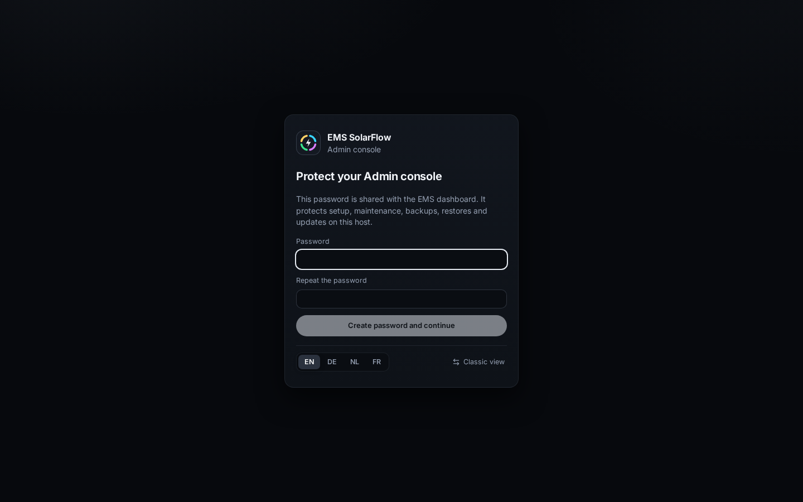
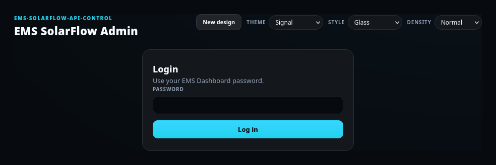

# First start and sign-in

## Purpose

Get from a freshly installed Admin Console to its first page, and know what
the sign-in, the reconnect notice and signing out mean.

## When to use this workflow

- The very first time you open the Admin Console on a host.
- Any later sign-in.
- When the browser suddenly shows the sign-in again, or a *Reconnecting…*
  notice, and you want to know whether something broke.

## Prerequisites

- The Admin Console container is installed and running. See
  [Admin Console](../admin-console.md#start) for the install command.
- A browser on the same machine or the same trusted LAN: Chrome or Edge 114,
  Firefox 125 or Safari 17 (iPadOS 17) or newer.
- Nothing else: no EMS container, no `config/config.json` and no password are
  needed yet.

## Step-by-step instructions

### 1 — Open the console

Open:

```text
http://127.0.0.1:8090
```

From another device on your LAN, use `http://<host-ip>:8090` (host networking
is the default).

**Expected result:** the page loads and shows either the password-creation
card, the sign-in card, or — if your session is still valid — the console
itself.

**If it differs:** nothing loads at all → the container is not running. Check
`docker compose -f docker-compose.admin.yml ps` and the logs. A certificate
warning means you opened the optional HTTPS port `8091` instead — see
[Optional HTTPS](../admin-console.md#optional-https).

The language can be chosen right on the card: **EN**, **DE**, **NL** or **FR**.

### 2 — Create the password (first start only)



**What you see:** *Protect your Admin console* — *This password is shared with
the EMS dashboard. It protects setup, maintenance, backups, restores and
updates on this host.* — with **Password** and **Repeat the password**.

**What you enter:** a password you choose, twice. There is no default and no
recovery question.

**What it changes:** the password is written to `config/dashboard-auth.json`
on the EMS host. This is a **shared** secret: the same password later unlocks
the EMS Dashboard's protected areas.

**What you select:** **Create password and continue**.

**Expected result:** you are signed in, and the console opens.

**If it differs:** *The two passwords do not match.* → retype both fields. If
someone (or an earlier attempt) already created the password, the card turns
into the sign-in; use that instead.

> The first browser to reach a console with no password set is the one that
> creates it. On an untrusted LAN, create the password immediately after
> install.

### 3 — Sign in



**What you see:** *Sign in* — *Use your EMS dashboard password.*

**What you enter:** the shared password from step 2.

**What it changes:** it starts a session. No configuration is touched.

**Expected result:** the console opens.

**If it differs:**

- *Sign-in failed. Try again.* → the password is wrong.
- *The password file needs repair* → `config/dashboard-auth.json` exists but
  cannot be read. Repair or remove that file on the EMS host, then **Try
  again**. The console will not guess and will not overwrite it for you.
- *The settings file needs repair* → `config/config.json` cannot be read, so
  the console cannot tell where the password file is. Repair it, then **Try
  again**.
- *The Admin console does not answer* → it may be restarting after an update.
  The card keeps trying by itself.

### 4 — Where the console opens

**What you see:** opened at its bare address, the console starts on the
[assistant](assistant.md), which says what is still to do on this
installation and leads to the page for it. While nothing is installed, its
first step offers **Set up a new system**. If you turned the assistant off, the
console starts on the **Overview** instead; a bookmark of a page opens that
page.

**What it changes:** nothing. The console never starts a workflow on its own.

**Expected result:**

- Nothing installed → [Guided setup](guided-setup.md), from the assistant's
  first step.
- An installation exists → the [assistant](assistant.md) or the
  [Overview](maintenance.md#1--read-the-overview).
- A guided setup is unfinished on the server → the console opens it in place
  of the assistant and the Overview, so it can continue.

## What happens in the background

- The console reads the install state (is there a `config/config.json`, a
  `docker-compose.yml`, an EMS container?) and turns it into the assistant's
  steps and the Overview's verdict. It never starts a flow for you.
- Authentication is server-side. Hiding a button in the browser is never what
  protects an action; the server checks the session and a CSRF token on every
  change.
- No config, runtime state or container is touched by signing in.

## Session, reconnect and sign-out

These look similar in the browser and mean very different things.

| What you see | What it means | What to do |
| --- | --- | --- |
| The sign-in card comes back | Your session ended: you signed out (perhaps in another tab), it expired, a restore put back an older password file, or the Admin Console was replaced | Sign in again. Nothing was lost — running workflows are stored on the server, not in the tab |
| *The Admin console does not answer. Reconnecting…* at the top of the page | The console lost contact with its server, for example while the Admin Console restarts | Wait. The page keeps trying and goes on by itself |
| The page reloads by itself | A new Admin Console answers — after an update of itself | Sign in again if asked; the page then follows what was running |
| *This page could not be loaded. The Admin console may be restarting.* | The page's own file did not arrive | **Reload** once the console answers |
| A progress list *inside* a page | A normal step of a workflow is running | Wait for that step. The rest of the console stays usable |

### When the Admin Console is replaced


**Why:** during a [Guided Upgrade](guided-upgrade.md), Admin and EMS are
brought to the same System Build. If the Admin Console has to change, the
container serving your page is replaced.

**What you see:** the update's step **Update the Admin console** is running,
and while the old console is gone, *The Admin console does not answer.
Reconnecting…* appears at the top.

**What it changes:** the Admin container is recreated on the new image. Your
EMS, settings and data are untouched at this point — the backup and the checks
already ran under the old console.

**Expected result:** as soon as the new console answers, the page reloads from
it. Sessions do not survive the restart, so the sign-in comes back with *An
update is running, and the Admin console may have restarted with it. Sign in
again to follow the update; it keeps running meanwhile.* Sign in with the same
password; the page opens **Updates** and follows the update on. Completed steps
are not repeated.

**If it differs:** on a Raspberry Pi the restart can take several minutes;
after two the page says so and offers **Reload page**. If the console does not
come back at all, the new Admin container may have failed to start:

```bash
docker compose -f docker-compose.admin.yml logs
docker compose -f docker-compose.admin.yml up -d
```

### Signing out and returning safely

**Sign out** (top right; on a phone under **More**) ends the session only. It
does not cancel a workflow, roll anything back, or stop a running update —
server-side work keeps running and you can sign back in to watch it.

To leave a workflow without ending it, open another page from the menu. The
workflow stays exactly as it was, and every page shows a banner with **Continue
the setup** or **Show the update** to return to it.

To *end* a workflow deliberately, use its own action — **Start setup over** in
the guided setup, **Cancel the update** in a stopped update. Those are
described in [Guided setup](guided-setup.md#recovery-or-next-steps) and
[Guided Upgrade](guided-upgrade.md#recovery-or-next-steps).

## Warnings and common problems

- **Do not expose ports 8090/8091 to the internet.** A deployment-capable Admin
  container controls the host Docker engine. Trusted local machine or trusted
  LAN only — see [Safety](../admin-console.md#safety).
- **Two browser windows are allowed, one workflow is current.** A window that
  lost the guided setup says *This tab no longer owns the setup* and offers to
  open the current one. It never silently acts on the newer workflow.
- **Bridge mode makes discovery less reliable.** If you installed with
  `--bridge`, a LAN scan may only see Docker networks; enter your LAN range by
  hand.
- **An older browser opens Classic.** A browser older than the ones listed
  under *Prerequisites* is sent to the deprecated Classic console at
  `/classic/`; see [the Classic console](index.md#the-deprecated-classic-console).

## Recovery or next steps

- First install → [Guided setup](guided-setup.md)
- Not sure what is next → [The assistant](assistant.md)
- Existing install → [Maintenance](maintenance.md)
- Locked out because `config/dashboard-auth.json` is unreadable → repair or
  remove that file on the host and try again. You can also set a new password
  from the CLI with `python3 emsctl.py dashboard set-password`.
