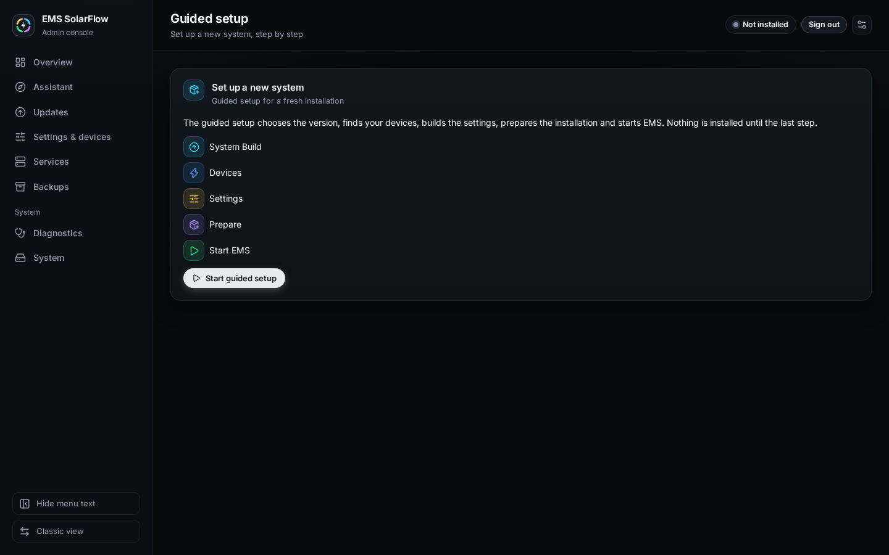
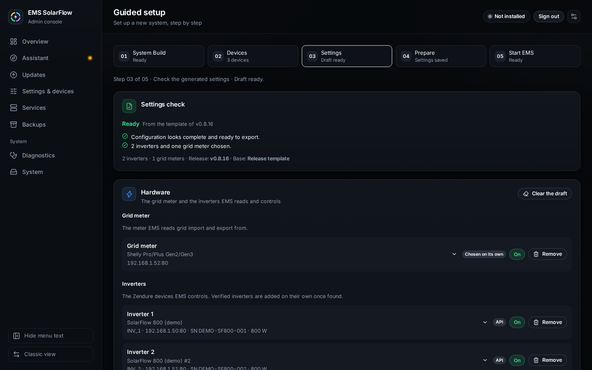
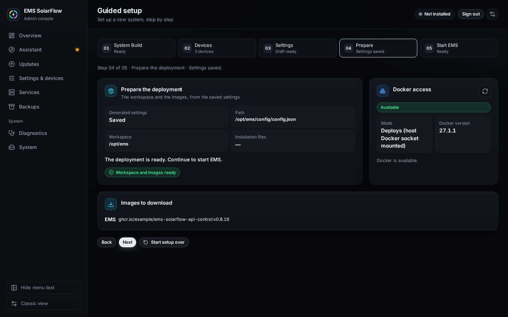
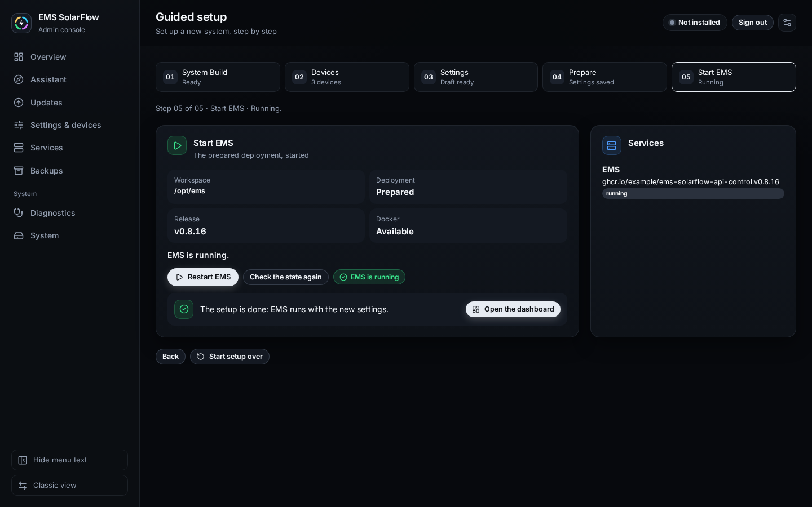

# Guided setup — install a new system

## Purpose

Install EMS from nothing: choose a paired Admin + EMS version (the **System
Build**), find your hardware, build `config/config.json`, prepare the
containers, and start EMS.

## When to use this workflow

- First installation on this host.
- A deliberate clean reinstall.

**Not** for changing an installed system. To update a version, add a device or
edit a setting, use [Maintenance](maintenance.md) — it changes less and checks
everything first.

## Prerequisites

- The Admin Console running and signed in — see [First start](first-start.md).
- Docker available to the Admin container.
- Your inverters powered on and on the same LAN (or reachable through a broker,
  for MQTT).
- A grid meter (Shelly, everHome EcoTracker, Tasmota, a Zendure meter, or an
  E3/DC read over Modbus TCP). See
  [Supported setups](../supported-setups.md).
- Internet access once, to download the images.

## Step-by-step instructions

### Open the guided setup



**Where:** on a host with nothing installed the console opens on the
[assistant](assistant.md), whose first step, **Install EMS**, offers **Set up
a new system**; the Overview of an empty host offers the same button. On an
installed system, the assistant's **Set up again** tile and **Open the guided
setup** on the **System** page lead here.

**What you see:** *Set up a new system* with the five steps, and **Start
guided setup**.

**What you select:** **Start guided setup**.

**What it changes:** the server opens a setup workflow. Nothing is installed
until the last step.

**If it differs:** on a host that already has an installation, the console
asks *Set up over the existing installation?* first; a new setup can replace
its settings. When an update or another workflow holds the console, it asks
*End the current workflow and start setup?*. Cancel either if you only meant to
change a setting.

The setup then runs as five steps under a stepper. Each tab names the step and
its state; a step stays greyed out until the step before it is genuinely done,
and that lock is enforced by the server, not by the browser. A line under the
stepper says where you are: *Step 02 of 05 · Find your devices · 3 devices.*

```text
01 System Build → 02 Devices → 03 Settings → 04 Prepare → 05 Start EMS
```

### 01 — Choose and verify the System Build


**What you see:** *Choose a System Build* with a **System Build** list grouped
**Latest**, **Stable**, **Unstable** and **Experimental**, and the **Progress**
card that shows what the server has done for this build: *Chosen*, *Checked*,
*Admin console updated*, *Reconnected*, *Files verified*, *EMS installed*,
*System checked*.

**What you select:** one build — a **Stable** one is the normal choice — then
**Verify the System Build**.

**What it changes:** choosing downloads nothing; you can look at several builds
without contacting the container registry. **Verify the System Build**
downloads (or reuses) the Admin and EMS images and checks them as a pair.

**Expected result:** *The Admin console is ready for this build.*, the six
checks ticked (*Admin image available*, *EMS image available*, *Revision
matches*, *Build ID matches*, *Channel matches*, *Embedded resources match*),
and **Continue** opens step 02.

**If it differs:**

- *The Admin console has to be updated before you can continue.* — press
  **Update the Admin console**. The page waits for the new console and reloads
  from it; the setup continues where it was. See
  [First start](first-start.md#session-reconnect-and-sign-out).
- *This Admin console can install this older EMS version.* — an older release
  installs from its verified release archive; continue.
- The registry limited the downloads — nothing was changed. Wait, then **Check
  again**.
- You choose another build afterwards — the earlier check is cleared on
  purpose. Verify the new one once.

### 02 — Find your devices


**What you see:** **Search sources** with the **Search order** (Local API, Local
MQTT, Zendure MQTT), **Search progress**, **Devices found**, **Networks and
routers**, **Scan one network**, and **Credentials for the search** for local
brokers and the Zendure cloud key.

**What you select:** nothing, the first time: the search runs on its own. Use
the boxes and arrows to choose which sources the search uses and in which
order, **Search again** to repeat it, **Scan the networks** to scan the
networks found once more, and **Scan** under *Scan one network* for an address
or range the search did not reach. **Configure** on a source shows what it
found, its state and its credentials.

**What it changes:** nothing on your hardware and nothing in any settings. The
search only reads. The order affects the setup only — a device found by more
than one source is set up over the first one in the list — never how EMS runs.

**Expected result:** your inverters and the grid meter appear under **Devices
found**, each **Found**. One physical device found over several connections is
listed **once**.

**If it differs:**

- **No devices found** → open a source with **Configure** to see its state. In
  bridge mode, enter your LAN range under *Scan one network*. Check that the
  inverter's local API is switched on.
- **It looks like duplicates** → usually it is not. See
  [Device management](device-management.md#one-inverter-several-connections).
- **A Zendure MQTT device is missing** → save the broker credential or the
  Zendure cloud key under *Credentials for the search*, or add the device by
  hand in step 03; see [MQTT](mqtt.md).

### 03 — Check the generated settings



**What you see:** the **Settings check**, then **Hardware** (the grid meter and
the inverters), **Features**, **Control and safety**, **Advanced and system**
and **Generated settings**.

**What you enter:**

- **Grid meter** — verified finds fill it in on their own (*Chosen on its
  own*) when exactly one meter is found; otherwise choose one. Only one grid
  meter can be active. An **E3/DC** chosen as grid meter is also added as a
  read-only device, so its PV, battery, inverter and grid appear on the
  dashboard.
- **Inverters** — verified inverters join the draft on their own. Each gets a
  short EMS name (`INV_1`, `INV_2`, …): the name used in `config.json`, logs and
  the dashboard. Change it now if you want another. **Add more devices** lists
  the other finds and **Add a device by hand** what the search could not reach.
- **Features** — winter mode, energy savings, full-charge assist and so on.
- **Control and safety** — what EMS may do once it starts, and the limits it
  stays inside.

**What it changes:** nothing on disk yet. The server checks the draft as you go,
and the **Settings check** shows its verdict: **Ready**, **Checking…** or
**Needs attention**, with the reason.

**About Control and safety.** These switches are on by default, so a finished
setup actually controls your system — you do not have to switch anything on.
They exist to *stop* EMS: switch one off for read-only validation, or switch on
*Dry run* while you check a setup. Read the group heading before the checkbox,
because the two groups point in opposite directions:

| Group | On means |
| --- | --- |
| **What EMS may change** | allowed |
| **Hold EMS back** | blocked, whatever the group above allows |

The same switches are on the **Safety** tab of
[Settings & devices](maintenance.md#3--change-settings) afterwards.

**What you select:** **Continue to deployment** once the check says **Ready**.
It saves the generated settings for the deployment.

**Other ways out of this step:** under **Generated settings**, **Download
encrypted** saves the settings as an encrypted backup you can put back later
(they hold API keys and broker passwords, so they never download in the
clear), and **Apply to the installation** writes them into the installation's
`config/config.json` — an existing one is backed up first — without deploying
anything.

**If it differs:**

- **Continue to deployment is greyed out after an edit** → intended. The check
  runs again first; what you saw checked is exactly what gets saved.
- **A connection question appears** — *Change INV_1 from … to …?*, naming what
  happens to output control → answer it with **Use …** or **Keep …**. Nothing
  changes until you do.
- **Output control is not available for a device** → it follows the model and
  the write route, not a checkbox. See
  [Device management](device-management.md#why-a-device-is-read-only).
- **Clear the draft** takes every device and the grid meter out of the draft;
  the search results stay.

### 04 — Prepare the deployment



**What you see:** *Prepare the deployment* with the saved settings, their path,
the workspace and the installation files, **Docker access** and **Images to
download**.

**What you select:** nothing — *Preparing starts on its own.* When it is done,
**Next**.

**What it changes:** **this is where the installation is written.** The
console writes `config/config.json` and the container setup into the workspace
and downloads the EMS image and its resources. The new settings come from the
release template and your choices; nothing of an existing config is kept but
the location of the shared password file. The dashboard's runtime settings are
rebuilt from the new settings when EMS starts on them, and the old ones stay in
`data/runtime-state.json.before-setup-<UTC time>`; your runtime databases are
not touched.

**Expected result:** *The deployment is ready. Continue to start EMS.* and
*Workspace and images ready*.

**If it differs:**

- *An EMS installation already exists here. Continuing replaces its config.json
  and docker-compose.yml; both are backed up first.* → **Continue and replace
  these files**, or go back.
- *The workspace was prepared for another release or other settings.* →
  **Replace the existing workspace**.
- The installation's settings changed after this setup was opened —
  Maintenance, a restore or another session edited them. Nothing was
  overwritten. Go back to **03 Settings**, choose **Check the current
  settings** and continue again.
- *Preparing failed.* → **Prepare again**; **Check Docker again** in the Docker
  card re-reads Docker's state.

### 05 — Start EMS



**What you see:** *Start EMS* with the workspace, the deployment, the release
and Docker, and **Services**.

**What you select:** **Start EMS** (**Restart EMS** once it ran).

**What it changes:** the EMS container is created and started with your
settings. EMS begins reading your meter and devices.

**Expected result:** *EMS is running.* and *The setup is done: EMS runs with
the new settings.*, with **Open the dashboard**. It points at
`http://<host>:8080`.

**If it differs:**

- *An EMS container already exists* → a stopped container with the same name
  blocks the start; **Remove the old container and continue**. A running one
  with another image is offered **Replace the running EMS and continue**, which
  asks once more.
- *The workspace does not belong to the container's user* → **Repair the
  permissions and continue**.
- EMS does not come up → **Check the state again**, then run the checks — see
  [Diagnostics and recovery](diagnostics-recovery.md).

## What happens in the background

- Steps 01 to 03 only read and draft. The installation is written in **04
  Prepare**; **Apply to the installation** in step 03 is the one earlier write,
  and only when you choose it.
- Every save is bound to the exact check you saw and to the exact
  `config/config.json` that existed when it was made. If either moved, the save
  is refused rather than guessing.
- Device identity comes from the backend (trusted serial plus scoped route),
  never from what the browser displays.
- The search, the check and the preparation belong to one setup workflow on
  the server. Closing the tab does not cancel it: after a sign-in, a reload or
  an Admin Console restart, the console opens the unfinished setup again, and
  every other page shows **Continue the setup**.
- The draft is kept in the browser under the same names Classic uses, so a
  setup begun in one console continues in the other.

## Expected result

- `config/config.json` written in the standard layout.
- `docker-compose.yml` prepared with the verified EMS image.
- The EMS container running and the dashboard reachable on port 8080.

## Warnings and common problems

| Symptom | Meaning | What to do |
| --- | --- | --- |
| No devices found | The search could not reach them | Scan your LAN range under *Scan one network*; check the inverter's local API; in bridge mode discovery is less reliable |
| Two entries look like the same inverter | Usually two *connections*, not two devices | See [Device management](device-management.md#one-inverter-several-connections) |
| Output control unavailable | Model or write route not proven | [Why a device is read-only](device-management.md#why-a-device-is-read-only) |
| *The devices found changed after this draft was planned* | The search found different devices since the draft was made | It was planned again; check it and continue once more |
| The check is out of date | You edited the draft | Wait for **Ready** again |
| The settings changed meanwhile | `config/config.json` changed after the setup was opened | **Check the current settings**, then continue |
| *This tab no longer owns the setup* | Another tab, or a restart, took the setup over | **Open the current setup**, or **Discard this tab's draft** |
| The page loses contact in step 01 | The Admin Console is being replaced | Wait; the page reloads from the new console |
| The registry limited the download | GHCR throttled you | Wait, then **Check again**. Nothing was changed |

## Recovery or next steps

**To start over:** **Start setup over**, below every step, removes the setup
draft, the generated settings, the deployment plan and the progress, then
returns to step 01. The installed system, its settings, data, containers and
backups stay as they are.

**A stuck setup:** when the System Build work behind a setup failed, expired or
lost its Admin Console replacement, step 01's **Progress** card says why and
offers **Resume the transition** and **Discard the setup**, each when the server
allows it. A discard is refused while an operation the setup started is still
running, and says which one; wait and discard afterwards. Nothing is
half-discarded. A setup that can no longer be reached here is reset on the
**System** page — see
[Diagnostics and recovery](diagnostics-recovery.md#unfinished-setup-or-update).

**After a successful setup:**

1. Work through the [first-run checklist](../../first-run-checklist.md).
2. Read [Safety](../safety.md) before enabling live hardware writes.
3. Open the [EMS Dashboard guides](../dashboard/index.md).
4. Make a first backup — the [assistant](assistant.md) shows it as the next
   step.
5. Use [Maintenance](maintenance.md) for everything from here on.

**Full behavioural reference**, including every refusal and ownership rule:
[Admin Console: Set up a new system](../admin-setup.md).
