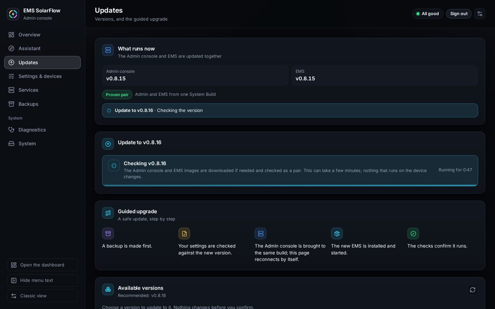
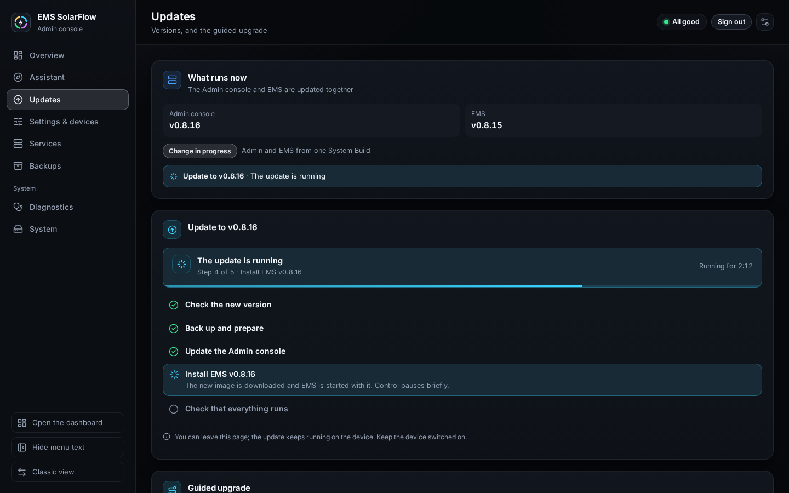
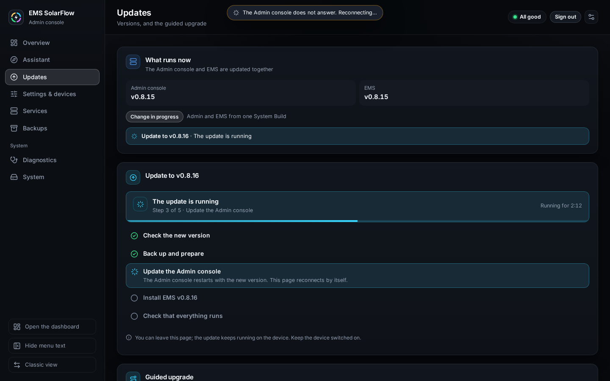
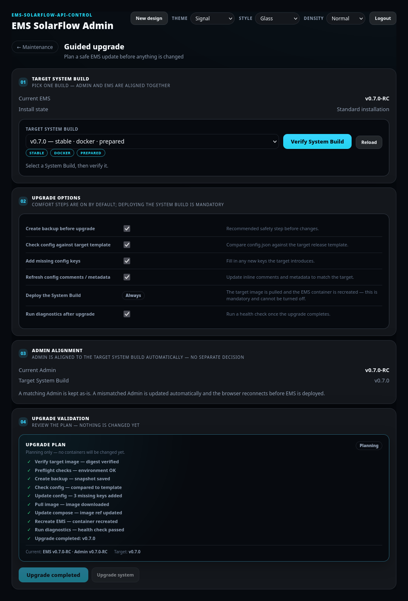

# Guided Upgrade — update an installed system

## Purpose

Move an installed EMS to a newer version safely: check the paired Admin + EMS
build, back up first, bring the settings file up to date, bring the Admin
Console to the same build, install the new EMS, and check that it runs.

## When to use this workflow

- A new release is out and you want it.
- You need a fix that landed in a later build.

**Not** for going back to an older minor or major version. Guided Upgrade moves
**forward**, or back by a patch inside the release line you are running, and
never proposes going back by itself. Further back belongs to
[Backup and restore](backup-restore.md).

## Prerequisites

- An installed, running EMS.
- Disk space for a backup and one more image.
- Internet access, unless the new image is already on disk.
- A few minutes without interrupting the host.

## Step-by-step instructions

### 1 — Open Updates


**Where:** **Updates** in the menu; the **Update** tile of the
[assistant](assistant.md) and **Updates** on the Overview's **Versions** card
lead here too.

**What you see,** from the top:

- **What runs now** — the Admin Console and EMS versions, and whether they are
  one build: **Proven pair**, **Recorded pair**, **Not verified**, **Not a
  pair** or **Change in progress**. Once an update has run, *Last update:
  v0.8.16* names it. While an update is open, a coloured line at its foot
  names it and says where it is, such as *Update to v0.8.16 · Checking the
  version*, with a turning symbol while the device works.
- **The update** you chose, once you chose one: its own card, right below
  *What runs now*. Steps 2 to 6 happen in it.
- **Guided upgrade** — the five things an update does, and **Update to …** for
  the recommended version. The button gives way while an update is open.
- **Available versions** — *Recommended: v0.8.16*, then the versions grouped
  **Stable releases**, **Rolling build**, **Release candidates** and
  **Development builds**, each with its channel and a state such as **Newer**
  or **Already installed**. **Show all … versions** adds the ones that cannot
  be installed now, with the reason. The buttons above the list show **All**
  or a single channel, such as **Stable** or **Rolling**, each with how many
  versions it lists; the browser remembers the choice.

**Which version is recommended:** the newest stable release that is neither the
one you run nor behind it. On a stable release with nothing newer to install,
nothing is recommended and the page says so; on a release candidate or a
development build it asks you to choose. The rolling `latest` is recommended
only when `latest` itself runs, when the running release cannot be told, or
when nothing is installed.

**What it changes:** nothing. Reading the page never downloads anything.

### 2 — Choose a version



**What you select:** **Update to v0.8.16** in the Guided upgrade card, or
**Choose** on any version in the list.

**What it changes:** nothing that runs on the device. The version is checked
at once: the Admin Console and EMS images are downloaded if needed and
verified as a pair, and the MQTT migration review is read with them.

**What you see while it works:** the card *Update to v0.8.16* opens right
below *What runs now*, and the page moves to it when it is out of view. A
coloured bar says *Checking v0.8.16*, with a turning symbol, a
line moving along its foot and *Running for 0:47* counting up; with motion
switched off under **Appearance**, the symbol and the line stand still. A
download takes a few minutes on a slow line or a Raspberry Pi; the bar stays
until the check is done. The chosen version in the list says **Checking**.


**Expected result:** the card's mark turns green — *Checked. Nothing has
changed yet* — and the card opens with a green box: *v0.8.16 is ready to
install. The images are on the device and were checked as a pair.* Below it
are **Runs now** and **After the update**, the **Options** and **What
happens**, in order:

1. The new version is checked once more.
2. A backup is made and verified.
3. The MQTT setup is migrated — only when it has to be.
4. The Admin Console is updated and restarts; this page reconnects by itself —
   only when the build needs it.
5. EMS stops briefly and starts again as the new version. Control pauses for
   that time.
6. The checks confirm that everything runs.

**If it differs:**

- *The version could not be checked.* → **Check again**, or **Choose another
  version**. The registry may have limited the downloads; nothing changed.
- *An unfinished guided setup holds the console.* → **Discard the setup**
  removes that setup (the installed system is not changed by it), then the
  check runs again. A setup that has not finished tidying up is released under
  **System** — **Open System**.
- *The MQTT setup of 1 device is migrated to the new format.* — and, where it
  applies, which devices lose their output control. Read it before you start;
  see [MQTT](mqtt.md#zendure-mqtt-migration-during-an-upgrade).

### 3 — Check the options

| Option | Default | What it does |
| --- | --- | --- |
| **Back up first (recommended)** | On | Settings and local databases, so you can go back |
| **Bring the settings file up to date** | On | Checks it against the new version, adds new settings with their defaults and refreshes the comments |
| **Run the checks afterwards** | On | Confirms that EMS reads its devices and runs as it should |

Installing the new EMS is not an option: it is what the update is.

**Leave *Back up first* on.** It is what lets you go back. It runs under the
Admin Console that runs *now*, before any part of the update changes it.
Switched off, the page warns: *No backup is made first. Without one, there is
no way back if something goes wrong.*

### 4 — Start the update and follow it



**What you select:** the green **Update to v0.8.16** at the foot of the card,
and confirm once in *Update to v0.8.16 now?*. There is no second,
Admin-specific confirmation.

**What it changes:** everything the card listed, in order.

**Expected result:** a bar at the top of the card says *The update is running*
and where: *Step 4 of 5 · Install EMS v0.8.16*, with *Running for 2:12*
counting up and a line along its foot that fills as the steps go by. Below
it, the page follows the update in five steps: **Check the new version**,
**Back up and prepare**, **Update the Admin console**, **Install EMS
v0.8.16**, **Check that everything runs**. Finished steps are ticked green;
the running step is highlighted, turns its symbol and says what it does. You
can leave the page; *You can leave this page; the update keeps running on the
device. Keep the device switched on.*

**If it differs:** a long step (an image download, the checks) keeps its
spinner rather than freezing. *Lost contact with the Admin console; the update
keeps running on the device. Trying again…* means only the page lost contact.

> Immediately before any change, the version is checked once more. If the
> image behind it moved since you chose it — a mutable `latest` re-pushed to a
> new digest — the update is refused before any backup, migration or
> installation, and the page asks you to check it again.

### 5 — Wait through the Admin Console's restart



**What you see:** when the build needs a new Admin Console, **Update the Admin
console** runs — *The Admin console restarts with the new version. This page
reconnects by itself.* — and while the old console is gone, *The Admin console
does not answer. Reconnecting…*.

**What it changes:** the Admin container is recreated on the new image.

**Expected result:** the page reloads from the new console. Sign in again with
the same password — sessions do not survive the restart; the sign-in says why.
The page then opens **Updates** and follows the update on. The backup and the
first checks are **not** repeated.

**If it differs:** on a Raspberry Pi the restart can take several minutes;
after two the page says *This takes longer than usual…* and offers **Reload
page**. The update goes on either way. If the console does not return:

```bash
docker compose -f docker-compose.admin.yml logs
docker compose -f docker-compose.admin.yml up -d
```

### 6 — Confirm completion



**What you see:** **Update complete** — *EMS and the Admin console now run
v0.8.16.* — with **Before**, **Now**, **Finished**, **Took** and **Backup made
first**.

**What you select:** **Open the dashboard** to see live values again, or
**Done**.

**Expected result:** EMS runs the new build and the pair is recorded as known
good. **What runs now** names the new version without a reload, and *Last
update: v0.8.16* stays on the page afterwards.

**Verify for yourself:** the Overview shows the new version, and the
[EMS Dashboard](../dashboard/index.md) shows live telemetry again.

## What happens in the background

- **Admin and EMS are one build.** You make one version decision. Updating the
  Admin Console is a step of the update, not a separate choice — a matching
  Admin Console is kept as it is, a stale container-setup tag is corrected, a
  mismatched one is replaced.
- **The tag names the build; the digest is what runs.** After the check the
  release tag is only a label. The EMS image is pulled and written into
  `docker-compose.yml` by its exact verified digest (`…@sha256:…`), so a later
  registry change to that tag cannot alter your installed EMS or what a
  restart runs.
- **A running EMS container is the authoritative baseline.** If its image
  identity cannot be read, the installed release is shown as **unknown** with a
  warning rather than guessed from the container setup.
- **A merely prepared release is never shown as installed**, so downloading a
  newer build does not make a real update look like a downgrade.
- **The backup and the first checks run under the current Admin Console**,
  before it is replaced. The new one is never assumed first.
- **The update runs on the server.** Closing the page, a lost network or a
  sleeping laptop does not stop it; the page finds it again when you come back.

## Expected result

- EMS running the new build, by digest.
- A verified backup from before the change.
- The settings file brought up to date and checked against the new version.
- `data/`, volumes, backups and history unchanged.

## Warnings and common problems

| Symptom | Meaning | What to do |
| --- | --- | --- |
| A version you expect is not in the list | The buttons above the list show a single channel, or the version cannot be installed now | Choose **All**; then **Show all … versions** |
| *The update did not start* | The server refused it before any work; *It stopped before anything was changed. EMS runs as before.* | Read the reason, fix it, choose the version again |
| The update is refused right at the start | The image moved since the check | Choose the version again; it is checked anew |
| *The GitHub Container Registry limits downloads just now* | The registry throttled you | Nothing changed; wait and **Try again** |
| The sign-in appears in the middle of the update | The Admin Console was replaced | Same password; the page follows the update on |
| A device would lose control | The MQTT migration review says so | Decide before you start — see [MQTT](mqtt.md) |
| An unfinished setup holds the console | An unfinished guided setup exists | **Discard the setup** first; an update never deploys over a setup |
| *The update did not finish* | A step failed | See below |

## Recovery or next steps

A stopped update does not throw the workflow away. The card says *The update
did not finish*, *Stopped at:* the step, whether anything may have changed
already, and offers the ways out the console can take at that moment:

- **Try again** — continues the update from the step where it stopped. Steps
  already done are not repeated.
- **Go back to the version that runs** — sets the Admin Console back to the
  last version that was verified with this EMS; the page reconnects by itself.
- **Cancel the update** — gives the update up. What it already changed stays;
  your running system, live settings and last known-good build stay as they
  are, and a backup brings back the state from before.
- **Choose a version** and **Backups** are always there.

When **Go back to the version that runs** finds the Admin Console already on
that version, nothing restarts; **System alignment** on the **Updates** page
then shows what is left: **Continue** checks that version's files, and after
that **Release the console** leads to **System**, where the recovery card frees
the console with one confirmation — see
[Diagnostics and recovery](diagnostics-recovery.md#unfinished-setup-or-update).

**Retry or recover:** try again when the cause was passing (network, rate
limit). Use the recovery card on **System** when the state itself is
inconsistent — for example the Admin Console was replaced but the update did
not finish.

**Rolling back:** if the new version misbehaves, restore the backup the update
made. A restore does **not** silently install an older EMS image — see
[Backup and restore](backup-restore.md#no-hidden-ems-downgrade).

**Full behavioural reference:** [Admin Maintenance](../admin-maintenance.md).
