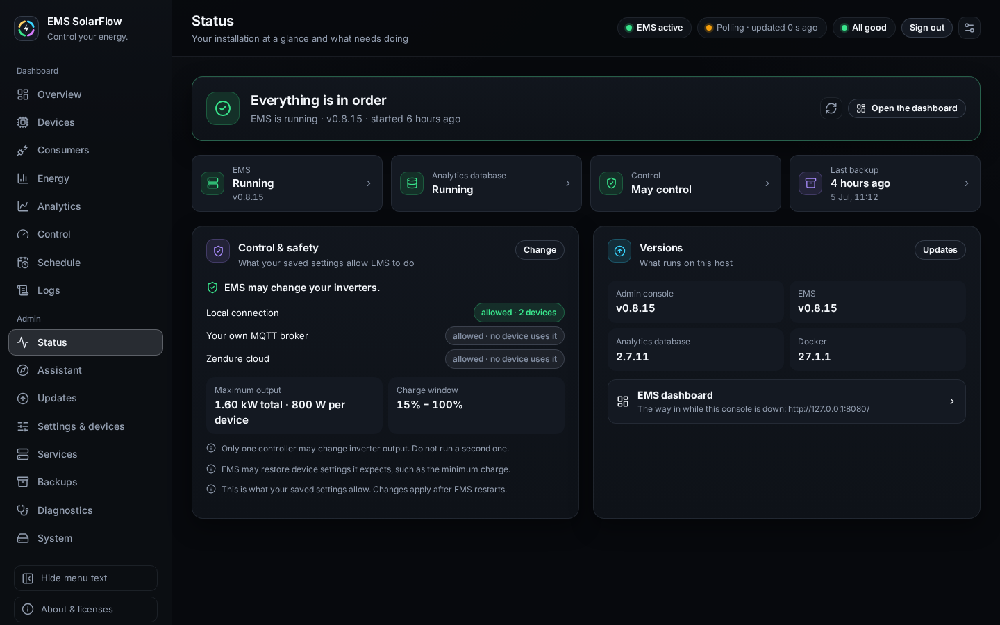

# Admin Console — step-by-step guides

Screenshot-led walkthroughs for the local browser console (**EMS SolarFlow
Admin**) on port `8090`. It installs EMS, updates it, changes its devices and
settings, backs it up and repairs it. Each guide follows the same shape: what
the workflow is for, when to use it, what you need first, numbered steps with
what you see and what changes, then warnings and recovery.

New here? Read [what the Admin Console is](../admin-console.md) first — product
overview, install command, sign-in, networking and HTTPS.



## Not sure where to start?

Open the console at its address and it starts on the
[assistant](assistant.md): it says what is still to do on this installation —
install EMS, add your devices, make a first backup — highlights the next step
with its button, and links to the page for anything else you came to do.

## Choose your guide

| You want to | Start here |
| --- | --- |
| Know where to start, or what is still open | [The assistant](assistant.md) |
| Open the console for the very first time, or sign in | [First start and sign-in](first-start.md) |
| Install EMS for the first time | [Guided setup](guided-setup.md) |
| Update an installed EMS to a newer version | [Guided Upgrade](guided-upgrade.md) |
| Read the state of an installation, change a setting, restart EMS | [Maintenance](maintenance.md) |
| Add, edit, disable or remove a device | [Device management](device-management.md) |
| Set up Local MQTT or Zendure Cloud MQTT | [MQTT connections](mqtt.md) |
| Save a snapshot, or roll one back | [Backup and restore](backup-restore.md) |
| Something is wrong and you need evidence | [Diagnostics and recovery](diagnostics-recovery.md) |
| Use the console in your language, in another colour scheme or on a phone | [Appearance, language and phone](appearance.md) |

## The pages

The app shows the EMS dashboard's pages and the console's own in one side
menu, in two groups:

```text
Dashboard: Overview · Devices · Consumers · Energy · Analytics · Control · Schedule · Logs
Admin: Status · Assistant · Updates · Settings & devices · Services · Backups · Diagnostics · System
```

The **Dashboard** pages are described in the
[EMS Dashboard guides](../dashboard/index.md); anyone who reaches the address
can read them, and a write there needs the sign-in. The **Admin** pages need the
sign-in to open: choosing one while signed out shows the sign-in in its place,
with the way back to the dashboard. Signing in once signs you in to both.

| Page | What it shows and does |
| --- | --- |
| **Status** | *Your installation at a glance and what needs doing*: one verdict, what needs your attention, tiles for EMS, the analytics database, control and the last backup, **Control & safety** and **Versions** |
| **Assistant** | *What is still to do, and the way to what you came for* — see [The assistant](assistant.md) |
| **Updates** | *Versions, and the guided upgrade*: what runs now, the available versions, the update itself |
| **Settings & devices** | *Devices, features and the safety switches*, in the tabs **Features**, **Safety**, **Expert** and **Devices** |
| **Services** | *State and restart of EMS and the analytics database*: **Restart EMS now** and **Repair analytics** |
| **Backups** | *Save your settings, or put an older copy back*: create, download, bring back, restore, delete |
| **Diagnostics** | *Checks of the installation and the EMS's own diagnosis*: the console's read-only checks, then the EMS's diagnosis profiles and the support bundle |
| **System** | *Files, device telemetry and unfinished workflows*, and the way into the guided setup |

**Guided setup** has no place in the menu. The assistant, the Status page of an
empty host and the System page open it. On a host with nothing installed the
app opens on the assistant; otherwise it opens on the dashboard's Overview.

The top bar always names the page, says how the installation is — **All
good**, **A note**, **Needs a look**, **Needs attention**, **Not installed**,
**Checking…** or **Unknown state**, a pill that leads to Status — beside the
EMS's live state, and carries **Sign in** or **Sign out** and the
**Appearance** button. The foot of the side menu holds **Hide menu text** and
**About & licenses**. On a phone the menu becomes a bar at the bottom with
four pages and **More**; see
[Appearance, language and phone](appearance.md#on-a-phone).

**About & licenses**, also on the sign-in screen, shows the version and
commit, the source code of exactly that version, the project's license (GNU AGPL v3 or later, without any
warranty), the note that this is an independent community project and not a
Zendure product with links to its Discussions and issues on GitHub, the
invitation to report a device that works (or does not) with links to the
report form and to the [supported setups](../supported-setups.md), and the
license of every component the page is built from.

While a guided setup or an update holds the console, every other page shows a
banner that says so, with **Continue the setup** or **Show the update**.

## Admin and EMS move together

The Admin Console and EMS are **one paired System Build**. You pick a single
version; the console brings both sides to it.

- There is no separate "Admin version" choice, and no supported way to run EMS
  on one build while the Admin Console stays on another.
- During a [Guided Upgrade](guided-upgrade.md), updating the Admin Console is a
  step of its own. When it is replaced, the page loses contact for a moment,
  reconnects by itself and follows the update on.
- Choosing a version on the **Updates** page checks it at once and changes
  nothing; in the guided setup, **Verify the System Build** does the download
  and the check.

Background: [System-build pairing](../../technical/system-build-pairing.md).

## What changes what

Use this before you click something you are unsure about.

| Action | Reads | Writes settings | Recreates containers |
| --- | --- | --- | --- |
| Assistant, Overview, Diagnostics | Yes | No | No |
| Reading the System page | Yes | No | No |
| **Move the settings** / **Apply the migration** on System | Yes | Yes | No |
| **Search my network**, a scan | Yes | No | No |
| **Check changes** on Settings & devices | Yes | No | No |
| **Save and apply** on Settings & devices | Yes | Yes | No |
| **Restart EMS now** on Services | Yes | No | Yes |
| Guided setup, steps 01 to 03 | Yes | No | No |
| Guided setup, **Continue to deployment** and **04 Prepare** | Yes | Yes | No |
| Guided setup, **Start EMS** | Yes | No | Yes |
| Guided Upgrade | Yes | Yes | Yes |
| **Create backup** | Yes | No | No |
| Restore preview | Yes | No | No |
| **Restore now** (confirmed) | Yes | Yes | Possibly |

Every writing action shows what it will do first and asks for an explicit
confirmation. Saving settings, the guided upgrade and a restore back up what
they replace first, unless you switch that off.

## Browsers and old addresses

The console needs Chrome or Edge 114, Firefox 125 or Safari 17 (iOS and
iPadOS 17) or newer. An older browser shows a page that says so, in English,
German, Dutch and French.

The previous design, **Classic**, has been removed. An old bookmark of
`/classic/` or `/modern/` opens the console at its address, and an address
that named a Classic page (such as `#maintenance-upgrade` or
`#maintenance-settings-features`) opens the same page here.

## Deeper reference

The guides here are task-oriented. The full behavioural reference — every edge
case, refusal, ownership rule and recovery state — lives in:

- [Admin Console: Set up a new system](../admin-setup.md)
- [Admin Maintenance](../admin-maintenance.md)
- [Admin Console: Backup / restore](../admin-backup-restore.md)
- [Admin discovery (technical)](../../technical/admin-discovery.md)
- [Admin architecture (technical)](../../technical/admin-architecture.md)

## Related

- [EMS Dashboard guides](../dashboard/index.md) — the everyday operating UI.
- [Connection types](../connection-types.md) — Local API vs Local MQTT vs cloud.
- [Supported setups](../supported-setups.md) — whether your hardware fits.
- [Safety](../safety.md) — the pre-live checklist for hardware writes.
