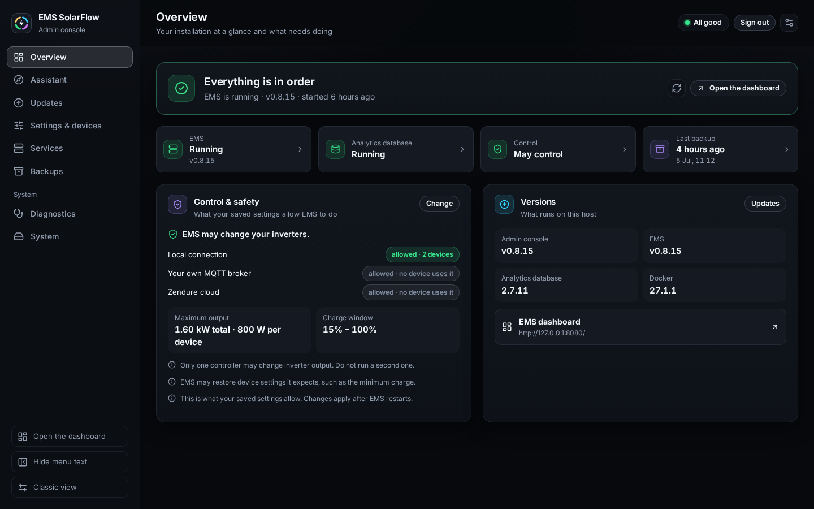
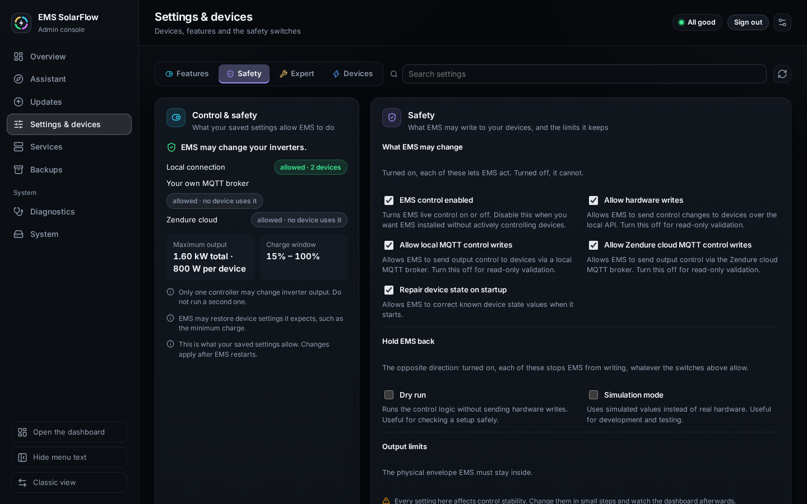
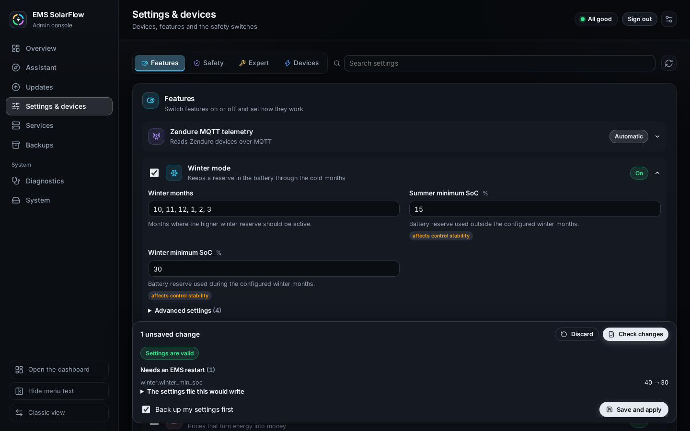

# Maintenance — manage an installed system

> **Video:** [What You Can Configure](https://www.youtube.com/watch?v=Ymdq613eGAA)

## Purpose

Read, change, restart and repair an EMS installation that already exists,
changing as little as possible each time.

## When to use this workflow

Any time after the first install: reading the state of the installation,
changing settings and devices, restarting EMS, and finding the way to updates,
backups, checks and recovery.

Use [Guided setup](guided-setup.md) only for a first install or a deliberate
clean reinstall.

## Prerequisites

- An installed EMS (`config/config.json` and `docker-compose.yml` present).
- The Admin Console signed in — see [First start](first-start.md).

## Where each task lives

| Page | Use it for | Guide |
| --- | --- | --- |
| **Overview** | Is everything in order, and what needs doing | This page |
| **Assistant** | What is still to do, and the way to each task | [The assistant](assistant.md) |
| **Updates** | Move EMS and the Admin Console to a newer System Build | [Guided Upgrade](guided-upgrade.md) |
| **Settings & devices** | Features, safety switches, expert tuning, devices | This page, and [Device management](device-management.md) |
| **Services** | What runs, **Restart EMS now**, **Repair analytics** | This page |
| **Backups** | Create, download, bring back, restore or delete backups | [Backup and restore](backup-restore.md) |
| **Diagnostics** | Read-only checks of the installed EMS | [Diagnostics and recovery](diagnostics-recovery.md) |
| **System** | Files, device telemetry, an older MQTT setup, unfinished workflows, the guided setup | This page, [MQTT](mqtt.md) and [Diagnostics and recovery](diagnostics-recovery.md) |

Every page has its own address and can be bookmarked, a single settings tab
included (`#/settings/safety`). Reading and changing are separate: the
Overview, Diagnostics and System pages never edit anything, and Settings &
devices never restarts anything.

## What each area changes

Read this before clicking something you are unsure about.

| Area | Read-only | Writes settings | Recreates containers |
| --- | --- | --- | --- |
| Overview, Control & safety | Yes | No | No |
| Services — reading | Yes | No | No |
| **Restart EMS now** | No | No | Yes |
| **Repair analytics** | No | No | No |
| Diagnostics — **Run the checks** | Yes | No | No |
| System — files, device telemetry | Yes | No | No |
| Settings & devices — editing and searching | Yes | No | No |
| Settings & devices — **Check changes** | Yes | No | No |
| Settings & devices — **Save and apply** | No | Yes, after the check | No |
| **Put saved values back** | No | No (runtime state only) | No |
| Older MQTT device setup — review | Yes | No | No |
| **Apply the migration** | No | Yes | No |
| **Move the settings** (old place) | No | Yes | No |
| Guided Upgrade | No | Yes | Yes |
| Create backup | Yes | No | No |
| Restore preview | Yes | No | No |
| Restore (confirmed) | No | Yes | Possibly |
| Unfinished setup or update | Depends on the action chosen | No | No |

Nothing in the write rows happens without a check and an explicit
confirmation.

## Step-by-step instructions

### 1 — Read the overview

**What you see:** first the answer to the page's own question — **Everything
is in order**, *One thing needs your attention*, *2 things to note* — with the
EMS line under it (*EMS is running · v0.8.15 · started 6 hours ago*), the
refresh button and **Open the dashboard**. Below the verdict, when there is
something to report, the findings, worst first, each with what to do and the
button that leads there. Then:

- four tiles — **EMS**, **Analytics database**, **Control** and **Last backup**
  — each leading to its page;
- **Control & safety** — what your saved settings allow EMS to do;
- **Versions** — Admin Console, EMS, the analytics database and Docker, and
  the dashboard's address.

**What it changes:** nothing. The refresh button reads everything again.

The top bar's pill says the same in a word, on every page: **All good**, **A
note**, **Needs a look**, **Needs attention**, **Not installed**, or **Unknown
state** when the installation could not be read.

**The findings** are the ranked answer, not a second opinion: they are built
from the same read-only overview the tiles show. Errors come before warnings,
warnings before notes. Two are easy to miss:

- **Saved settings are newer than the running EMS.** Saving settings writes the
  file; EMS reads it when it starts. Until you restart EMS, part of what you
  saved is not in effect. The finding leads to **Restart EMS** on Services.
- **EMS writes nothing yet.** A template, empty or unusable value is left in a
  setup field, so EMS runs in safe mode, calculating targets but changing no
  inverter. The finding names each field and leads to **Open settings**.

If the overview itself cannot be read, the verdict says *This installation
could not be read*, and everything below is the last readable answer with the
time it was read. It never reports a healthy system on missing information.

**Control & safety** answers the one question the page exists for: **may EMS
change your inverters right now?**

- A sentence naming the effective state — *EMS may change your inverters.*,
  *EMS only calculates and does not change your inverters.*, *EMS uses
  simulated data…*, *EMS control is switched off.*, *Nothing may change an
  inverter right now.*, or *EMS writes nothing until every setup value it needs
  is filled in.* (see [Safety](../safety.md#when-ems-starts-writing)).
- One row per connection — **Local connection**, **Your own MQTT broker**,
  **Zendure cloud** — saying whether it is allowed and how many devices use it.
- The **Maximum output** and **Charge window** your devices are held to.
- *Only one controller may change inverter output. Do not run a second one.*
- **Change**, which opens the **Safety** tab.

It reads your **saved settings**, so a change reaches the running EMS only
after a restart, and it says what your settings *allow*, never that EMS is
running right now. A value the dashboard changed while EMS runs is named as
such. If a part cannot be read, the card says the control state is unknown
rather than showing a partial answer.

### 2 — Restart EMS, or repair analytics

**Where:** **Services**.

**What you see:** **EMS services** with EMS and the **Analytics database**,
their state (**Running**, **Stopped**, **Missing**, **Not set up**, **Off**,
**External**), name, version and start time; **Restart and keep in step** with
what each should be, whether the **Saved settings** are *in effect* or *newer
than the running EMS*, and **What a restart does**; and **Docker** with its
access and version.

**What you select:** **Restart EMS now**, and confirm in *Restart EMS now?*.

**What it changes:** EMS is recreated with the saved settings, and the bundled
analytics database is started or stopped as the settings say. When analytics
is on it also creates missing analytics buckets and downsampling tasks, the
same way **Repair analytics** does. Settings, data, volumes and backups are not
deleted; control pauses for a moment while EMS restarts.

**Expected result:** *Done. The containers match the saved settings.*, with
each step and when it ran. Analytics is optional, so a failed analytics step
does not stop the restart; the result names what did not work.

**Repair analytics** (while analytics is on) creates the missing analytics
buckets and downsampling tasks now. It deletes nothing and changes nothing
else: no container is started, stopped or recreated. You rarely need it: while
`influxdb.auto_sync` is on (the default), the running EMS does the same by
itself within minutes of InfluxDB answering, and checks again every half hour.
A shorter retention you configured, or a downsampling entry you removed, is
applied only by a full schema sync, which you run on purpose because it deletes
the data that falls out of the new retention — in the installation directory,
`docker compose exec ems python3 emsctl.py influx sync`. **Run the checks**
names a retention that differs from the settings.

**Restart EMS now** is greyed out when nothing can be restarted from here —
Docker or the container setup is not available — and the two actions never run
at the same time.

### 3 — Change settings

**Where:** **Settings & devices**.

**What you see:** four tabs and a search box over all of them:

| Tab | Holds |
| --- | --- |
| **Features** | Winter mode, full-charge assist, AC charging, energy savings, the dashboard, analytics — each switched on or off, opened to set how it works |
| **Safety** | What EMS may write to your devices, dry run and simulation, and the output limits |
| **Expert** | The system basics and the control tuning; change them in small steps |
| **Devices** | The grid meter, the Zendure MQTT broker and every device, the network search — see [Device management](device-management.md) |

**Search settings** finds a setting by its name, its description or its config
path across the tabs, and each tab counts its matches. Switching a tab never
reloads and never touches your unsaved changes.

**What you enter:** the change you want. Each field names its unit, says what
it does and, when it is empty, which default applies (*800 (default)*).
Advanced and expert fields are folded away under **Advanced settings** and
**Expert settings**.

**What it changes:** nothing yet. A bar at the foot of the page counts your
unsaved changes — *1 unsaved change* — and keeps them when you change pages or
reload; **Discard** drops them.

**The markers on a setting** name the consequence of changing it:

| Marker | What it means |
| --- | --- |
| *affects control stability* | Can make the control loop oscillate or react too slowly. Change it in small steps and watch the dashboard afterwards |
| *can discard stored data* | Can drop history or analytics data that is already stored |
| *secret* | A credential. It is stored outside the settings file and never shown back in full |
| *deprecated* | On its way out and may be removed in a later release |

**How your answers are read.** The guided setup and Settings & devices read a
field the same way: leading and trailing spaces are removed; **emptying a
field removes the setting**, so EMS falls back to its own default; list fields
(such as Shelly channels) take a comma-separated entry; leaving a **password**
box blank *keeps* the stored secret, and **Clear the stored password** removes
it; changing a grid meter's type removes fields the new type cannot use, while
keys you added by hand stay.

### 4 — Read the safety switches

**Where:** the **Safety** tab, also opened by **Change** on the Overview's
Control & safety card.

**What you see:** the **Control & safety** summary beside the switches,
grouped:

| Group | On means |
| --- | --- |
| **What EMS may change** | allowed — EMS may act over that connection |
| **Hold EMS back** | blocked — dry run and simulation mode suppress every hardware write, whatever the group above allows |
| **Output limits** | the physical envelope EMS must stay inside |

Read the group heading before the checkbox: both groups are checkboxes, but a
tick means the opposite thing in each.

**These switches are on by default.** A fresh installation controls your
inverters without you switching anything on; the switches exist to *stop* it,
for read-only validation or while you test. A switch your settings file does
not mention is shown at that default.

### 5 — Check and save

**What you select:** **Check changes** in the bar at the foot of the page.

**What it changes:** nothing. The server checks the result: **Settings are
valid**, or how many problems it has, and every value that would change, split
into **Takes effect at once** and **Needs an EMS restart**. **The settings file
this would write** shows the file itself.

**What you select next:** **Save and apply**, with **Back up my settings
first** on, and confirm in *Save the checked changes?*.

**What it changes:** `config/config.json` is written, after a backup of the
current settings unless you switched that off. The values EMS can take at once
are handed to the running EMS too. A change made after the check has to be
checked again: *Something changed since the check. Check again before
saving.*

**Expected result:** **Settings saved**, naming the backup. When a change
needs an EMS restart, the card says *Some changes take effect once EMS
restarts.* with **Restart EMS now**; **Follow it in Services** shows how it
goes. Otherwise *EMS uses the new values without a restart.*

**Values changed in the dashboard.** A value the dashboard changed while EMS
runs is marked **Running: …** beside its field, and a note at the top of the
page counts them. **Put saved values back** makes EMS use the saved values
again, at once; it changes the running state, not the settings file.

### 6 — Look at the system's files

**Where:** **System**.

**What you see:**

- **Files on this machine** — the install state (*Standard installation*), the
  **Settings file**, **Data folder** and **Container setup** with their paths,
  each found or missing, and when the settings were last saved.
- **Device telemetry** — what EMS hears from Zendure devices over MQTT; see
  [MQTT](mqtt.md#3--check-the-result).
- **Older MQTT device setup** — only while a migration waits; see
  [MQTT](mqtt.md#zendure-mqtt-migration-during-an-upgrade).
- **Unfinished setup or update** — only while a guided workflow needs it; see
  [Diagnostics and recovery](diagnostics-recovery.md#unfinished-setup-or-update).
- **Guided setup** — **Open the guided setup**, which installs EMS from nothing
  or sets it up again; over an existing installation it asks first.

**Settings in the old place.** When the settings are still in a `config.json`
beside the installation, the files card says so and offers **Move the
settings**: after a backup, the old file is copied to `config/config.json`,
where EMS and the console expect it. The old file and the data folder stay as
they are. When `config/config.json` already exists with other content, the
button reads **Replace config/config.json**, and both files are backed up
first.

## What happens in the background

- Every summary is read from the running system, not from a cached guess. The
  write permissions in **Control & safety** come from the same EMS gate logic
  the controller applies, projected onto your saved settings — the Admin
  Console does not decide them.
- If a fact cannot be proven — for example an image whose build labels are
  missing — it is shown as **unknown** with a warning rather than filled in
  from a weaker source.
- Your unsaved changes live in the browser until you save them. They survive a
  reload; they are never saved for you.
- Saving writes `config.json`, and mirrors the values the dashboard can also
  change (system power and loop limits, winter on or off, each device's
  enabled state, maximum power and PV priority) into `data/runtime-state.json`,
  so they take effect at once. It never moves `data/` history,
  `docker-compose.yml` or databases.

## Expected result

You can read your whole installation without touching it, change a setting
with a check before the save and a backup before the write, and restart EMS
when the change needs it.

## Warnings and common problems

| Symptom | Meaning | What to do |
| --- | --- | --- |
| The pill says **Unknown state** | The installation could not be read just now | Press refresh on the Overview; if it stays, run the checks under [Diagnostics](diagnostics-recovery.md) |
| **Restart EMS now** is greyed out | Docker or the container setup is not available here, or nothing needs to change | Read **What a restart does** on Services |
| *Saved settings are newer than the running EMS* | EMS still runs the settings from before your save | **Restart EMS now** |
| *Something changed since the check* | You edited after **Check changes** | **Check changes** again |
| *The devices, grid meter or broker changed elsewhere since you began changing them* | Another session saved device changes | **Discard device changes**, then make yours again |
| A dashboard value seems ignored | The field shows **Running: …** | **Put saved values back**, or save the field again |
| *No answer came back, so whether it ran is unknown.* after a restart or a reset | The request got no reply | The page reads the state again; look at it before you try again |
| *No settings file was found yet* on Settings & devices | Nothing is installed | [Guided setup](guided-setup.md) |

## Recovery or next steps

- Update EMS → [Guided Upgrade](guided-upgrade.md)
- Add or change a device → [Device management](device-management.md)
- Something is wrong → [Diagnostics and recovery](diagnostics-recovery.md)
- Roll a change back → [Backup and restore](backup-restore.md)
- Full behavioural reference → [Admin Maintenance](../admin-maintenance.md)
