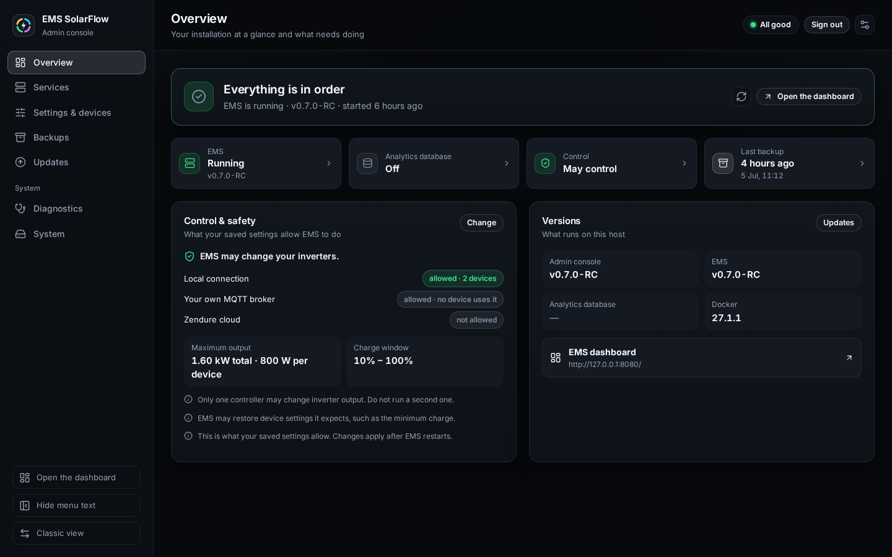
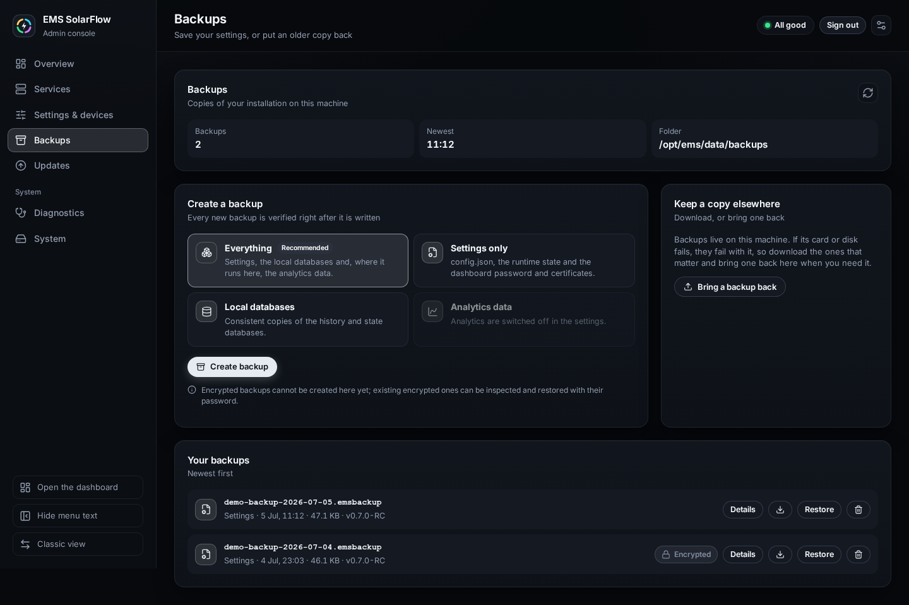
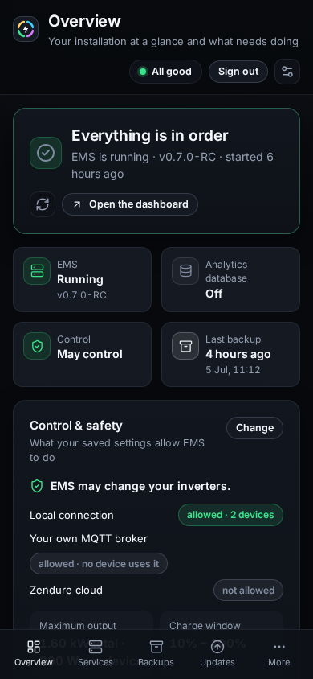

# The Modern Admin console

## Purpose

The Admin Console has two views of the same server. **Modern** is the one the
console's address opens: a newer design at `/modern/` on the same address and
port, arranged like the Modern dashboard, in English, German, Dutch or French.
**Classic** is the console the other guides in this section describe; it keeps
the workflows Modern does not run yet. Both have the same password, the same
checks and the same actions. Modern and the Modern dashboard are one product:
the same colours, the same menu, the same mark.

Both views talk to the same Admin server and write through the same checks.
Nothing you do in one is hidden from the other, and switching between them
changes nothing on the host.

## When to use this workflow

- You want to see at a glance whether your installation is well, and what to
  do about it when it is not.
- You want to create, download, bring back or restore a backup.
- You want to restart EMS, repair the analytics schema or run the checks.
- You prefer the console in your own language, or on a phone.

## Prerequisites

- The Admin Console is installed and reachable (see
  [what the Admin Console is](../admin-console.md)).
- A current browser: Chrome or Edge 114, Firefox 125, Safari 17 (iPadOS 17)
  or newer. An older browser keeps using Classic.

## What you see

| Page | What it shows and does |
| --- | --- |
| **Overview** | One answer to "is everything in order": what needs your attention, ranked, each with the way out of it; tiles for EMS, the analytics database, control and the last backup; what your settings allow EMS to do; the versions and the link to the dashboard |
| **Updates** | What runs now, the versions you can update to, and the update itself: choose a version, then confirm once. Progress and the result are shown on the page |
| **Settings & devices** | Your devices, the grid meter, the features and the safety switches as EMS applies them; editing opens the Classic editor at the right tab |
| **Services** | EMS and the analytics database as they run; what should run and what a restart changes; **Restart EMS now** and **Repair analytics** |
| **Backups** | Create a backup, see what is in one, download it, bring one back, restore it after a preview, delete it |
| **Diagnostics** | The read-only checks of the installed EMS, with the EMS diagnosis in full |
| **System** | The files of the installation, the device telemetry over MQTT, an older MQTT setup that waits for migration, and the reset of a guided workflow that can no longer finish |

The top bar always says how the installation is: **All good**, **A note**,
**Needs a look**, **Needs attention** or **Not installed**; **Checking…**
while it reads, and **Unknown state** when the console could not read the
installation. It leads back to the overview.

## Switching between the two

1. In Classic, the header has a **New design** button. It opens Modern.
2. In Modern, the foot of the side menu has **Classic view** (on a phone, under
   **More**). It opens the same page in Classic.

Modern is the default, as on the EMS dashboard. The browser remembers your
choice: once you have switched to Classic, the console's address opens Classic
until you press **New design**. Adding `?ui=classic` or `?ui=modern` to the
address sets the choice explicitly. A browser too old for Modern always opens
Classic.

Some workflows run in Classic for now: **Guided setup**, editing **settings
and devices**, and applying an **older MQTT setup's migration**. Modern names
them and opens them in Classic with one click, at the right page, without
changing your choice. The guided setup is the one exception: Classic never
starts it from an address, so that button opens Classic's start page, where it
is the first choice. When you go back to the console's address, Modern opens
again.

An update that is running is shown on every Modern page, with **Show the
update**. A guided setup in progress is shown the same way, with **Continue in
the classic view**.

What Modern shows but does not change itself yet:

| Where | Shown in Modern | Done in Classic |
| --- | --- | --- |
| **Settings & devices** | Every device, the grid meter, the features and the safety switches | Changing them, adding devices, putting live values back |
| **System** | An older MQTT setup that waits for migration | Reviewing and applying the migration, under **System status** |
| **Overview** | That nothing is set up yet | The guided setup |

## Signing in

The sign-in uses the same password as Classic and the EMS dashboard. On a
fresh host, the first visit creates it. The language can be chosen right on
the sign-in screen.

A session that ends -- you signed out in another tab, it expired, a restore
put back an older password file, or the Admin Console itself was updated --
brings the sign-in back. If the Admin Console restarts, for example after an
update of itself, the page reconnects on its own and reloads with the new
version; sessions do not survive the restart, so it asks you to sign in again.

## Updating

1. Open **Updates**. **Update to …** takes the recommended version; any other
   version in **Available versions** is chosen by tapping it.
2. The version is checked at once: the Admin console and EMS images are
   downloaded if needed and verified as a pair, and the update is planned
   right after. Nothing on the device changes.
   The page then shows what the update will do: the version now and after, an
   MQTT setup that is migrated, whether the Admin console restarts too.
3. Choose the options. **Back up first** is on and recommended; so are bringing
   the settings file up to date and running the checks afterwards.
4. Press **Update to …** and confirm once.
5. The page follows the update in five steps: check the new version, back up,
   update the Admin console, install EMS, check that everything runs. The
   running step says what happens, and a clock shows how long it has run.
   You can leave the page; the update keeps running on the device.
6. If the Admin console is updated too, it restarts in the middle. The page
   waits for the new one and reloads from it. Sign in again with the same
   password: the page then opens **Updates** and follows the update on. The
   update keeps running meanwhile. On a Raspberry Pi the restart can take
   several minutes; after two the page says so and offers to reload.
7. At the end the page says **Update complete**, what ran before and what runs
   now, when it finished, how long it took and which backup was made first.
   **Updates** keeps naming the last update afterwards.

If the server refuses the update before it starts -- for example because the
version may not replace the one that runs -- the page says **The update did not
start** and that nothing was changed. If the update stops later, the page says
where it stopped when the server names the step, and whether anything may have
changed already. It offers the ways out the console can take at that moment:
**Try again** continues the update from where it stopped and installs again
when the installation failed, **Go back to the version that runs** sets the
Admin console back to the version that was verified with the EMS that runs,
and **Cancel the update** gives it up. A backup can always be restored under **Backups**. The full reference is
[Guided Upgrade](guided-upgrade.md); **Use the classic view instead** on the
**Updates** page opens it there.

## Backups

1. Choose what to back up. **Everything** is recommended: settings, the local
   databases and, where it runs here, the analytics data.
2. Press **Create backup**. Each step is shown as it runs, and the backup is
   verified right after it is written.
3. **Details** shows what is in a backup and whether it holds passwords or keys.
   An encrypted backup asks for its password first.
4. The download button saves a copy to your computer. **Bring a backup back**
   uploads one, for example after a new card or disk.
5. **Restore** shows a preview first: which files are added, replaced or left
   unchanged. By default a copy of the current state is made first, and the
   restore undoes itself if a check afterwards fails. Nothing is written until
   you confirm.
6. After a restore, restart EMS under **Services** so it uses the restored
   files.

The full reference is [Backup and restore](backup-restore.md).

## On a phone

On a narrow screen the side menu gives way to a bar at the bottom with four
pages -- Overview, Updates, Settings and Services until you choose others -- and
**More** for the rest, the language, the colour scheme, signing out and the
switch to Classic.

## Appearance

The **Appearance** button in the top bar holds the same choices as the Modern
dashboard: colour scheme (**Graphite** or **Midnight**), language, density,
side menu and motion. They belong to the browser you made them in. The
dashboard and the Admin Console are different addresses, so each remembers its
own.

## Expected result

The console opens in the view you chose, in your language, and says in one line
whether the installation is in order. Every action it offers shows what it will
do before it does it.

## Warnings and common problems

| Symptom | Meaning | What to do |
| --- | --- | --- |
| The address opens Classic | This browser chose Classic, or it is too old for Modern | Press **New design**, or open the address with `?ui=modern` |
| A button opens the Classic view | That workflow has not moved to Modern yet | Finish it there; the console's address brings you back to Modern |
| An update waits at **Update the Admin console** | The Admin console is restarting with the new version | Wait; after two minutes the page offers **Reload page**. The update goes on either way |
| The sign-in appears in the middle of an update | The Admin Console was replaced by the new version, and sessions end with it | Sign in with the same password; the page then follows the update on |
| A message is in English | It comes from the server and has no translation yet | It is still accurate; report it if it matters to you |
| **Restart EMS now** is greyed out | Docker or the container setup is not available here, or nothing needs to change | Read **What a restart does** on the Services page |
| The sign-in comes back after a restore | The restore put back the password file from the backup | Sign in with the password from the backup |
| A backup or restore says contact broke off | The page lost the Admin Console while the job ran; the job runs on there | Press **Check again** once the console answers; the page also tries again by itself after a reconnect |
| A restart or a reset says no answer came back | The request got no reply, so whether it ran is unknown | The page reads the state again; look at it before you try again |
| The top bar says **Unknown state** | The console could not read the installation just now; the overview shows the last answer it had and when | Press the refresh button on the overview; if it stays, run the checks under **Diagnostics** |
| A restore says it did not start | The preview had expired or was already used, or another restore was running | Check the fresh preview shown below it and confirm again |

## Recovery or next steps

- Back to Classic → use **Classic view** in the side menu.
- What each maintenance action does in detail → [Maintenance](maintenance.md)
- Updating EMS → [Guided Upgrade](guided-upgrade.md)
- Something is wrong and you need evidence →
  [Diagnostics and recovery](diagnostics-recovery.md)
