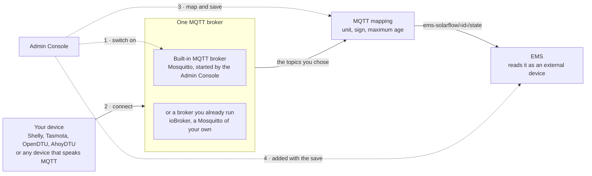
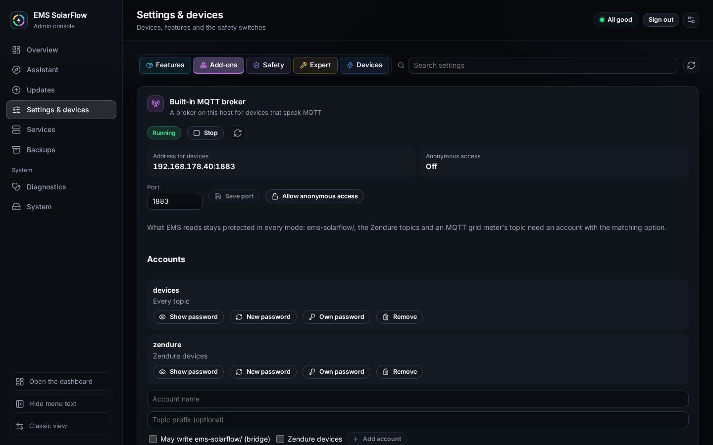
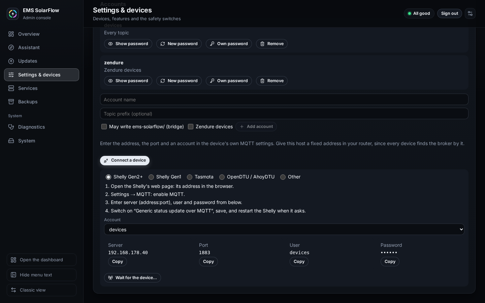
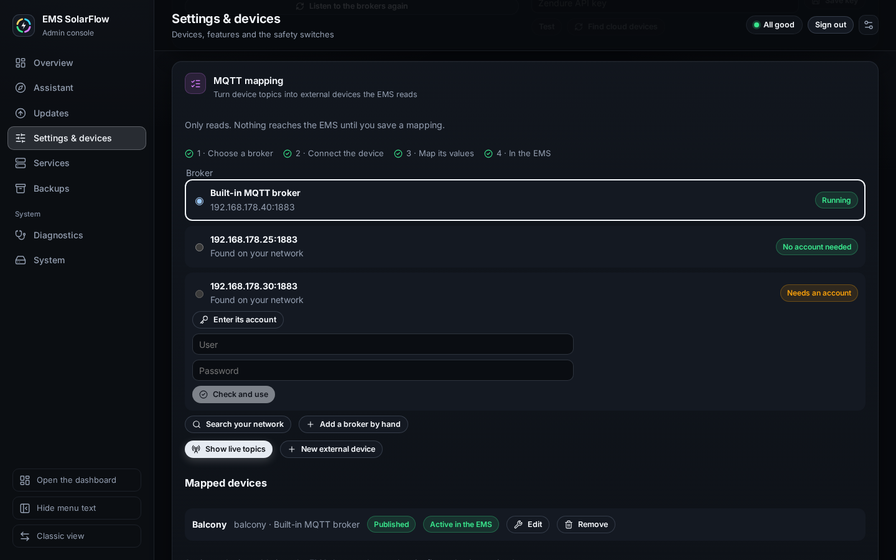
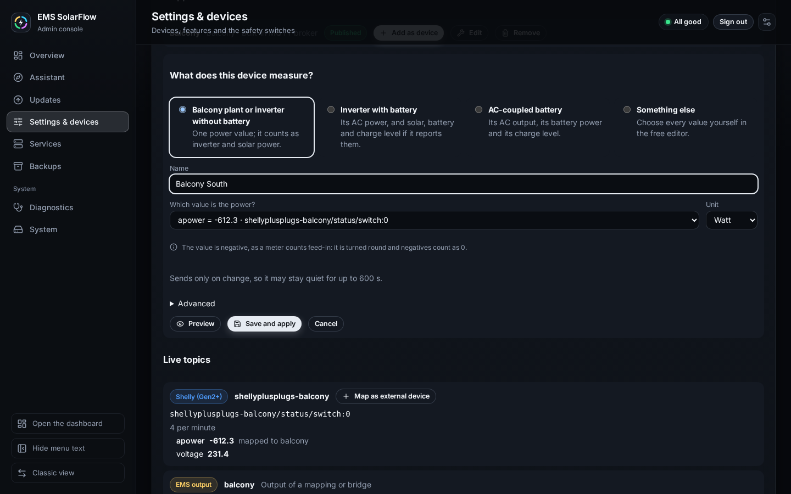

# Built-in MQTT broker and MQTT mapping

## Purpose

Bring a device that speaks MQTT in a format EMS does not know — a Shelly that
measures a balcony inverter, a Tasmota plug, an OpenDTU — into EMS as an
**external device**, without writing a bridge yourself. Two parts do it:

- the **built-in MQTT broker**, a Mosquitto the Admin Console starts beside EMS
  when you switch it on;
- the **MQTT mapping**, a small service that reads the topics you choose, turns
  their values into the [external-device standard](../external-devices.md)
  and publishes them as `ems-solarflow/<id>/state`.

Saving the mapping adds the device to EMS in the same step; no search has to
find it first. It only reads: an external device counts in the dashboard, the
house load and the statistics, and the regulation keeps working against the
grid meter. Nothing reaches EMS until you save a mapping.

## How the parts fit together

Solid arrows carry the readings; dotted arrows are what you do in the Admin
Console. The four steps, each with its section below; the panel shows them
above the broker list and marks the next one:

1. **Choose a broker**: switch the built-in one on, or keep the broker you
   already run.
2. **Connect the device**: enter the broker's address, port and an account in
   the device's own MQTT settings.
3. **Map its values**: pick them from the live topics. The mapping publishes
   them as `ems-solarflow/<id>/state` on the same broker, where EMS reads them.
4. **In the EMS**: the save that writes the mapping adds its device to EMS,
   which reads it once EMS restarts; under Settings, with no other changes
   waiting, the dialog offers that restart next.

## Prerequisites

- The Admin Console. Only the Admin switches the broker; the dashboard's
  maintenance status, `emsctl status` and `emsctl diagnose` only show its state:
  off, on, EMS connected or not, and who uses it.
- A fixed address for this host in your router: every device finds the broker
  by it.
- Docker Hub reachable the first time you switch the broker on (22 MB).

The mapping also works on a broker you already run (ioBroker, a Mosquitto of
your own), without the built-in one: see [Choose the broker](#choose-the-broker).

## Switch the broker on

**Settings → Add-ons → Built-in MQTT broker → Switch on.** In Guided Setup the
same card is in step 02, so the broker runs before you map devices.

The broker is off by default. The first time, a shared account `devices` with a
generated password is created and anonymous access stays off. **Show password**
shows it again whenever you need it for the next device; **Own password** in an
account's row sets one you choose. **Allow anonymous access** asks first, since
every device on your network may then read and publish without an account.

| Setting | Effect |
| --- | --- |
| Anonymous access on, no accounts | an open home broker |
| Anonymous access on, with accounts | both at once |
| Anonymous access off, one account | one shared account for every device |
| Anonymous access off, several accounts | per device or per vendor, optionally limited to a topic prefix |

**What EMS reads stays protected in every mode.** `ems-solarflow/` (the
external devices, the mapping's outputs among them), the Zendure topics (`iot/`,
`Zendure/`) and the topic of an MQTT grid meter on this broker cannot be read or
written by anonymous clients or by accounts without the matching option. The
regulation itself reads only the Zendure topics and the grid meter; protecting
`ems-solarflow/` keeps a device on a shared account from overwriting another
device's readings in the dashboard and the statistics:

- **May write ems-solarflow/ (bridge)** — for Node-RED or ioBroker that already
  publish the standard themselves;
- **Zendure devices** — for a Zendure device you point at this broker. Such an
  account reaches the Zendure topics only (and its topic prefix, if it has one):
  a device may report and answer there, but never send a device a command —
  only EMS does that. Give Zendure devices an account of their own; the shared
  `devices` account cannot take this option;
- the grid meter account chosen under the accounts. Choose one only the meter
  uses: every device on it may send grid readings, so the shared `devices`
  account cannot be it. A meter publishing under `Zendure/`, like a Zendure
  Smart Meter, needs an account with the **Zendure devices** option.

The grid meter's topic is protected within seconds of saving the meter, also
when the broker is already running. Let EMS read the meter through the built-in
broker's profile: read with another account, such as `devices`, it no longer
receives the protected topic, and the broker card says so.

**Stopping is always possible.** The dialog names what changes: external
devices are shown as stale after 60 s, a Zendure device on this broker is no
longer regulated and keeps its last setpoint, an MQTT grid meter on it fails.
Accounts, mappings and the image stay; switching on again needs no download.

## Connect a device

With the broker running, **Connect a device** on its card guides you:

1. Choose the device type — Shelly Gen2+, Shelly Gen1, Tasmota, OpenDTU/AhoyDTU
   or another — and follow its three or four steps. For a Shelly Gen2+ that is:
   Settings → MQTT, enable it, enter server, user and password, and switch on
   **Generic status update over MQTT**.
2. Copy the address, the port, the user and the password with the buttons
   beside them.
3. **Wait for the device…** shows the live topics; as soon as the device
   publishes, it appears with **Set it up now**.

## Choose the broker

Above the live topics, **Settings → Devices → MQTT mapping** (in Guided Setup,
step 02) lists every broker a mapping can read:

- the **built-in broker**, with **Switch on** right there while it is off;
- the brokers EMS already reads through a Local MQTT connection;
- the brokers your mappings already read;
- brokers **found on your network**: by Find devices, or by **Search your
  network**, which asks every address of your network on ports 1883 and 8883
  (up to a minute).

Each found broker is checked with a real login and says what it needs: *No
account needed*, *Account works* (a broker account you saved for the search
fits), or *Needs an account*: **Enter its account**, give user and password
and **Check and use**. *Certificate not trusted* is a TLS broker whose
certificate this host does not trust: add it by hand and tick **Accept its
certificate unchecked** if you know the broker. A broker the search does not
reach, such as one in another network, is added with **Add a broker by hand**:
address, port, optionally TLS, and its account if it has accounts.

A broker your mappings read can be checked again with **Check**: when its
account changed or got lost, it says *Needs an account* and takes a new one
the same way.

Choose a broker that can be read, then **Show live topics**. They list one
folded row per device, as the devices further down the page are listed: its
name, its kind, how many topics it sends on and the value that is likely its
power, and whether a mapping reads it — **Not mapped** with **Map as external
device**, or **Mapped:** and the mapping's id with **Edit**, with *· Waits for
an EMS restart* added while the running EMS has not read that device as saved.
A click on the row opens it to every topic and value, **Expand all** and
**Collapse all** open or fold every row at once, and **Find a device or topic**
narrows the list to the devices whose name, kind, topic or value path contains
what you type. Saving the first mapping on a found broker remembers it, so the
mapping keeps reading it after a restart; its account is kept with the search's
broker accounts. The device the mapping adds gets a connection of its own to
that broker, the same one Find devices would give a device it found there; on a
broker EMS already reads, it uses that connection.

## Map it

**Set it up now**, or **Map as external device** on a device in the live topics
under **Settings → Devices → MQTT mapping** (in Guided Setup, step 02), opens a
dialog named after the device, wherever on the page the button was. The dialog
keeps **Cancel**, **Preview** and **Save** at its foot, with the preview's answer
above them, and asks one question first:

1. **What does this device measure?**
   - *Balcony plant or inverter without battery*: one power value, counted as
     inverter and solar power.
   - *Inverter with battery*: its AC power, and solar, battery and charge level
     if it reports them.
   - *AC-coupled battery*: its AC output, its battery power and its charge
     level. The EMS counts a device by what it feeds into the house, so a
     battery needs its AC output too.
   - *Consumer (washing machine, heat pump, plug …)*: the one power value the
     device draws. It is published as `ems-consumer/<id>/state` and shown on
     the dashboard's [Consumers](../dashboard/consumers.md) page and in its
     energy flow; the EMS never regulates by it, because the grid meter already
     sees what it draws.
   - *Something else*: the free editor, where you choose every value.
2. Give it a name, and check **Which value is the power (W)?** — the likely
   value is already chosen; pick the unit (Watt or Kilowatt; for a charge level
   Percent or a share 0–1). For a plant without battery, a value that reads
   negative, as a Shelly counts feed-in, is turned round on its own and
   negatives count as 0. A battery's negative AC power may just mean it is
   charging, so there it only counts as 0: check in the preview that
   discharging shows as a positive value. A source may stay quiet for three of
   its measured intervals (60 to 900 s); one that sends only on change, or that
   has not been seen often enough to measure, may stay quiet for 600 s.
   **Advanced** holds the id, the topic and path and a free factor; a name
   already in use gets a number in its id.
3. **Preview** asks the service's own calculation what it would publish, and
   why not; a refused negative value has a **Correct** button in the free
   editor. **Save and add to the EMS** writes the mapping and adds its device
   to EMS, after one confirmation that names both: the settings are saved at
   once, with a backup first. EMS reads a newly added device only after a
   restart, so under Settings the dialog stays open for that last step: it
   says *Saved and added to the EMS* and *… becomes active once EMS
   restarts.*, what a restart does, and offers **Restart EMS now** and **Map
   another device**:
   - **Restart EMS now** restarts EMS right there; the button is the
     confirmation. The dialog then says how it went, waits for the restarted
     EMS to report what it reads, and says *EMS has restarted and reads …
     now.*; **Done** closes it onto the device's row. When the restarted EMS
     does not tell this console what it reads, the dialog says so: at once for
     an EMS of a later release that cannot tell it, and after two minutes
     otherwise, for one of an earlier release, which does not say when it
     started, or when no restarted EMS has reported. A restart that fails says why and can be tried again.
   - **Map another device** closes it onto the live topics' search, or, with no
     live topics listed, opens the dialog for a new device, so you can map
     several devices and restart once at the end; the step then names every
     device that waits, *Waiting for an EMS restart: …*.
   - Closing the dialog leaves the restart for later. Right below the mapped
     devices the panel keeps offering it, and names the devices that wait,
     until the running EMS reads them as saved, in any tab and after the page
     is opened again, while the running EMS says what it reads; otherwise the
     overview's *Saved settings are newer than the running EMS* offers it.

   The same step follows a rename, and a removal that took the EMS device with
   it, where **Restart later** closes it. A device removed and mapped again
   before EMS restarted is *added again*: EMS reads it as it was until the
   restart. A save the running EMS already reads as saved, such as a name set
   back or a device mapped again unchanged, ends no step. Where the Admin
   cannot restart EMS, for instance without the container setup, **Restart EMS
   now** stays off and says why. In Guided Setup the setup's own deployment
   starts EMS with the device. Under Settings the device is named after the
   mapping's name, unless another device has it; with other changes waiting
   there, it joins them, is saved with them, and the dialog closes at once. In
   Guided Setup it joins the setup's devices under the setup's next free name.

   **Edit** on a mapped device opens the free editor in the same dialog, with
   every source's factor, sign, negative rule and maximum age. Below them the
   live topics list the device's own topics first and open; **Use as …** beside
   a value adds it as a source of the value chosen above. Once saved, the dialog
   closes and the device's row is marked and brought into view; when the save
   added, moved or renamed the EMS device, the restart step comes first, and
   **Done** or closing it leads to the row:

   
4. Its row says **Waits for an EMS restart** while the running EMS has not read
   what is saved for it, and **Active in the EMS** once it runs the device as
   saved, switched on. Switching a mapped device on or off waits for a restart
   too, as EMS reads it from the settings file only when it starts. It asks the
   running EMS itself, which names the devices it read when it started, so this
   holds in any tab, after a reload and after a restart from the command line.
   Otherwise it says **In the EMS**: for a
   device switched off, and while no running EMS says what it read, because
   none runs or it is of another release. An EMS that has just stopped still
   counts as running for a while, at least a minute, as on the Diagnose page.
   Once the mapping service has sent the first value it also says
   **Published**; until then **Waiting for the first value**. When the device
   could not be added, for instance while the broker was off, the row says why
   and **Add to the EMS** tries again.

A mapped device and its EMS device stay one thing. A new name in **Edit**
renames the EMS device too, when no other device has that name, and the
confirmation says so; a save that leaves the name alone leaves the EMS device's
name alone too, also one you gave it under **Devices**. A rename that did not
happen is offered again with **Try again**, or made under **Devices**. **Remove** asks whether to remove the EMS device as well;
keep it only when you move the device to another broker, see below. EMS uses a
new name, and drops a removed device, after a restart, as for any change to a
device under Settings.

### Renaming a consumer

A consumer's energy and power history belong to its device id, so a new name,
or a move to another broker, keeps them. When the consumer has recorded values,
saving the change asks first, with what it recorded and when it last drew:

- **Carry them along** — the consumer counts on from them under its new name.
- **Begin anew** — it starts at zero; the old values stay on the dashboard's
  Consumers page as a former consumer, with the day it last drew.

The same question comes, as **Take them over** or **Begin anew**, when a new
consumer would continue values recorded before: under its own device id, or
under a removed consumer of the same name — a new meter under the old washing
machine, say. Closing the question writes nothing. In the settings' review the
questions stand above **Apply**, which waits for an answer to each. The answer
is written as the consumer's `history_id` (see
[Configuration](../../technical/configuration.md)).

## Expected result

The mapping publishes the device every 15 s, retained, with an expiry of 45 s.
It falls silent as soon as one of its sources is older than its maximum age or a
value would be refused by EMS (a negative inverter power, a charge level above
100 %); EMS then shows the device as stale after 60 s.

## Warnings and common problems

- **Would not publish: a value the EMS would refuse** — usually the sign: invert
  it.
- **A source is too old** — the device sends only on change; raise the maximum
  age.
- **Port in use** — another broker runs on this host; choose another port or
  map on that broker instead.
- A settings backup carries the account passwords. Restored in the Admin
  Console, the broker is set up again with them as the restore's last step, so
  devices keep connecting with the password they were given, also after a
  re-flashed card.
- **The id … already comes from …** — the search saw another broker publish
  that id, and EMS does not read it there. EMS reads an id from one broker
  only, so a new mapping takes another id; the guide never proposes one
  another broker has. To move a mapped device to another broker under its id,
  remove its mapping on the old broker and keep its EMS device, then map it on
  the new one and set its id under **Advanced**: saving moves the EMS device to
  the new broker. Until it has moved, the row says **The EMS reads this id from
  another broker** and **Move to this broker** moves it. A mapping saved before
  the other broker appeared keeps
  saving, and the live topics say where else its id comes from.
- **Not added: the server offers no device for this mapping now** — its broker
  is off, or its account is no longer saved. Switch the broker on or give it
  its account again, then **Add to the EMS** in the row.
- **Not done: the settings changed meanwhile** — another page or console saved
  the settings between reading and writing them; nothing was written to them.
  Check them, then use **Add to the EMS** or **Try again** in the row. When the
  mapping was removed but its EMS device was not, the panel says so above the
  mapped devices; remove the device under **Devices**.
- `emsctl diagnose` reports `mqtt_broker_stopped_in_use`,
  `mqtt_broker_profile_missing`, `mqtt_mapping_device_silent` and
  `external_device_second_source`.

## Recovery or next steps

- A device stays stale: open the mapping, **Preview** it and follow the reason.
- The broker does not start: free the port or choose another, then switch on
  again; nothing was saved while it failed.
- Files, containers and accounts:
[configuration reference](../../technical/configuration.md#built-in-mqtt-broker-and-mqtt-mapping).
