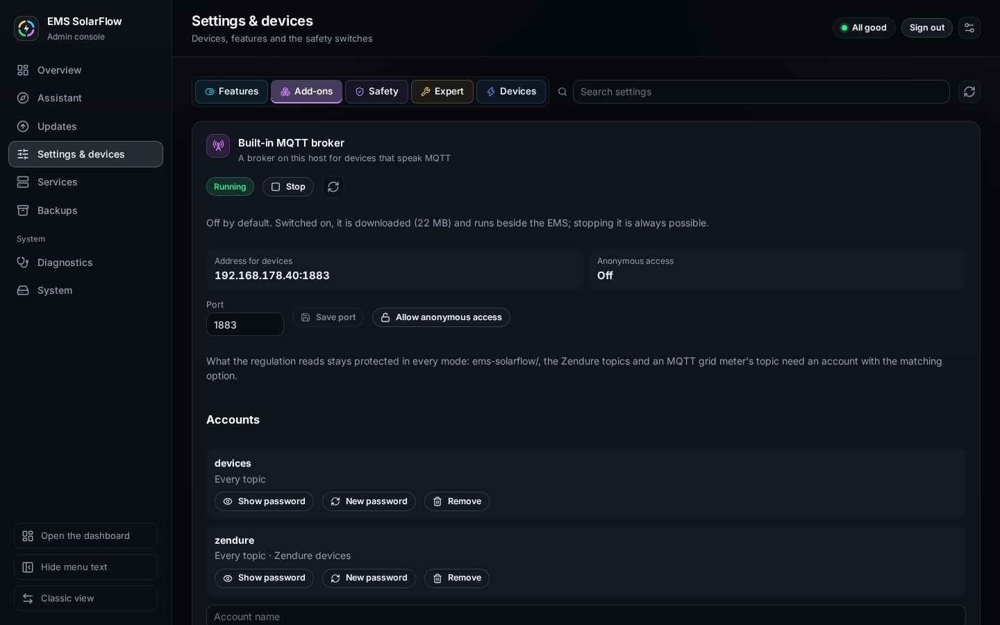
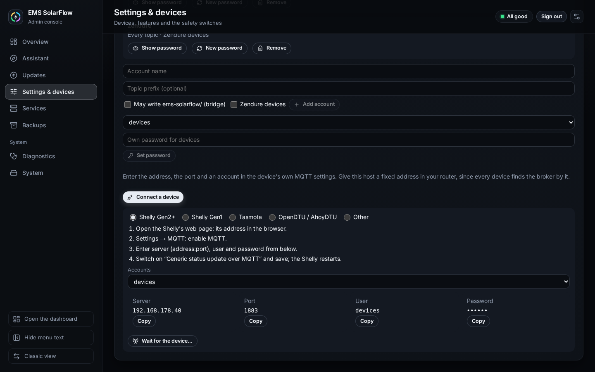
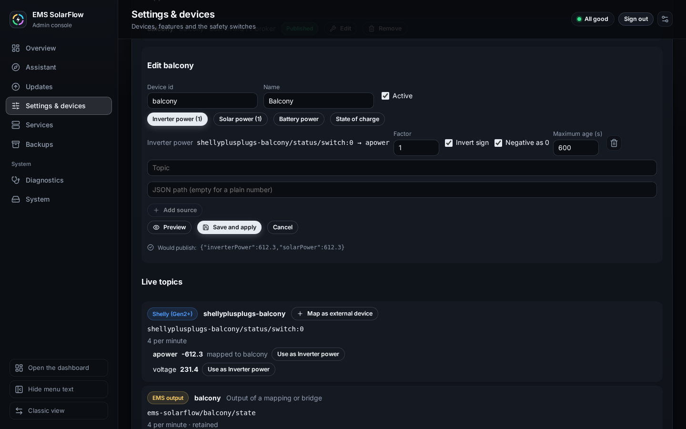
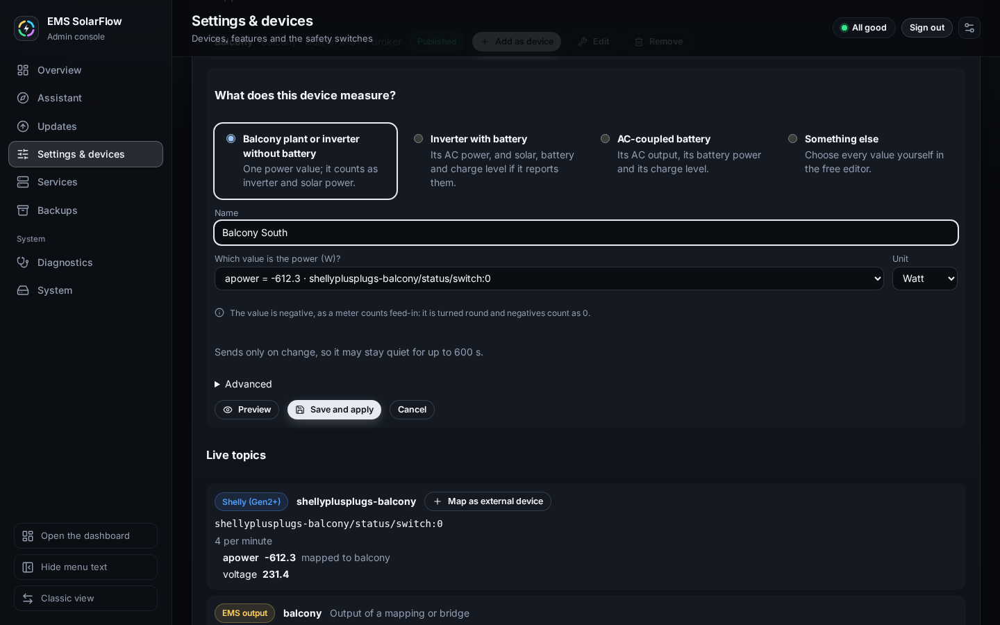
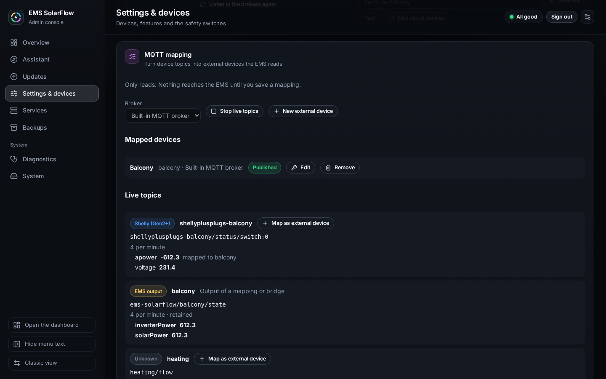

# Built-in MQTT broker and MQTT mapping

## Purpose

Bring a device that speaks MQTT in a format EMS does not know — a Shelly that
measures a balcony inverter, a Tasmota plug, an OpenDTU — into EMS as an
**external device**, without writing a bridge yourself. Two parts do it:

- the **built-in MQTT broker**, a Mosquitto the Admin Console starts beside EMS
  when you switch it on;
- the **MQTT mapping**, a small service that reads the topics you choose, turns
  their values into the [external-device standard](../external-devices.md)
  and publishes them as `ems-solarflow/<id>/state`.

EMS then finds the device under **Find devices** like any bridge's output. It
only reads: an external device counts in the dashboard, the house load and the
statistics, and the regulation keeps working against the grid meter. Nothing
reaches EMS until you save a mapping.

## Prerequisites

- The Admin Console. Only the Admin switches the broker; the dashboard's
  maintenance status, `emsctl status` and `emsctl diagnose` only show its state:
  off, on, EMS connected or not, and who uses it.
- A fixed address for this host in your router: every device finds the broker
  by it.
- Docker Hub reachable the first time you switch the broker on (22 MB).

The mapping also works on a broker you already run (ioBroker, a Mosquitto of
your own): choose that local MQTT profile instead of the built-in broker.

## Switch the broker on

**Settings → Add-ons → Built-in MQTT broker → Switch on.** In Guided Setup the
same card is in step 02, so the broker runs before you map devices.

The broker is off by default. The first time, a shared account `devices` with a
generated password is created and anonymous access stays off. **Show password**
shows it again whenever you need it for the next device.

| Setting | Effect |
| --- | --- |
| Anonymous access on, no accounts | an open home broker |
| Anonymous access on, with accounts | both at once |
| Anonymous access off, one account | one shared account for every device |
| Anonymous access off, several accounts | per device or per vendor, optionally limited to a topic prefix |

**What the regulation reads stays protected in every mode.** `ems-solarflow/`
(the mapping's outputs), the Zendure topics (`iot/`, `Zendure/`) and the topic
of an MQTT grid meter on this broker cannot be read or written by anonymous
clients or by accounts without the matching option:

- **May write ems-solarflow/ (bridge)** — for Node-RED or ioBroker that already
  publish the standard themselves;
- **Zendure devices** — for a Zendure device you point at this broker;
- the grid meter account chosen under the accounts.

**Stopping is always possible.** The dialog names what changes: external
devices are shown as stale after 60 s, a Zendure device on this broker is no
longer regulated and keeps its last setpoint, an MQTT grid meter on it fails.
Accounts, mappings and the image stay; switching on again needs no download.

## Connect a device

With the broker running, **Connect a device** on its card guides you:

1. Choose the device type — Shelly Gen2+, Shelly Gen1, Tasmota, OpenDTU/AhoyDTU
   or another — and follow its three or four steps. For a Shelly Gen2+ that is:
   Settings → MQTT, enable it, enter server, user and password, and switch on
   **Generic status update over MQTT**.
2. Copy the address, the port, the user and the password with the buttons
   beside them.
3. **Wait for the device…** shows the live topics; as soon as the device
   publishes, it appears with **Set it up now**.

## Map it

**Set it up now**, or **Map as external device** on a group under **Settings →
Devices → MQTT mapping** (in Guided Setup, step 02), asks one question first:

1. **What does this device measure?**
   - *Balcony plant or inverter without battery*: one power value, counted as
     inverter and solar power.
   - *Inverter with battery*: its AC power, and solar, battery and charge level
     if it reports them.
   - *AC-coupled battery*: its AC output, its battery power and its charge
     level. The EMS counts a device by what it feeds into the house, so a
     battery needs its AC output too.
   - *Something else*: the free editor, where you choose every value.
2. Give it a name, and check **Which value is the power (W)?** — the likely
   value is already chosen; pick the unit (Watt or Kilowatt; for a charge level
   Percent or a share 0–1). For a plant without battery, a value that reads
   negative, as a Shelly counts feed-in, is turned round on its own and
   negatives count as 0. A battery's negative AC power may just mean it is
   charging, so there it only counts as 0: check in the preview that
   discharging shows as a positive value. A source may stay quiet for three of
   its measured intervals (60 to 900 s); one that sends only on change, or that
   has not been seen often enough to measure, may stay quiet for 600 s.
   **Advanced** holds the id, the topic and path and a free factor; a name
   already in use gets a number in its id.
3. **Preview** asks the service's own calculation what it would publish, and
   why not; a refused negative value has a **Correct** button in the free
   editor. **Save and apply** writes the mapping; EMS does not restart.

   **Edit** on a mapped device opens the free editor with every source's
   factor, sign, negative rule and maximum age:

   
4. Once it is published, **Add as device** in its row adds it through the same
   adoption as Find devices; save the settings (in Guided Setup, it joins the
   setup draft).

## Expected result

The mapping publishes the device every 15 s, retained, with an expiry of 45 s.
It falls silent as soon as one of its sources is older than its maximum age or a
value would be refused by EMS (a negative inverter power, a charge level above
100 %); EMS then shows the device as stale after 60 s.

## Warnings and common problems

- **Would not publish: a value the EMS would refuse** — usually the sign: invert
  it.
- **A source is too old** — the device sends only on change; raise the maximum
  age.
- **Port in use** — another broker runs on this host; choose another port or
  map on that broker instead.
- A settings backup carries the account passwords. Restored in the Admin
  Console, the broker is set up again with them as the restore's last step, so
  devices keep connecting with the password they were given, also after a
  re-flashed card.
- `emsctl diagnose` reports `mqtt_broker_stopped_in_use`,
  `mqtt_broker_profile_missing` and `mqtt_mapping_device_silent`.

## Recovery or next steps

- A device stays stale: open the mapping, **Preview** it and follow the reason.
- The broker does not start: free the port or choose another, then switch on
  again; nothing was saved while it failed.
- Files, containers and accounts:
[configuration reference](../../technical/configuration.md#built-in-mqtt-broker-and-mqtt-mapping).
