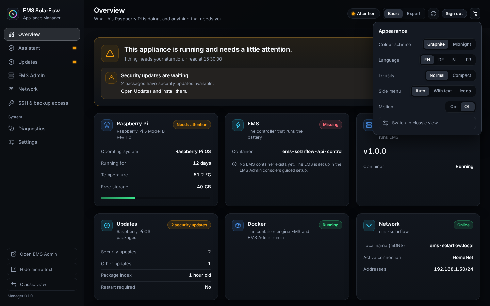
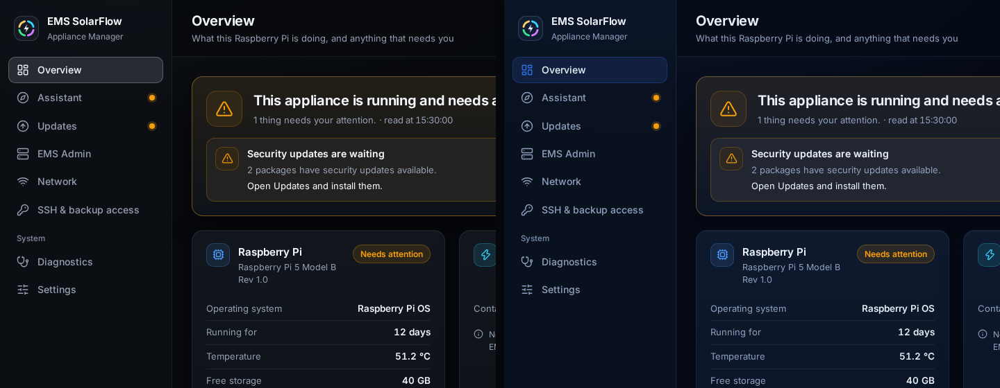
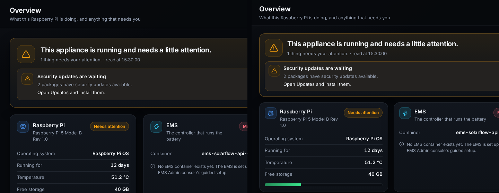
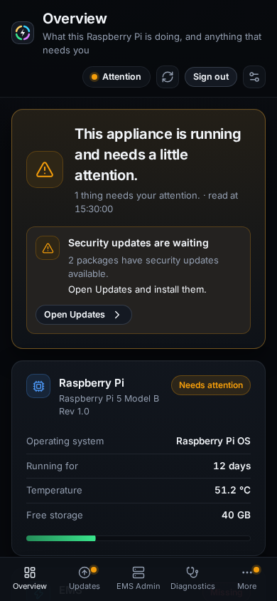
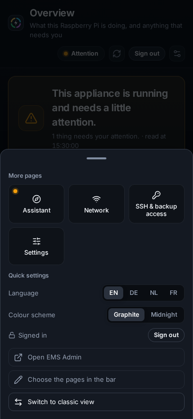

# Appearance, language and phone

## Purpose

Make the Appliance Manager read well where you use it: in your language, in the
colour scheme and density that suit the screen, with the side menu as wide as
you want it, and on a phone.

## When to use this workflow

- You want the console in German, Dutch or French.
- You prefer the other colour scheme, or want more on the screen at once.
- You manage the appliance from a phone.

## Prerequisites

- The console open. The language can be chosen before you sign in; everything
  else is in the console. These are choices of your browser, not settings of
  the appliance.

## Step-by-step instructions

### 1 — Open the Appearance menu

**What you select:** the **Appearance** button, the sliders icon at the right
end of the top bar.

**What you see:** **Appearance** with five choices and the way to the old
design:

| Choice | Values |
| --- | --- |
| **Colour scheme** | **Graphite** (the default, neutral near-black) or **Midnight** (deep navy) |
| **Language** | **EN**, **DE**, **NL**, **FR** — numbers and dates follow the language |
| **Density** | **Normal** or **Compact** |
| **Side menu** | **Auto** (text beside the icons on a desktop, icons only below 1024 px), **With text** or **Icons** |
| **Motion** | The console's small movements, such as the sheet sliding in on a phone, **On** or **Off** |

**Switch to classic view** opens the deprecated Classic console. **Hide menu
text** at the foot of the side menu switches the text beside the icons as well,
and is kept like the choice in the menu.

### 2 — Choose a colour scheme

Left **Graphite**, right **Midnight**. Only the surfaces and the accent colour
change; nothing moves. The colours that carry meaning are the same in both,
and the same as in the EMS Admin console and on the EMS Dashboard: a healthy
state stays green, a warning amber and a fault red.

### 3 — Choose a density

Left **Normal**, right **Compact**. Compact takes less room around and between
everything, so more fits on the screen at once. Colour and text size stay the
same.

### 4 — Choose a language

Select **DE**, **NL** or **FR** — in the Appearance menu, under **More** on a
phone, or at the foot of the sign-in card. Every page, menu and message the
console words itself changes at once, and so do numbers and dates.

Some sentences come from the appliance itself: why it refused a plan, what a
step of an operation is called, what a repair check found, a message it raised
that this console has no words for. They stay in English when the console has
no translation; the action they describe is the same.

## On a phone

On a narrow screen the side menu gives way to a bar at the bottom with four
pages — **Overview**, **Updates**, **EMS Admin** and **Diagnostics** until you
choose others: what a recovery visit needs first — and **More**. The cards stack
in one column. The **Basic** / **Expert** switch moves to **Settings**, under
**Detail level**.

**More** opens a sheet with the other pages (**Assistant**, **Network**, **SSH
& backup access**, **Settings**), **Quick settings** for the language and the
colour scheme, **Sign out**, **Open EMS Admin**, **Choose the pages in the bar**
and **Switch to classic view**. To change the bar, choose **Choose the pages in
the bar**, tap two pages to swap them — one **In the bar**, one **Under More** —
and **Done**; **Default pages** puts the four back. Swipe the sheet down or tap
its handle to close it. A dot on **More** says that a page under it has
something waiting.

## What happens in the background

- Each choice is stored by the browser you made it in, under the console's
  address. A phone and a laptop can each have their own. They are not appliance
  state and change nothing on the Raspberry Pi.
- The EMS Admin console and the EMS Dashboard are separate addresses, so their
  choices are separate too, although they offer the same ones.
- The Classic console keeps its own appearance; changing one never changes the
  other.
- A system that asks for reduced motion gets none, whatever **Motion** says.

## Expected result

The console opens in your language, colour scheme, density and menu width
every time, in this browser.

## Warnings and common problems

| Symptom | Meaning | What to do |
| --- | --- | --- |
| Another browser shows the default again | The choices belong to the browser they were made in | Choose them there too |
| A message is in English | It comes from the appliance and has no translation | It is still accurate; report it if it matters to you |
| The address opens the Classic console | `?ui=classic` in the address, or a browser too old for Modern | See [The deprecated Classic console](index.md#the-deprecated-classic-console) |

## Recovery or next steps

- The pages and the menu → [Appliance guides](index.md#the-pages)
- The same choices in the EMS Admin console →
  [Admin appearance](../admin/appearance.md)
