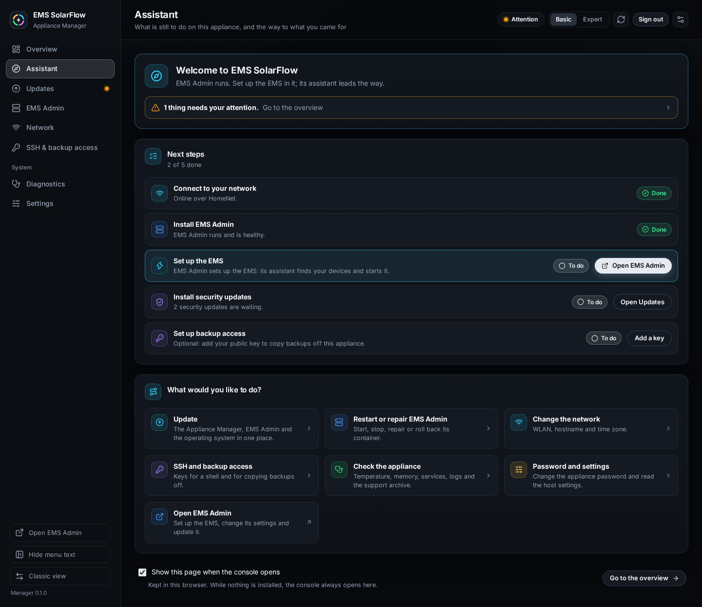

# The assistant

## Purpose

The assistant is the Appliance Manager's starting page. It answers two
questions for someone who opens the console and is not sure what to do:
**what is still to do on this Raspberry Pi**, and **where do I go for what I
came to do**. It lists the steps from a freshly flashed card to a running EMS,
each with its state, highlights the one to do next, and links to the page that
does it.

It exists for three moments:

- **A freshly flashed card.** Nothing is installed yet, and the console has
  eight pages. The assistant says which one matters now: install EMS Admin,
  and then set up the EMS in it.
- **You do not know where to start.** The steps say, in plain words, what each
  part of the appliance is doing and what is missing.
- **Coming back later.** Months after the setup it shows at a glance whether
  anything is left open — a security update waiting, EMS Admin not answering,
  no key to copy backups off — and keeps the common tasks one click away.

The assistant only reads and links. It never installs, restarts, changes or
deletes anything by itself.

## When to use this workflow

- The console opens on it: that is the normal start, see
  [When the assistant opens](#when-the-assistant-opens).
- You want to check that the appliance is complete and up to date.
- You know what you want to do (update, change the WLAN, copy a backup off) but
  not which page does it.

## Prerequisites

- You are signed in — see [First start](first-start.md).
- Nothing else. The assistant works on a card that has nothing installed, on a
  half-finished appliance and on one that runs the EMS.

## When the assistant opens

| You open | The console shows |
| --- | --- |
| The bare address, `http://ems-solarflow.local:8088/` | The assistant, while **Show this page when the console opens** is ticked (it is, until you untick it) |
| The bare address with the box unticked | The **Overview** — except while nothing is installed, see below |
| The bare address while nothing is installed | Always the assistant, whatever the box says |
| An address that names a page, such as `…:8088/#/updates` | That page. A bookmark or a link to a page is never redirected |

Some details worth knowing:

- **The choice belongs to the browser.** It is kept in this browser only. A
  second browser, a phone or a private window starts with the box ticked again.
- **Nothing installed overrides the choice.** While the appliance has no EMS
  Admin deployment and no EMS Admin container — a freshly flashed card — the
  console always opens on the assistant. That holds even while Docker does not
  run: without Docker, the missing deployment files are what say that nothing
  is installed.
- **With the box unticked, the console waits for the answer.** It needs to
  know whether anything is installed before it can choose, so it opens once the
  appliance has said so, however many reads fail first. With the box ticked it
  opens the assistant straight away.
- **It happens once per load, without a history entry.** The console replaces
  its bare address with the assistant's, so the browser's Back button leaves
  the console rather than bouncing you back to it. Moving between pages
  afterwards never sends you to the assistant again, and a page you open, or a
  switch to the Classic view, before the console has chosen is left alone.
- **You can always open it from the menu.** **Assistant** is the second entry
  of the side menu, right below **Overview**. On a phone it is under **More**.
- **The menu shows when something is left.** An amber dot beside
  **Assistant** means EMS Admin or EMS is not installed or not running; a
  quieter dot, white or blue as the colour scheme has it, means security
  updates are waiting, or the network has no gateway to the outside or asks
  for a sign-in. A network with a gateway that does not reach the internet,
  and backup access, which is optional, stay steps on the page and never mark
  the menu. On a phone the dot sits on **More**.

## Step-by-step instructions

### 1 — Read the welcome

**What you see:** *Welcome to EMS SolarFlow*, and one sentence that says what
the appliance is right now:

| The appliance | The welcome says |
| --- | --- |
| Docker does not run, or is not installed | *Docker does not run on this appliance, so nothing can be installed or started.* |
| Nothing is installed yet | *This appliance is ready for the EMS. Install EMS Admin first; it then sets up the EMS.* |
| EMS Admin is there but not ready: stopped, starting, failing its health check, missing or being replaced | *EMS Admin is not ready yet. The steps below say why and what to do.* |
| EMS Admin runs and is healthy, and there is no EMS container yet | *EMS Admin runs. Set up the EMS in it; its assistant leads the way.* |
| The EMS container exists but does not run | *The EMS is set up but does not run. EMS Admin shows why.* |
| The EMS runs | *This appliance runs the EMS. Here is what is still open, and the way to what you came for.* |
| The status could not be read, or does not say enough | *The appliance status could not be read.* |

The rows are checked in this order: Docker first, because without it nothing
else can be told; a running EMS wins over anything EMS Admin reports, because
the EMS keeps running when EMS Admin does not.

**The attention line.** When the [Overview](overview.md) lists something that
needs your attention, a line under the welcome says so — *1 thing needs your
attention.* or *3 things need your attention.* — and **Go to the overview**
leads there. It counts exactly what the Overview lists, including the
console's own findings about this session, such as a password that still has
to be confirmed.

**What it changes:** nothing.

### 2 — Work through the next steps

**What you see:** the **Next steps** card with five rows, in the order a fresh
appliance takes them:

1. **Connect to your network**
2. **Install EMS Admin**
3. **Set up the EMS**
4. **Install security updates**
5. **Set up backup access** — optional

The card's subtitle counts the done rows: *2 of 5 done*, or *Everything is set
up.* once all five are done, the optional one included. While a row cannot be
told yet, no count is shown at all, so a count never claims more than the
appliance has said.

Each row has a state on its right:

| State | Meaning |
| --- | --- |
| **Done** | The fact the step checks is true on this appliance |
| **To do** | It is not, and the row carries the button that does it |
| **Later** | It waits for an earlier step: the EMS is set up in EMS Admin, so it waits until EMS Admin runs and is healthy |
| **Unknown** | The fact could not be read just now, is still loading, or is changing: EMS Admin starting or being replaced. Never shown as done |

**The next step** is the first row that is **To do**, leaving out the optional
backup access. Only once nothing else is to do does **Set up backup access**
become the next step. The next step is highlighted with a coloured frame, and
its button is the primary one. Rows further down that are also **To do** keep
their buttons, in the quieter style.

**What you select:** the button of the highlighted step.

**What it changes:** nothing yet. Every button opens the page where the work is
done; nothing happens until you read and confirm a plan there.

**Expected result:** after you finish the work and come back, the row reads
**Done** and the next row is highlighted.

### 3 — Know how each step decides

Each step looks at one fact the console already reads for the
[Overview](overview.md) and the **SSH & backup access** page, and nothing else.

**Connect to your network** is **Done** when the appliance reports full
connectivity, and then says over which connection: *Online over HomeNet.* When
it reports limited connectivity, a login page or none, the row is **To do** —
*The appliance is not fully online. Check its WLAN on the Network page.* — and
**Open the network** opens [Network](network.md). Until the appliance has
reported its connectivity, the row is **Unknown**: *This could not be read
just now.*

**Install EMS Admin** goes by what Docker and the EMS Admin deployment report,
Docker first:

| The appliance reports | The row says | State and button |
| --- | --- | --- |
| Docker is stopped or not installed | *Docker does not run, so EMS Admin cannot run either. Diagnostics says more.* | **To do**, **Open Diagnostics** |
| No EMS Admin deployment and no container: a fresh card | *Nothing is installed yet. EMS Admin sets up the EMS and keeps it up to date.* | **To do**, **Install EMS Admin**, which opens the EMS Admin page |
| A deployment, but the container is gone | *The EMS Admin container is gone. Repair it on the EMS Admin page.* | **To do**, **Restart or repair** |
| The container exists but does not run | *EMS Admin is installed but does not run. Start or repair it.* | **To do**, **Restart or repair** |
| It runs, and its health check has not answered yet | *EMS Admin is starting; its health check has not answered yet.* | **Unknown**, no button: wait |
| It runs, and its health check fails | *EMS Admin runs, but its health check fails. Restart or repair it.* | **To do**, **Restart or repair** |
| The EMS Admin console is replacing itself, during its own update | *EMS Admin is being replaced right now.* | **Unknown**, no button: wait |
| It runs and is healthy (or has no health check) | *EMS Admin runs and is healthy.* | **Done** |

**Restart or repair** opens the [EMS Admin page](recovery.md#ems-admin-or-the-ems-is-not-running),
where restarting and repairing are plans you confirm.

**Set up the EMS** goes by the EMS container, by the name the appliance's
deployment gives it:

| The appliance reports | The row says | State and button |
| --- | --- | --- |
| The EMS container runs | *The EMS runs.* | **Done** — whatever EMS Admin reports |
| EMS Admin is not done yet, including while it starts | *Comes after an earlier step.* | **Later** |
| EMS Admin is healthy, and no EMS container exists | *EMS Admin sets up the EMS: its assistant finds your devices and starts it.* | **To do**, **Open EMS Admin** |
| EMS Admin is healthy, and the EMS container exists but does not run | *The EMS container is there but does not run. Look at it in EMS Admin.* | **To do**, **Open EMS Admin** |
| The EMS Admin state or Docker's containers could not be read | *This could not be read just now.* | **Unknown** |

**Open EMS Admin** opens the EMS Admin console in a new tab, at this
appliance's address and the EMS Admin port. Its own
[assistant](../admin/assistant.md) then leads through the guided setup:
choosing the version, finding your devices and starting the EMS. The button is
there only while EMS Admin is installed and its port could be read from the
appliance's settings.

**Install security updates** goes by the operating-system update check:

| The appliance reports | The row says | State |
| --- | --- | --- |
| Security updates are waiting | *2 security updates are waiting.* | **To do**, **Open Updates** |
| The update check failed, or the package manager needs recovery | *The update check failed; the Updates page says why.* | **To do**, **Open Updates** |
| None are waiting | *No security updates are waiting.* | **Done** |
| The check has not answered yet | *This could not be read just now.* | **Unknown** |

A package index that is merely old does not count as a failed check. **Open
Updates** opens [Updates](updates.md#the-operating-system), where the install
is a plan you confirm.

**Set up backup access** is optional. It is **Done** when the read-only backup
account `ems-backup` has at least one public key — *Backups can be copied off
with your key.* — and **To do** otherwise: *Optional: add your public key to
copy backups off this appliance.* **Add a key** opens
[SSH & backup access](backup.md). If the backup account could not be read, the
row is **Unknown**.

### 4 — Go where you came for

**What you see:** **What would you like to do?**, tiles that lead straight to
the page for each task:

| Tile | Opens |
| --- | --- |
| **Update** | **Updates** — the Appliance Manager, EMS Admin and the operating system in one place |
| **Restart or repair EMS Admin** | **EMS Admin** — start, stop, repair or roll back its container |
| **Change the network** | **Network** — WLAN, hostname and time zone |
| **SSH and backup access** | **SSH & backup access** — keys for a shell and for copying backups off |
| **Check the appliance** | **Diagnostics** — temperature, memory, services, logs and the support archive |
| **Password and settings** | **Settings** — change the appliance password and read the host settings |
| **Open EMS Admin** | The EMS Admin console, in a new tab — set up the EMS, change its settings and update it |

The six tiles are always there, on a fresh card too. **Open EMS Admin** joins
them once EMS Admin is installed and its address is known.

### 5 — Keep the assistant, or turn it off

**What you see:** at the foot of the page, the box **Show this page when the
console opens** with the hint *Kept in this browser. While nothing is
installed, the console always opens here.*, and **Go to the overview**.

**To turn it off:** untick the box. From the next time you open the console at
its bare address, it opens on the **Overview** instead — unless nothing is
installed.

**To turn it back on:** open **Assistant** from the menu and tick the box again.

**What it changes:** only this browser's choice. Nothing is saved on the
appliance, and other browsers keep their own choice.

## What happens in the background

- The assistant asks the appliance nothing of its own. It reads the same host
  status the Overview reads, which the console refreshes on its own every few
  seconds, and the backup-account listing the **SSH & backup access** page
  reads, and turns them into steps.
- A step is never shown as done on missing information. An answer that is still
  loading or could not be read makes the step **Unknown**, and the count is
  left out until every step is known.
- Its buttons are links. Installing EMS Admin, updating, changing the WLAN and
  adding a key still go through their own page, where the appliance makes a
  plan that you read and confirm.
- The choice to open here is stored in the browser, under the console's
  address, like the appearance choices.

## Expected result

You know what is left to do on this appliance and have the button for it, and
the page for anything else you came to do is one click away.

## Warnings and common problems

| Symptom | Meaning | What to do |
| --- | --- | --- |
| The console opens on the Overview, not the assistant | The box was unticked in this browser | Open **Assistant** from the menu and tick **Show this page when the console opens** |
| The console opens on the assistant although the box is unticked | Nothing is installed on this appliance | Expected; it opens there until EMS Admin is installed |
| A dot stays beside **Assistant** in the menu | A step is still to do; backup access and a network whose gateway does not reach the internet never mark it | Open **Assistant**; the highlighted step is the one left. On a LAN without any gateway the network step and the dot stay; that is expected |
| A bookmark opens another page, not the assistant | The address names a page | Expected; open the bare address, or **Assistant** from the menu |
| **Install EMS Admin** stays **Unknown** | EMS Admin is starting, is replacing itself, or its state could not be read | Wait a minute; if it stays, look at the [EMS Admin page](recovery.md#ems-admin-or-the-ems-is-not-running) and **Diagnostics** |
| **Set up the EMS** stays **Later** | EMS Admin is not healthy yet | Do the **Install EMS Admin** row first |
| **Set up the EMS** has no button | The EMS Admin port could not be read from the appliance's settings | Press the refresh button in the top bar; the button comes back once the settings are read |
| **Set up backup access** stays **To do** after adding a key | The key was added to another account, such as the shell account | Add it for `ems-backup` on [SSH & backup access](backup.md) |

## Recovery or next steps

- Install EMS Admin → [First start](first-start.md#4--install-ems-admin)
- Set up the EMS → the EMS Admin console's [assistant](../admin/assistant.md)
  and [guided setup](../admin/guided-setup.md)
- Security updates → [Updates](updates.md)
- The page behind the attention line → [Overview page](overview.md)
- Copy backups off → [SSH & backup access](backup.md)
