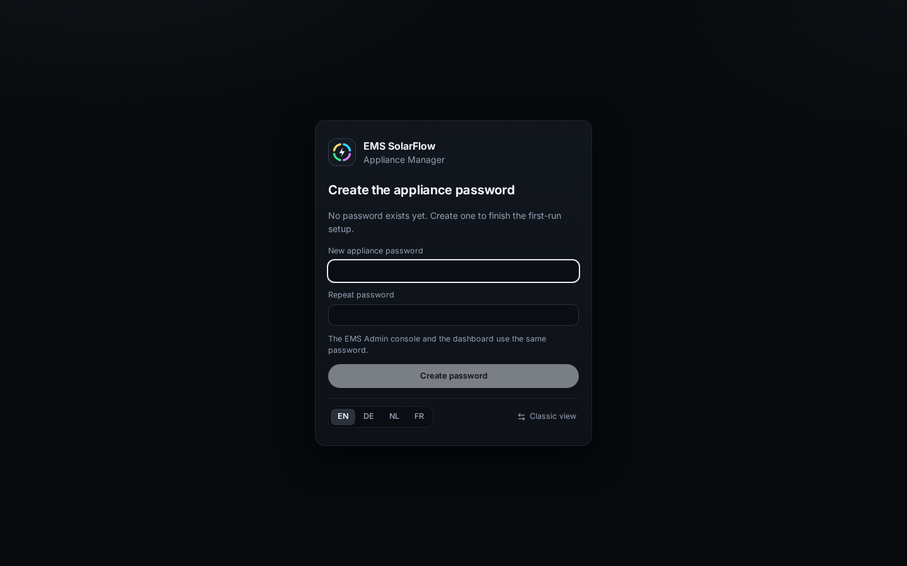
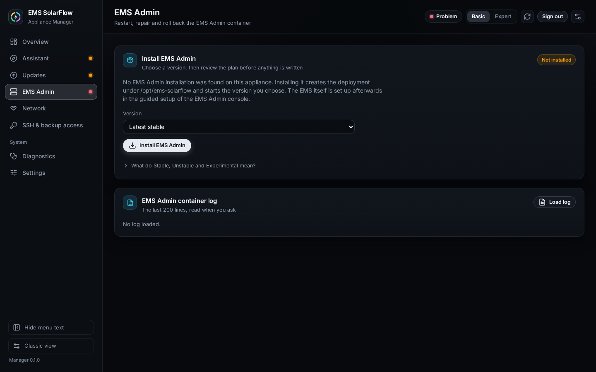
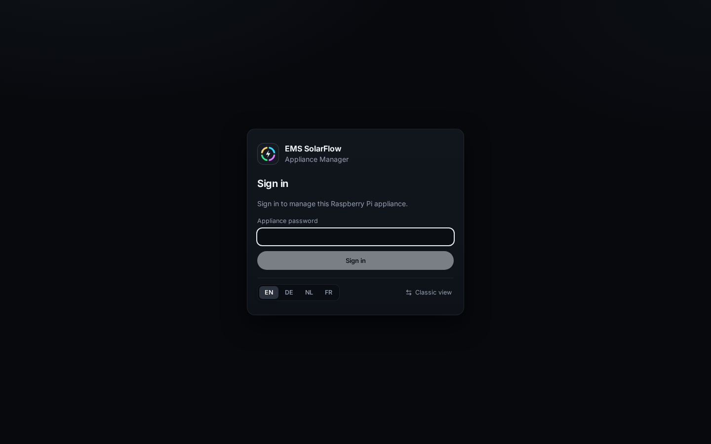
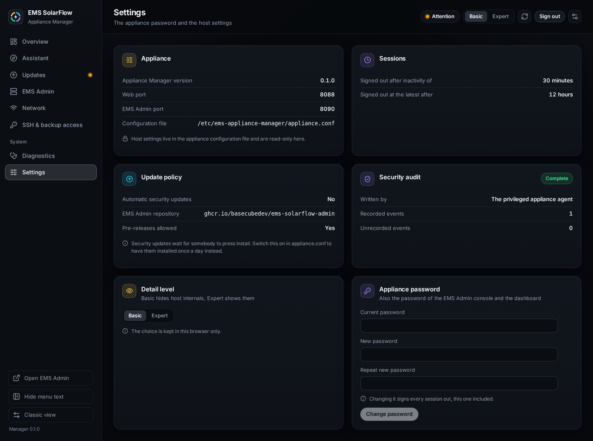

# First start

## Purpose

Find the appliance on your network, create its password, and take the first
steps the [assistant](assistant.md) lists: installing EMS Admin, which then
sets up the EMS. About ten minutes, most of it waiting for downloads.

## When to use this workflow

- The card is freshly written and the Raspberry Pi has just started.
- You come back to the appliance and need to sign in again.
- You want to know what the one password protects.

## Prerequisites

- The card is written, the Ethernet cable is in, and the Pi has been powered
  for at least three minutes. See [Flashing the card](install.md).
- A computer or phone on the same network, with a current browser: Chrome or
  Edge 114, Firefox 125 or Safari 17, or newer.

## Step-by-step instructions

### 1 — Open it in a browser

Try this address first:

```text
http://ems-solarflow.local:8088
```

That name is announced on your network by the appliance itself. It works out
of the box on macOS, on most Linux desktops, and on Windows 10 and 11.

**If the name does not resolve**, find the address instead:

- Open your router's admin page and look for a device called `ems-solarflow`
  in its list of connected clients.
- Then use `http://<that address>:8088`.

Both routes reach the same page. The name is more convenient; the address
always works.

### 2 — Create the password



**What you see:** *Create the appliance password* — *No password exists yet.
Create one to finish the first-run setup.* — with **New appliance password**
and **Repeat password**. The foot of the card chooses the language (**EN**,
**DE**, **NL**, **FR**) and holds **Classic view**, the deprecated older
console.

**What you enter:** a password, twice, then **Create password**.

There is no default password and no account name — one password protects the
whole console. It is the same password the EMS Admin console and the dashboard
ask for later, and changing it in any of the three changes it everywhere.

Choose something you can find again. There is no email recovery. If it is
lost, the way back is a keyboard at the appliance — sign in as `ems-rescue` and
run `sudo ems-appliance password-reset` — and failing that, writing the card
again. Re-flashing erases the whole card — configuration, data, on-box backups
and the password alike — so keep a backup somewhere else.

> The appliance serves plain HTTP on your local network. Anyone who can reach
> port 8088 sees the sign-in page, so a real password matters even at home.

**What it changes:** the password is stored on the appliance, and you are
signed in.

### 3 — Read the assistant

**What you see:** the console opens on the [assistant](assistant.md). On a
fresh card it says *This appliance is ready for the EMS. Install EMS Admin
first; it then sets up the EMS.*, and **Next steps** lists **Connect to your
network** (done, while the cable is in), **Install EMS Admin** as the
highlighted next step, **Set up the EMS** for later, **Install security
updates** and the optional **Set up backup access**.

Two things are worth doing before the next step:

1. **Set the time zone**, under **Network → Change the time zone**, if you do
   not live on UTC. EMS Admin takes the zone with it when it is installed and
   passes it to the EMS, whose hour-based control windows open in it; a change
   made afterwards does not reach the containers that already run. See
   [Network](network.md#4--set-the-time-zone).
2. **Set up WLAN**, if you do not want to keep the cable — see
   [Network](network.md). Do it with the cable still in, before you move the
   box.

### 4 — Install EMS Admin



**What you select:** **Install EMS Admin** in the assistant, or on the
Overview's quick actions. Both open the **EMS Admin** page.

**What you see:** the card **Install EMS Admin** — *Choose a version, then
review the plan before anything is written* — and what installing does: it
creates the deployment under `/opt/ems-solarflow` and starts the version you
choose. **Version** offers **Latest stable** and every published version,
grouped as **Stable**, **Unstable** and **Experimental**; a version this
appliance will not install is listed greyed out, with the reason. In Expert,
**Exact release tag** takes a tag you type.

**What you select:** keep **Latest stable**, press **Install EMS Admin**, read
the plan — *This creates the EMS Admin deployment; nothing exists to replace.*,
with the compose and environment files it writes — and press **Install**.

**What it changes:** the appliance downloads the EMS Admin image, checks it,
writes the deployment and starts the container. The banner at the top of the
page follows the steps; **Acknowledge** clears it once it says **Completed**.
On a slow card the download takes several minutes.

**Expected result:** the assistant shows **Install EMS Admin** as **Done**,
and **Open EMS Admin** appears at the foot of the side menu.

### 5 — Set up the EMS in EMS Admin

**What you select:** **Open EMS Admin** — on the assistant's **Set up the EMS**
row or at the foot of the side menu; both open it in a new tab, so the
Appliance Manager stays open in this one. The EMS Admin console answers on
port 8090 and asks for the same password.

From there, its own [assistant](../admin/assistant.md) and
[guided setup](../admin/guided-setup.md) choose the EMS version, find your
inverters and grid meter, and start the EMS. The Appliance Manager does not set
up the EMS itself.

## Signing in later



Every visit after the first asks for the password once, under **Sign in**,
without the second field. A session ends after 30 minutes without activity and
at the latest after 12 hours — the **Settings** page says what this appliance
uses. A console left open in a tab you are not looking at stops asking the
appliance, so it does not count as activity. The sign-in page then says *Your session ended. Sign in again to
continue.* **Sign out** is at the right of the top bar, and on a phone under
**More**.

After a restart of the Raspberry Pi you sign in again, and so does every
session after the password was changed: *The password was changed and every
session was signed out. Sign in with the new password.*

## One password for everything



The password you set here is the same one you use for the EMS Admin console and
the dashboard. You set it once, and you can change it later from either side:
in the Appliance Manager under **Settings → Appliance password** (*Current
password*, *New password*, *Repeat new password*, **Change password**), or on
the EMS host with `emsctl dashboard set-password`. Changing it signs every
session out, this one included.

A password set somewhere the Appliance Manager could not confirm it — with
`emsctl`, in the EMS Admin console, or by restoring a backup — is still the
password you sign in with, but switching SSH on, adding a key and updating the
Appliance Manager wait until you confirm it. The Overview then says *SSH and
Manager changes wait for the previous password*, and **Settings** shows
**Confirm the password**: enter the password the Appliance Manager knew before
and press **Confirm password**.

## What this console is not

The Appliance Manager looks after the *box*: the operating system, the
network, operating-system updates — `apt`, in place, on the one image there is
—, its own replacement as a signed package, SSH and the backup export, and the
EMS Admin container. It does not configure your inverter, your grid meter or
your control settings — that is the EMS Admin console, on port 8090, once it is
installed.

## What happens in the background

- The first password is stored on the appliance in the file the EMS Admin
  console and the dashboard read too. Only the first visit may create it.
- Every change on this appliance is a plan the appliance makes, which you read
  and confirm; see [Overview page](overview.md#changing-something).
- The language and the appearance belong to this browser, not to the
  appliance; see [Appearance, language and phone](appearance.md).

## Expected result

You are signed in, EMS Admin is installed and healthy, and the EMS Admin
console has taken over setting up the EMS.

## Warnings and common problems

| What you see | What to try |
| --- | --- |
| The name does not resolve | Use the IP address from your router |
| Connection refused on the address | Give it another two minutes. The first start grows the card to its full size, sets up the host identity and starts its services, and the page answers only once the web service runs |
| *The appliance does not answer* | The page tries again every few seconds by itself; **Try again** asks at once |
| The page asks to sign in, not to create a password | A password was set already. If it is unknown, see [When it stops working](recovery.md#the-password-is-lost) |
| *The password file the EMS Admin console and the dashboard share is missing* | A password was set before and its file is gone, so the page may not create one again: run `sudo ems-appliance password-reset` at the appliance, or set a password in the EMS Admin console and confirm it here afterwards |
| *Too many attempts* | Wait a moment, then sign in again |
| The address opens the Classic console | It carries `?ui=classic`, or the browser is too old for Modern; see [The deprecated Classic console](index.md#the-deprecated-classic-console) |
| Nothing on the network at all | [When it stops working](recovery.md) |

## Recovery or next steps

- What the steps on the start page mean → [The assistant](assistant.md)
- What each part of the overview means → [Overview page](overview.md)
- Move the appliance onto WLAN, set the time zone → [Network](network.md)
- Set up the EMS → [EMS Admin guided setup](../admin/guided-setup.md)
