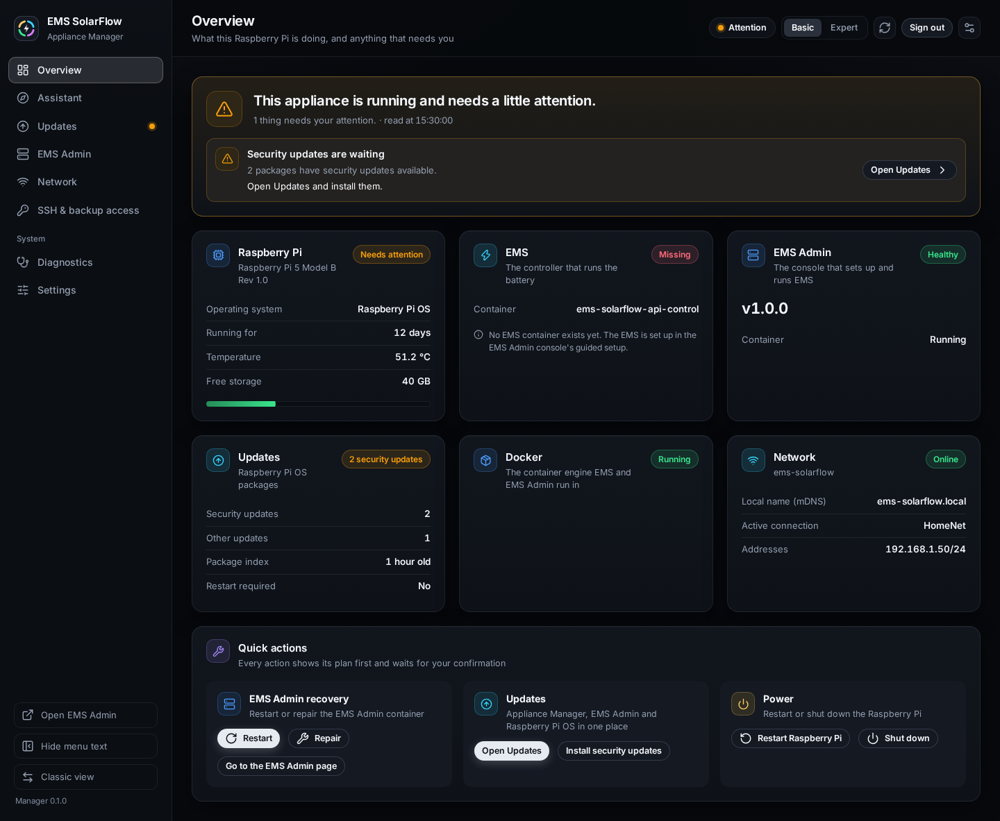

# Appliance — step-by-step guides

The **EMS SolarFlow Appliance** turns a Raspberry Pi into a dedicated box that
runs your energy management and nothing else. You flash one card, plug it in,
and manage it from a browser with the **Appliance Manager** on port `8088`.
There is no shell to learn and no operating system to maintain by hand.

Each guide follows the same shape: what the workflow is for, when to use it,
what you need first, numbered steps with what you see and what changes, then
warnings and recovery.

> **Partly confirmed on physical hardware.** One Raspberry Pi 3B+ has been
> running this image since 2026-08-29: it boots, it grew its root partition to
> the card, the console answers, and it has installed signed Appliance Manager
> packages over HTTPS and stepped back from one. What is *not* settled is the
> part that matters most for daily use — that board does not run EMS, Admin or
> InfluxDB, so nothing is known about a Pi 3's 1 GB of RAM carrying them. No Pi
> 4 or Pi 5 has run it at all. See [what that means](#what-not-confirmed-means).



## Not sure where to start?

Open the Appliance Manager at its address and it starts on the
[assistant](assistant.md): it says what is still to do on this Raspberry Pi —
connect it to your network, install EMS Admin, set up the EMS, install security
updates and, optionally, set up backup access — highlights the next step with
its button, and links to the page for anything else you came to do.

## Choose your guide

| You want to | Start here |
| --- | --- |
| Put the appliance on a card for the first time | [Flashing the card](install.md) |
| Find the box on your network, set its password, install EMS Admin | [First start](first-start.md) |
| Know where to start, or what is still open | [The assistant](assistant.md) |
| Understand what the main page is telling you, and how a change is made | [Overview page](overview.md) |
| Update the operating system | [Updates](updates.md#the-operating-system) |
| Update EMS Admin or the Appliance Manager itself | [Updates](updates.md#the-appliance-manager) |
| Move it onto WLAN, rename it, set the time zone | [Network](network.md) |
| Copy your configuration and data off it, or get a shell | [SSH & backup access](backup.md) |
| Something is wrong | [When it stops working](recovery.md) |
| Use the console in your language, in another colour scheme or on a phone | [Appearance, language and phone](appearance.md) |

## The pages

The side menu lists the pages in two groups, in this order:

```text
Overview · Assistant · Updates · EMS Admin · Network · SSH & backup access
System: Diagnostics · Settings
```

| Page | What it shows and does |
| --- | --- |
| **Overview** | *What this Raspberry Pi is doing, and anything that needs you*: one verdict, what needs your attention, tiles for the board, the EMS, EMS Admin, updates, Docker and the network, and the quick actions — see [Overview page](overview.md) |
| **Assistant** | *What is still to do on this appliance, and the way to what you came for* — see [The assistant](assistant.md) |
| **Updates** | *Appliance Manager, EMS Admin and Raspberry Pi OS in one place* — see [Updates](updates.md) |
| **EMS Admin** | *Restart, repair and roll back the EMS Admin container*, its known-good versions and its log; on a fresh card, installing it — see [When it stops working](recovery.md#ems-admin-or-the-ems-is-not-running) |
| **Network** | *WLAN, hostname and time zone* — see [Network](network.md) |
| **SSH & backup access** | *Shell access for you, and a read-only account that copies files off this appliance* — see [SSH & backup access](backup.md) |
| **Diagnostics** | *Host health, logs and the support archive* — see [When it stops working](recovery.md#collect-a-support-archive) |
| **Settings** | *The appliance password and the host settings*: the ports, the session limits, the update policy, the security audit and the detail level — see [First start](first-start.md#one-password-for-everything) |

The top bar always names the page and says how the appliance is — **Healthy**,
**Attention**, **Problem**, **Not readable**, **Unclear** or **Reading**, a
pill that leads to the Overview — and carries **Basic** / **Expert**, the
refresh button, **Sign out** and the **Appearance** button. A dot beside a menu
entry marks a page with something waiting. The foot of the side menu holds
**Open EMS Admin** (the EMS Admin console in a new tab, once it is
installed), **Hide menu text**, **Classic view**
and the Appliance Manager's version. On a phone the menu becomes a bar at the
bottom with four pages and **More**; see
[Appearance, language and phone](appearance.md#on-a-phone).

An operation that changes the appliance shows at the top of every page until
you acknowledge its result; see
[Changing something](overview.md#changing-something).

## What changes what

| Action | Reads | Changes the appliance |
| --- | --- | --- |
| Assistant, Overview, Diagnostics, Settings, a log, a WLAN scan | Yes | No |
| Any button that opens a plan | Yes | No — the plan is only shown, and holds other plans back until you confirm or drop it |
| **Confirm** (or **Install**, **Apply**, **Restart** …) in a plan | Yes | Yes |
| **Cancel**, the close button or Esc in a plan | — | No — the plan is dropped |
| **Change password** on Settings | Yes | Yes, and signs every session out |
| Appearance, language, Basic/Expert, the assistant's choice to open | — | No — this browser only |

## The deprecated Classic console

The previous design, **Classic**, still answers at
`http://ems-solarflow.local:8088/classic/` and is removed in a later release.
It uses the same password and drives the same appliance in the same way, so
switching changes nothing on the Raspberry Pi. **Classic view** at the foot of
the side menu and on the sign-in card, and **Switch to classic view** in the
Appearance menu and under **More**, open it; Classic's **New design** link
comes back. Nothing is remembered: the address always opens Modern. Every task
runs in Modern; these guides describe Modern only. Classic's palettes, object
styles and its Roomy density exist only there, and are not carried over.

The address opens Classic in two cases only: `?ui=classic` from a link made
before Modern moved to the address, and a browser too old for Modern. Modern
needs Chrome or Edge 114, Firefox 125 or Safari 17 or newer. An old bookmark of
`/modern/` opens the same page at the address.

## What you need

| | |
| --- | --- |
| **Board** | Raspberry Pi 3, 3B+, 4 or 5. Anything older will not run it |
| **Card** | 16 GB or larger. The image is about 8.25 GiB and grows into whatever is left on the card |
| **Network** | An Ethernet cable **for the first start**. WLAN can only be set up afterwards, from the appliance itself |
| **Power** | The official supply for your board. An underpowered Pi corrupts cards |
| **A second computer** | To write the card and to open the browser |

## What it is, and what it is not

It **is** a complete system: operating system, the EMS containers, an update
mechanism, and a small web console to drive all of it.

There is one image and one board-specific file per Raspberry Pi model. The
operating system is patched in place by `apt`, the way an ordinary Raspberry Pi
is, so a bad operating-system update is undone by you, at the machine — or by
writing the card again and restoring a backup. That is the one thing worth
knowing before you start, and it is why [backups](backup.md) come before
anything goes wrong rather than after.

It is **not** a way to run other software. A package you install by hand
survives, and it is then yours to maintain and yours to blame when an upgrade
goes sideways.

## What "not confirmed" means

This project uses the same words for the appliance as for its inverter support:

| Word | Meaning |
| --- | --- |
| **Validated** | Confirmed on the maintainer's own hardware |
| **Family-supported** | Shares an exact profile with something Validated |
| **Reverse-engineered** | Built and tested, but never confirmed on the physical device |

The appliance is in the third group. Every part of it is exercised
automatically — the package installs and its services start on a booted 64-bit
guest, the update mechanism is tested against a real Docker engine, the image
layout is audited — and one Pi 3B+ has been running the image since 2026-08-29.

What that one board has settled:

- the image boots, and the first boot grew the root partition to fill the card
- the agent and the web console come up and answer
- an appliance fetches and installs a signed Appliance Manager package over
  HTTPS from a real network, and steps back from one

What only real hardware can settle and nothing has:

- whether a Raspberry Pi 3's 1 GB of RAM carries Docker, Admin, EMS and
  InfluxDB together — **that board runs none of them**, so this is still
  unmeasured rather than estimated
- whether a Pi 4 or Pi 5 boots the image at all; neither has been tried
- how the system behaves when power is cut mid-update
- SD-card wear over time

### If you are the first

A report from one real board closes most of that list, and it is worth doing
properly, because a boot that fails leaves nothing behind on its own.

**Before you power it on**, if you can: attach a serial adapter and start
capturing. It is the only thing that records a start-up that never reaches the
network, and it is described in
[When it stops working](recovery.md#watch-it-boot). Everything else on this list
can be collected afterwards; that one cannot.

Then, whatever happened:

| | What to include |
| --- | --- |
| **Board and storage** | which Pi, how much RAM, and whether you booted from SD, USB SSD or NVMe |
| **Image** | the file name you flashed, and its `.sha256` |
| **How far it got** | no LED, LED but never on the network, web page reached, or fully working |
| **If it worked** | say so — a plain "Pi 5, NVMe, came up in three minutes" is the report that moves this to a supported tier |
| **If it did not** | the serial capture, and the FAT files described under [read the card](recovery.md#read-the-card-on-your-computer) |
| **If it worked and then an update failed** | the **support archive** from the appliance itself (**Diagnostics → Create support archive**); it redacts secrets and carries the package and Appliance Manager state |

Open it as a
[compatibility report](../supported-setups.md#help-improve-compatibility).

## Related

- [Appliance architecture](../../appliance/architecture.md) — for maintainers
- [Installing the manager on your own Pi OS](../../appliance/installation.md)
- [Admin Console guides](../admin/index.md) — the EMS management console that
  runs *on* the appliance
