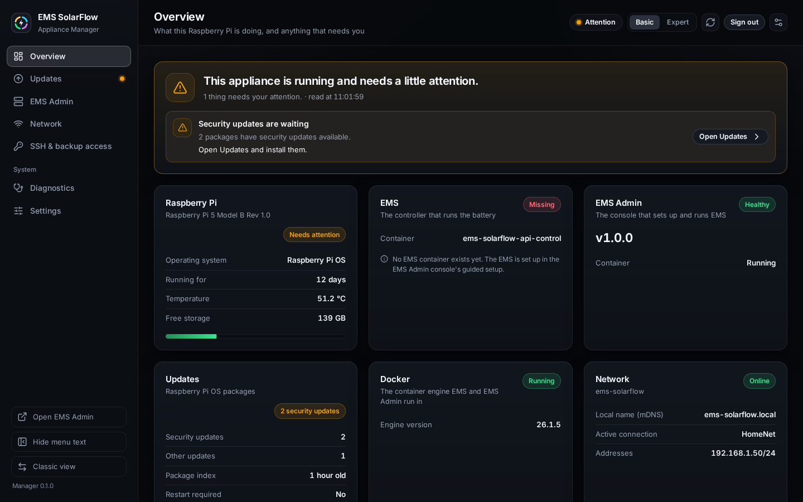
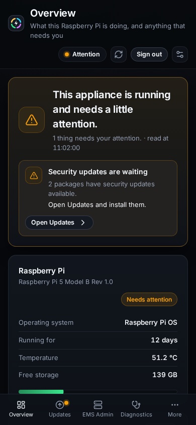

# The Modern view

## Purpose

The Appliance Manager has two views of the same Raspberry Pi. **Modern** is the
one a browser opens first: a side menu with one page per topic, in English,
German, Dutch or French, in the same design as the Modern dashboard and the
Modern Admin console. **Classic** is the view the other guides in this section
show in their pictures.

Both views read the same appliance and change it the same way: every change is
a plan the appliance makes, which you read and confirm, and the operation then
runs on the appliance whichever view is open. Switching between them changes
nothing on the Raspberry Pi.

## When to use this workflow

- You want the Appliance Manager in your own language.
- You manage the appliance from a phone.
- You want to find your way back to Classic, or make one of the two the view a
  browser opens.

## Prerequisites

- The appliance is running and you know its address (see
  [First start](first-start.md)). The password is the same in both views.

## What you see

| Page | What it is for |
| --- | --- |
| **Overview** | one sentence about the appliance, what needs your attention (each with a button to the page that fixes it), the state of the board, EMS, EMS Admin, updates, Docker and the network, and quick actions: restart or repair EMS Admin, install security updates, restart or shut down the Raspberry Pi |
| **Updates** | the Appliance Manager, EMS Admin and Raspberry Pi OS, each with what is installed, what is newest and the one button that updates it; below them every version you can choose, the way back to the kept Manager package, and the package-manager repairs |
| **EMS Admin** | start, stop, restart, repair and roll back the EMS Admin container, its known-good versions and its log; on a fresh card, installing it |
| **Network** | the interfaces, and changing the WLAN, the hostname and the time zone |
| **SSH & backup access** | SSH on or off, public keys, the root-capable shell account, the console rescue account and the read-only backup export with the commands to copy files off the box |
| **Diagnostics** | temperature, memory, storage and services, the logs and the support archive |
| **Settings** | the appliance password, the session limits, the update policy and the security audit; confirming a password that was set elsewhere |

The pill at the top right says the overall state on every page, and a dot in
the menu marks each page with something waiting. Beside the pill, **Basic** and
**Expert** change how much is shown, as in Classic (on a phone the switch is on
**Settings**): Expert adds image digests, plan fingerprints, every log source,
all operating-system updates and the package-manager repairs, which Basic shows
too as soon as the package manager needs one. The choice is kept in this
browser.

## Changing something

1. Press the button for what you want, for example **Restart Raspberry Pi**.
2. The appliance makes a plan and the page shows it: what will happen, to what,
   and anything that stops it. Nothing has changed yet. A plan the appliance
   refuses says why and cannot be confirmed.
3. **Confirm** runs it; **Cancel**, the close button or Esc drops it.
4. The operation then shows at the top of every page, step by step, until it
   ends. **Acknowledge** clears it once you have read the result; a support
   archive is downloaded from there.

A restart or shutdown of the Raspberry Pi turns the page into a waiting screen
that looks for the appliance by itself. After a restart you sign in again.
When another Appliance Manager version starts answering -- after an update, or
after going back to the kept package -- the page loads itself again from that
version, so it never runs against a Manager it was not made for.

The appliance's own messages -- why it refused something, what a step is
called, what a check found -- are shown as the appliance wrote them, in
English, when this view has no translation for them.

## On a phone

On a narrow screen the side menu gives way to a bar at the bottom with
Overview, Updates, EMS Admin and Diagnostics, and **More** for the rest. More
also holds the language, the colour scheme, signing out and the switch to
Classic, and lets you choose which four pages the bar shows.

## Switching between the two

- In Modern, the foot of the side menu has **Classic view** (on a phone, under
  **More**), and so does the sign-in page.
- In Classic, the header has a **New design** link.

The browser remembers the choice: opening the address again takes you to the
view you used last. Adding `?ui=classic` or `?ui=modern` to the address sets it
explicitly, for a bookmark. A browser too old for Modern -- older than Chrome
or Edge 114, Firefox 125 or Safari 17 -- stays on Classic.

The appearance (colour scheme, language, density, menu text, motion) is set
under the **Appearance** button at the top right (the sliders icon) and belongs to this browser. Classic's
palettes, object styles and densities are separate and stay as you left them.

## Expected result

The appliance opens in the view you chose, in your language, and both views
show the same state and offer the same actions.

## Warnings and common problems

| Symptom | Meaning | What to do |
| --- | --- | --- |
| The address opens the other view | The choice is stored per browser | Use the switch, or open the address with `?ui=modern` or `?ui=classic` |
| A message is in English although German is chosen | It is the appliance's own sentence, which this view shows unchanged when it has no translation | Read it as it is; the action it describes is the same |
| "The appliance did not answer in time" after pressing a button | The plan took longer than the browser waited | Wait: the plan opens by itself once the appliance has made it |
| The sign-in page says the session ended | The session timed out or the password was changed | Sign in again |

## Recovery or next steps

- What each part of the overview means → [Overview page](overview.md)
- Updates in detail → [Updates](updates.md)
- When the appliance stops answering → [When it stops working](recovery.md)
