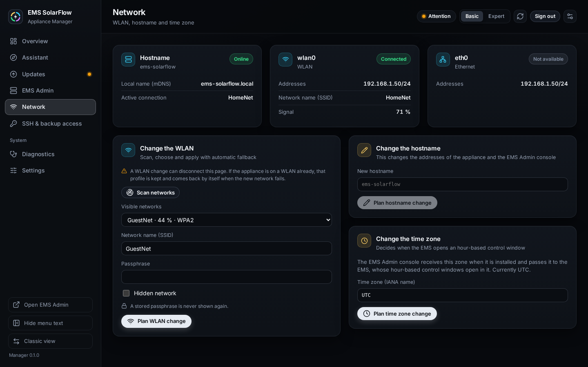

# Network

## Purpose

Move the appliance onto WLAN, rename it, and set the time zone the EMS runs
its hour-based control windows in. All three are on **Network** — *WLAN,
hostname and time zone*.

## When to use this workflow

- You want to unplug the Ethernet cable and run the appliance on WLAN.
- Your WLAN changed: a new router, a new passphrase.
- You want another name than `ems-solarflow`.
- You do not live on UTC — set the time zone before you install EMS Admin.

## Prerequisites

- You are signed in — see [First start](first-start.md).
- For WLAN: the Ethernet cable still plugged in. The first start needs it, and
  it is your way back if the WLAN does not work.

## Step-by-step instructions

### 1 — Read the interfaces

**What you see:** the **Hostname** card with the overall connectivity —
**Online**, **Limited**, **Behind a login page** or **Offline** —, the local
name (mDNS) and the active connection; then one card per interface, such as
**wlan0** (*WLAN*) and **eth0** (*Ethernet*), with its state, its addresses,
and for WLAN the network name (SSID) and signal. Expert adds the gateway and
DNS servers.

### 2 — Change the WLAN

**What you see:** **Change the WLAN** — *Scan, choose and apply with automatic
fallback* — and the warning *A WLAN change can disconnect this page. If the
appliance is on a WLAN already, that profile is kept and comes back by itself
when the new network fails.*

1. Press **Scan networks**. **Visible networks** lists what the appliance
   sees, each with its signal and security, the current one marked
   *connected*.
2. Choose yours, or type the **Network name (SSID)** and tick **Hidden
   network** for one that does not broadcast its name.
3. Enter the **Passphrase**, 8 to 63 characters.
4. Press **Plan WLAN change**, read the plan — *Change the WLAN connection* —
   and press **Apply**.

**What it changes:** the appliance joins the new network, and the page may
lose contact for a moment. A stored passphrase is never shown again.

#### It puts itself back if it goes wrong

A wrong passphrase would otherwise leave a box you cannot reach and cannot fix
without a keyboard. So the appliance treats the change as a trial: it joins,
and if the WLAN has not joined that network and held an address within about
ninety seconds, it returns to the previous WLAN profile on its own. The
previous profile is never deleted.

That way back exists **only when the appliance is already on a WLAN**. On an
appliance that so far ran on the cable alone, the first WLAN join has nothing
to fall back to, and its plan says so. That is why the honest way to do this is
**with the cable still plugged in**: confirm the WLAN works — the **wlan0**
card reads **Connected** with an address — then unplug.

Your passphrase is held in memory between planning and applying, and never
written to the operation record, a log, or the state directory.

### 3 — Rename the appliance

**What you see:** **Change the hostname** — *This changes the addresses of the
appliance and the EMS Admin console*.

1. Type the **New hostname**: letters, digits and hyphens.
2. Press **Plan hostname change**, read the plan and press **Apply**.

**What it changes:** the appliance answers to `<new name>.local` at once,
without a restart, and so does EMS Admin on port 8090. The old `.local` name
stops resolving, so update your bookmarks. A tab still open under the old name
stops accepting changes — *The appliance does not answer to this address* —
so open the new address, or the IP address from your router.

### 4 — Set the time zone

The appliance keeps its own clock on UTC, which never changes. What you set
here is the zone the EMS uses, and that matters: a charge window you set for
midday only happens at midday if the EMS agrees what midday means where you
live.

**What you see:** **Change the time zone** — *Decides when the EMS opens an
hour-based control window* — and the zone now: *The EMS Admin console receives
this zone when it is installed and passes it to the EMS, whose hour-based
control windows open in it. Currently UTC.*

1. Type the **Time zone (IANA name)**: `Europe/Berlin`, `Europe/Vienna`,
   `America/New_York`.
2. Press **Plan time zone change**, read the plan and press **Apply**.

The appliance refuses a name it does not carry rather than quietly staying on
UTC.

**Set it before you install EMS Admin.** The zone travels with the EMS Admin
installation into the EMS. A change made afterwards is saved, but the
containers that already run keep the zone EMS Admin was installed with.

## If the name does not resolve

`ems-solarflow.local` relies on mDNS, which some networks block and some
Windows configurations do not answer.

- Use the IP address from your router instead: `http://<address>:8088`.
- Give the appliance a fixed address in your router's DHCP settings, so the
  address does not move.

## Ports

| Port | What answers |
| --- | --- |
| 8088 | Appliance Manager — the box itself |
| 8090 | EMS Admin console — EMS management, once installed |
| 8091 | EMS Admin console over HTTPS, if enabled |
| 8080 | The EMS dashboard, once EMS runs |

**Settings** shows the two ports this appliance uses for itself and for EMS
Admin.

## What happens in the background

- The scan, the join and the revert are done by the appliance's agent with
  NetworkManager; the browser only sends the network name and the passphrase
  with the plan.
- Whether a WLAN join worked is read off the WLAN device itself — joined to
  that network and holding an address — not off the host's overall
  connectivity, which a plugged-in cable keeps reading as online.

## Expected result

The appliance is reachable on the network and under the name you chose, and
the EMS opens its hour-based windows in your time zone.

## Warnings and common problems

| Symptom | Meaning | What to do |
| --- | --- | --- |
| The page stopped answering after **Apply** on a WLAN change | The appliance is trying the new network | Wait two minutes; with a previous WLAN it comes back by itself. With the cable in, the old address keeps working |
| *The appliance does not answer to this address* | The page is open under the old name after a rename | Open the new name, or the IP address |
| *That is already the appliance's time zone* | Nothing to change | — |
| **Scan networks** finds nothing | No network is visible from here | A hidden network can still be typed in |

## Recovery or next steps

- [Network recovery](../../appliance/network-recovery.md) — what to do with a
  keyboard and screen when it is unreachable
- [When it stops working](recovery.md)
