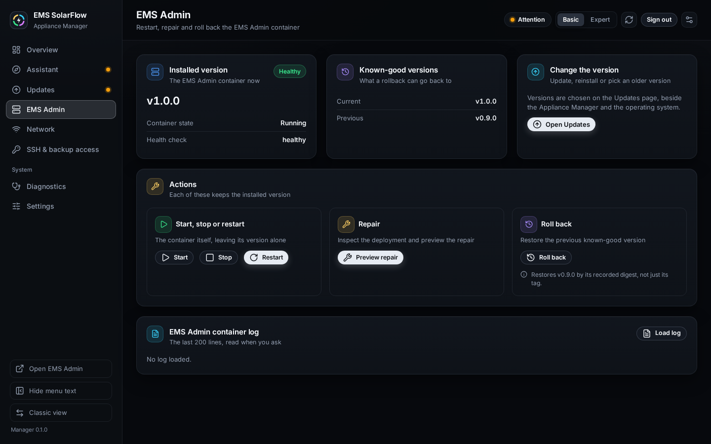
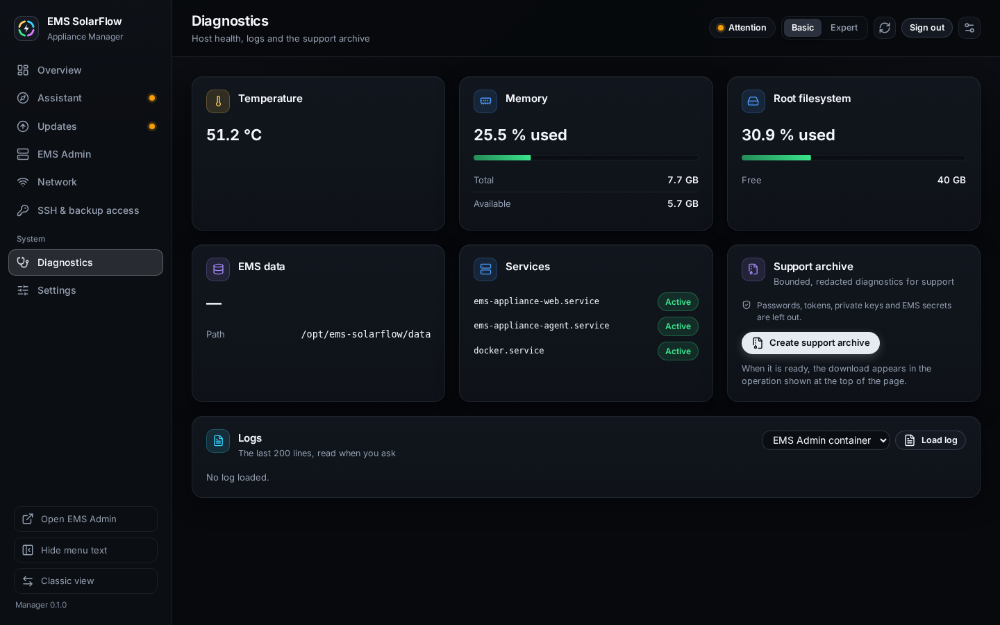

# When it stops working

## Purpose

What to do when the appliance, EMS Admin or the EMS does not behave, in the
order to try things. Start at the top of the section that fits and work down.
Each step is safe to try.

## When to use this workflow

- The web page does not load at all.
- The page loads, but EMS Admin or the EMS does not run.
- An update failed.
- The password is lost.

## Prerequisites

- For the first section, possibly a keyboard and a screen for the Raspberry Pi,
  or a USB-to-serial adapter.
- For the others, the console signed in — see [First start](first-start.md).

## The web page does not load

**Give it three minutes first.** The first start has work to do before it
answers — it grows the card to its full size, generates its own SSH host keys
and starts its services. And an update asks you for a restart when a kernel or
firmware package was among the changes. A page that is missing for two minutes
is usually a box that is coming back.

Then, in order:

1. **Try the address instead of the name.** Look up `ems-solarflow` in your
   router's list of connected devices and open `http://<address>:8088`. If that
   works, the name lookup is the problem, not the appliance — see
   [Network](network.md).
2. **Check the lights.** No activity LED at all means power or the card, not
   software. Try the official power supply; try re-seating the card.
3. **Check the cable.** A different switch port, or a different cable.
4. **Power-cycle it — but shut it down first if you can reach it at all.**
   Pulling power from a running appliance is how cards get corrupted.

If none of that helps: **plug in a keyboard and a screen.** The appliance has a
rescue account for exactly this — user `ems-rescue`, password `rescue-me` — and
it can become root with `sudo`. That password is written down here and in the
source, so it is public knowledge: fine on a home network, and worth changing
with `sudo passwd ems-rescue` if your appliance can be reached from outside one.
The **Console rescue account** card on **SSH & backup access** reports which of
the two it is; it does not insist.

The full order of attempts, down to reading the card in another computer, is in
[the console recovery guide](../../appliance/console-recovery.md).

Two things are also readable without logging in, and between them they usually
say what happened.

### Read the card on your computer

Power the appliance off, take the card out, and put it in your computer. The
card's `boot` partition is FAT, so Windows, macOS and Linux all read it without
extra software. You may be asked to format the other one — **say no**; that is
only your computer failing to read a Linux filesystem, not a damaged card.

| File | What it tells you |
| --- | --- |
| `cmdline.txt` on the `boot` partition | which root the kernel was asked to find |
| `config.txt` beside it | the board settings the firmware applied |

Nothing there needs interpreting to be useful — copying both files into an issue
is enough.

### Watch it boot

The appliance narrates its whole start-up on a serial line, from the firmware
onwards, and it does so whether or not the network ever comes up. This is the
only way to see *why* a boot failed rather than that it did.

You need a USB-to-serial adapter for 3.3 V (about €10, sold as "USB TTL" or
"FTDI"). Connect **GND, RX and TX only — never the power pin**, and open the
port at **115200 baud, 8N1**:

| Board | Where | Notes |
| --- | --- | --- |
| Raspberry Pi 5 | the 3-pin **UART** connector next to the power socket | a JST-SH debug cable, the connector the board is designed for |
| Raspberry Pi 4 | GPIO header: GND = pin 6, TXD = pin 8, RXD = pin 10 | the adapter's RX goes to the Pi's TX |
| Raspberry Pi 3 / 3B+ | the same GPIO pins as the Pi 4 | the image sets `enable_uart=1`, which is what a Pi 3 needs for a usable console |

Then power the appliance on and copy everything the terminal prints. A root
that will not mount says so there, and nowhere else.

You can also log in on this line, with the same rescue account as at a keyboard.
Anyone who can attach an adapter is already holding your appliance, which is the
threshold this account was written for.

If the boot never gets far enough to say anything, what is left is re-flashing
the card — and that **erases everything on it**: your configuration, your data
and the on-box backups alike. A backup you took earlier and kept somewhere else
is what you restore from. The paths are listed in
[network recovery](../../appliance/network-recovery.md#whether-you-have-a-shell-at-all).

## EMS Admin or the EMS is not running

The Appliance Manager and the EMS are separate. A working Appliance Manager page
with a stopped EMS means the box is fine and the application is not. The
Overview's **EMS** and **EMS Admin** tiles, and the assistant's steps, say which
of the two it is.

On the **EMS Admin** page — *Restart, repair and roll back the EMS Admin
container* — in this order:

1. **If EMS Admin is not installed,** the page offers one thing: **Install EMS
   Admin**. See [First start](first-start.md#4--install-ems-admin).
2. **If it is installed but not healthy,** press **Restart** under **Start,
   stop or restart** and confirm the plan. **Start** brings back a stopped
   container; all three leave its version alone.
3. **If it stays unhealthy,** press **Preview repair**. The appliance inspects
   the deployment and shows, in the plan, which checks pass and what it would
   change before it changes anything; **Confirm** runs it. A check it could not
   fix, or something you have to do yourself, is listed in the banner when it
   ends.
4. **If a new version broke it,** press **Roll back** — *Restore the previous
   known-good version*. **Known-good versions** shows what it goes back to, and
   the rollback restores that version by its recorded digest, not just its tag.
5. **To see why,** press **Load log** under **EMS Admin container log** — *The
   last 200 lines, read when you ask*.

When EMS Admin is healthy and the EMS still does not run, the EMS is EMS
Admin's to start: **Open EMS Admin** at the foot of the side menu, and see
[Diagnostics and recovery](../admin/diagnostics-recovery.md) there.

### "The EMS Admin console is replacing itself right now."

Two things can manage the EMS Admin container, and they refuse to fight. While
the EMS Admin console updates itself, the EMS Admin page says so and names the
stage it reached: installing, rolling back, repairing, starting, stopping and
restarting are refused until that finishes, because both would write the same
deployment files. Reading the status and the log still works.

Wait for it to finish. If it never does, a plan you start anyway is refused,
and its reason names the file holding that state; see
[When Admin is replacing itself](../../appliance/admin-recovery.md#when-admin-is-replacing-itself).

## An update failed

Read the reason before retrying, whichever kind it was. An update that failed
because the card is full or the download was truncated will fail again the same
way.

**An operating-system update.** Nothing was undone: `apt` patches the system in
place. If the appliance still boots, the banner and the **Operating system**
card on **Updates** say what failed, and you can try again — after a
**Package-manager recovery** when the card asks for one. If it does not boot,
this page's [first section](#the-web-page-does-not-load) is the route — screen
and keyboard first, reflash and restore last.

**An Appliance Manager update.** The appliance puts the previous package back by
itself when the new one does not report in on time, and **Last install** on
**Updates** then says **Put back**. If it says **Going back failed** or
**Nothing to go back to**, it stopped and is waiting for you: sign in at the
console and run `sudo ems-appliance rollback-manager`. See
[Updates](updates.md#if-the-new-one-does-not-come-up).

**An EMS Admin update.** The running EMS Admin is replaced only once the new
image is pulled and checked, so a failure before that leaves it as it was, and
the banner says so. After that, **Roll back** on the EMS Admin page is the way
back.

## The password is lost

There is no email recovery and no reset button in the browser. There is a
console login: sign in as `ems-rescue` at a keyboard and run
`sudo ems-appliance password-reset`.

If that is not available to you either, write the card again — but understand
what that costs: re-flashing replaces every partition on the card, so your EMS
configuration, data and on-box backups go with it. Take a
[backup](backup.md) first if you can still reach the box at all. It is the only
thing that comes back.

## Collect a support archive

**Diagnostics** — *Host health, logs and the support archive* — shows the
temperature (and under-voltage, where the board reports it), memory, the root
filesystem, the EMS data, and the appliance's services. **Logs** reads the last
200 lines of one source when you ask: in Basic the EMS Admin container, the
operations and the security audit; Expert adds every other source the appliance
declares — the Appliance Manager's web service and agent, the EMS container,
Docker, the start-up, the package installs, the Manager install and its
deadline, and more.

**Create support archive** makes a bounded archive of the appliance's state and
logs — *Passwords, tokens, private keys and EMS secrets are left out.* Confirm
its plan with **Create**; when it is ready, **Download support archive** appears
in the banner at the top of the page.

## What not to do

- **Do not pull power to "reset" it.** Shut it down from the Overview.
- **Do not install packages on it by hand.** Nothing stops you, and what you
  install stays — but it becomes yours to keep working, and yours to undo at
  the console when an upgrade trips over it.
- **Do not run a second controller against the same inverter.** Two things
  writing an output limit is worse than either alone.

## Expected result

The appliance answers again, EMS Admin is healthy, and the EMS runs — or you
have a support archive and the facts below for an issue.

## Recovery or next steps

Open an issue with: what you were doing, what the page said, the model of your
Pi, the Appliance Manager version (**Settings**, or the foot of the side menu),
and whether you flashed the appliance image or installed the package on your
own Raspberry Pi OS. If the appliance is reachable, its **support archive**
collects the relevant logs and state with secrets redacted, and attaching that
answers most questions in one round.

- [Appliance troubleshooting reference](../../appliance/troubleshooting.md)
- [Admin recovery, in technical detail](../../appliance/admin-recovery.md)
