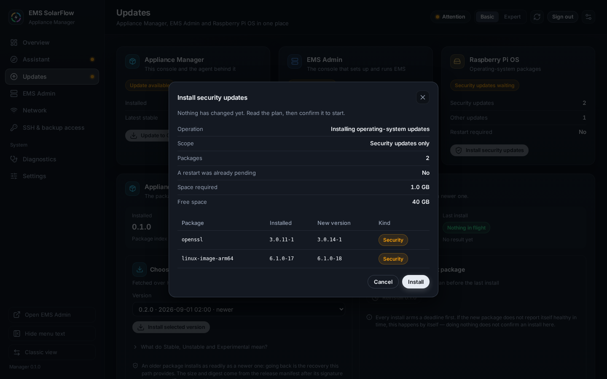
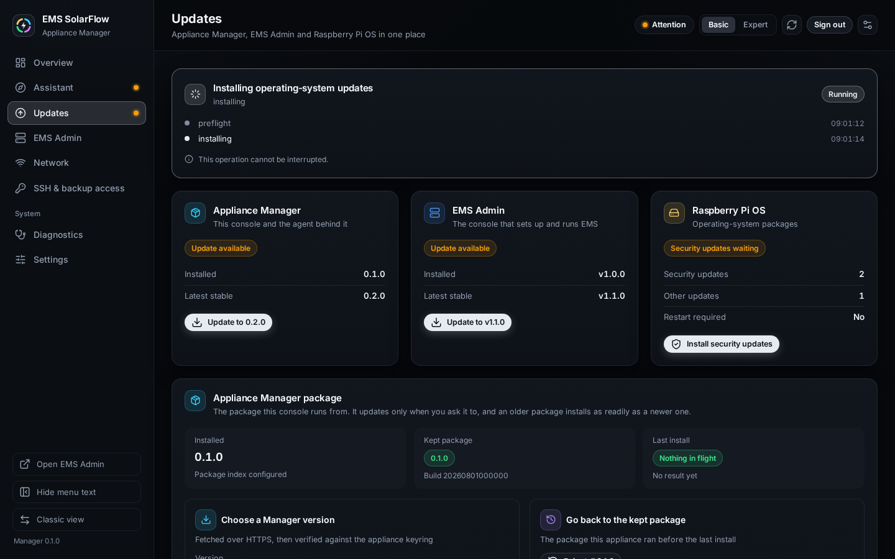

# Updates

## Purpose

Everything on the appliance that has a version is updated from one page,
**Updates**, the third entry in the side menu:

| What | Where on **Updates** |
| --- | --- |
| The Appliance Manager, the console you are looking at | **Appliance Manager** card, and **Appliance Manager package** |
| The EMS Admin container | **EMS Admin** card, and **EMS Admin versions** |
| The operating system underneath | **Raspberry Pi OS** card, and **Operating system** |
| The EMS container | the EMS Admin console's [Guided Upgrade](../admin/guided-upgrade.md), not here |

Nothing updates on its own unless you switch automatic security updates on:
every install shows its plan first and waits for your confirmation.

## When to use this workflow

- The assistant's **Install security updates** row, or the Overview, says
  security updates are waiting.
- A newer Appliance Manager or EMS Admin is published.
- You want to go back to an earlier version.

## Prerequisites

- You are signed in — see [First start](first-start.md).
- A backup kept somewhere other than the card — see
  [SSH & backup access](backup.md). An operating-system update has no way back
  but writing the card again.

## Step-by-step instructions

### 1 — Read what is out of date

**What you see:** three cards at the top — **Appliance Manager** (*This console
and the agent behind it*), **EMS Admin** (*The console that sets up and runs
EMS*) and **Raspberry Pi OS** (*Operating-system packages*). Each says what is
installed, what the newest stable version is, and whether that is an update:
**Update available**, **Up to date**, **Security updates waiting** or **No
security updates waiting**.

Some answers are deliberately not "up to date":

- **Newer than the latest stable** — a candidate or test build newer than the
  latest stable runs: current on its own track, not on the recommended one.
- **Installed version cannot be compared** — the installed version cannot be
  read, as for a feature build or an image without a version label. Whether
  that install is an update is exactly what is unknown, so the card offers no
  button and you choose from the list below.
- **The package counts are not an answer**, or the name of the problem — the
  operating-system check did not finish, or the package manager needs
  recovery. The card then offers no one-click install. A package index that is
  merely old still lists real security updates, so those are offered; with none
  waiting, the card says the index is out of date.
- **No package index configured**, **Package index unreadable**, **Release
  list unavailable** — the list the card compares against could not be read.

**What it changes:** nothing.

### 2 — Update with one button

**What you select:** the card's one button — **Update to 0.2.0**, **Update to
v1.1.0**, **Install security updates**. Each opens the plan for exactly that
version; nothing is installed by the button itself.

**What you see:** the plan, then the banner at the top of the page once you
confirm; see [Changing something](overview.md#changing-something).

### 3 — Or choose a version

Below the cards, the Appliance Manager and EMS Admin each have a version list,
**Choose a Manager version** and **Choose an EMS Admin version**. Both use the
group names and explanations of the EMS Admin console's version list, and
**What do Stable, Unstable and Experimental mean?** opens them:

| Group | What it holds |
| --- | --- |
| **Stable** | Recommended versioned releases for normal use. |
| **Unstable** | Release candidates for early testing. Mostly complete, but they may still contain issues. |
| **Experimental** | Feature builds with unfinished changes. Intended for testing only. |

The appliance decides the group from the version itself, never from the
browser, and by the EMS Admin console's rule for both lists: a release is
Stable, every pre-release (`-rc1`, `~rc2`, `-beta`, `~test1`, …) is Unstable,
and Experimental is a development build — for the Appliance Manager the
untagged `0.0.0~dev…` builds. A version the appliance cannot read in full is
Experimental, never Stable. A group with nothing in it is left out, and a
version this appliance will not install stays listed, greyed out with the
reason.

**What you select:** a version, then **Install selected version**.

## The operating system

The appliance runs Raspberry Pi OS, and its packages are patched in place by
`apt`. The **Operating system** card — *Raspberry Pi OS packages. Major
distribution upgrades are not performed here.* — shows what is pending:

| Tile | What it says |
| --- | --- |
| **Security updates** | How many; **Action recommended**, **Up to date**, or **Not certain** while the check did not finish or the package manager needs recovery |
| **Other updates** | How many, and whether a **Kernel update** or **Firmware update** is among them; **Held packages** |
| **Restart** | **Required** or **Not required** after the updates. Expert names the packages that ask for it |
| **Package manager** | **Healthy** or **Needs recovery**, and its lock |

A check that could not reach its mirrors is reported as exactly that, and the
counts then describe nothing: the tiles show `—`, and **Plan security updates**
waits. A tile the appliance has not answered yet says **Unknown**. The check
itself changes nothing.

1. **Plan security updates** (or **Install security updates** on the card
   above) plans the pending security packages. Only the packages the appliance
   itself found are upgraded — your browser never names a package.
2. Read the plan: the scope (*Security updates only*), the packages with their
   installed and new versions, the space it needs and the space there is.

   

3. **Install** starts it. The banner names the stage it reached and its steps,
   and survives a reload or a closed browser.

   

4. When it says **Completed**, press **Acknowledge**. If **Restart** now reads
   **Required**, restart the Raspberry Pi from the Overview's **Power** group.

In Expert, **Plan all updates** takes the same path for everything that is
upgradable rather than only the security archive, and **Pending security
packages** lists them.

Kernel and firmware upgrades are **not** held back or singled out for a separate
approval. If `apt` offers one, installing updates installs it. That is
deliberate: an appliance that quietly skips kernel security fixes is worse than
one that occasionally needs you at the machine.

### Package-manager recovery

When the check failed or the package manager needs recovery — and always in
Expert — **Package-manager recovery** offers *strictly defined repair actions*:
**Complete pending configuration**, **Repair dependencies** and **Refresh
package indexes**. Each is a plan you confirm with **Run repair**. An active
package-manager lock is never removed.

### Automatic security updates

**Settings → Update policy** says whether this appliance installs security
updates by itself. When **Automatic security updates** is on, waiting security
updates install once a day at a randomised hour, through the same plan and the
same blockers as the button on Updates — never a full upgrade, and never a
restart: a restart the updates ask for is reported and left to you. It is
switched on in `appliance.conf`, not in the browser.

### There is nothing to fall back to

If an update leaves the board unable to start, the way back is a keyboard and
screen at the appliance
([when it stops working](recovery.md#the-web-page-does-not-load)), and failing
that, writing the card again and restoring a backup.

This is the one thing worth understanding about this appliance's updates, and it
is why the backup matters more than the update does: **keep a backup somewhere
other than the card.** [SSH & backup access](backup.md) is how you get one off
the box.

A major OS generation change (for example Bookworm → Trixie) is not offered as
an update at all. Back up, flash the newer image, restore.

## EMS Admin

The **EMS Admin** card's **Update to …** installs the newest stable EMS Admin.
**EMS Admin versions** — *Installing pulls and checks the image before the
running one is replaced* — holds the rest:

- **Version** offers **Latest stable**, **Current version (reinstall)** and
  **Previous known-good** under **Channels**, then every published version by
  group; the running one reads *v1.0.0 · installed*. Expert adds **Exact
  release tag** with a **Release tag** field.
- **Reinstall the same version** reinstalls even when the version does not
  change.
- **Install selected version** makes the plan; **Install** in the plan starts
  it. The appliance pulls and checks the image before the running EMS Admin is
  replaced.
- **Restart, repair or roll back** — *Actions that keep the installed version*
  — opens the [EMS Admin page](recovery.md#ems-admin-or-the-ems-is-not-running).

On a fresh card the card says **Not installed** and **Install EMS Admin** opens
the EMS Admin page, where the first installation starts; see
[First start](first-start.md#4--install-ems-admin). While Docker does not run,
or while the EMS Admin console is replacing itself, no version can be
installed, and the card says why.

## The Appliance Manager

The Appliance Manager is the software this console *is*. It is updated on its
own, from **Updates**, and nowhere else — `apt` does not offer it, because it
is not in any package archive.

> Like the rest of the appliance, this has barely run on hardware. One
> appliance has fetched and installed manager packages over a real network,
> and its deadline, described below, has decided once: it confirmed an
> install. No deadline has yet put a package back on hardware; that path is
> tested in full offline, which is not the same claim. See
> [what "not confirmed" means](index.md#what-not-confirmed-means).

Nothing here happens on a schedule. There is no automatic update, no nightly
check that installs something, and no way for a newer version to arrive because
time passed. It moves when you press the button.

**Appliance Manager package** — *The package this console runs from. It
updates only when you ask it to, and an older package installs as readily as a
newer one.* — shows three tiles: **Installed**, the **Kept package** this
appliance can go back to (or **None kept**), and **Last install**: **Nothing in
flight**, **Waiting for the deadline**, **Confirmed**, **Put back**, **Going
back failed**, **Nothing to go back to**, **Deadline expired without a
verdict** or **Deadline record unreadable**.

The list you are choosing from names **every version ever published**, not only
newer ones. That is on purpose: installing an earlier package is the whole way
back from a bad update, so the older entries stay listed for as long as they
exist. Each entry says whether it is **newer**, **older**, the **same version
as installed**, or **cannot be compared**.

### Doing it

1. Open **Updates**. To go to the newest stable version, press **Update to …**
   on the Appliance Manager card and skip to step 3.
2. Otherwise, under **Choose a Manager version** — *Fetched over HTTPS, then
   verified against the appliance keyring* — pick a version and press
   **Install selected version**.
3. Read the plan. It names the version, says whether it moves forward or back,
   and lists everything that could refuse. **Install** is red when the step
   goes back, or when its direction cannot be compared.
4. Press **Install**. The console goes briefly unreachable while the package is
   unpacked — the update restarts the very services answering your browser.
   Once the new version answers, the page loads itself again from it.

Before anything is installed, the appliance fetches the package over HTTPS and
checks it against the signing keyring it ships. An unsigned package, one whose
contents do not match its signed description, one built for another
architecture, or one whose manager could not read the settings already on this
appliance, is refused *before* the install begins. So is a package whose
signed version is not the version the package index named, because that name
is what the list and the **Update to …** button showed you.

A password set where the Appliance Manager could not confirm it holds every
Manager install and revert back until you confirm it under **Settings**; the
buttons wait and say so. See
[First start](first-start.md#one-password-for-everything).

### Installing an older version is allowed

Deliberately. The same control installs an older package as readily as a newer
one, and the plan tells you which direction it is going.

Reinstalling the previous manager **is** the recovery — refusing to go
backwards would take it away. **Go back to the kept package** — *The package
this appliance ran before the last install* — does exactly that with one
button, **Reinstall** and the kept version, and **Reinstall** again in its plan.
What is refused instead is a version that could not read the state already on
the disk, or the state the running Manager writes, which is the question "is
this number bigger" never answered. A kept package from before packages
declared what they read cannot be judged; its plan says so instead of refusing.

### If the new one does not come up

**Doing nothing here does not undo anything** — an installed package stays
installed. So the appliance sets itself a deadline before it unpacks
anything.

Once a minute, it checks whether the version now installed is the one the update
promised, and whether the manager's two services are running. The window is
fifteen minutes of the appliance running — the board has no real-time clock,
so the deadline is counted in the checks themselves rather than in wall-clock
time — and it survives a reboot inside it: rebooting is exactly what you would
try when a console stops answering, so a deadline a reboot cancelled would be
no deadline at all. While it runs, the page says *An install is being judged.*
and nothing else can be started.

| What happens | What the appliance does | **Last install** says |
| --- | --- | --- |
| Those checks pass | The deadline is retired and the new version stays. | **Confirmed** |
| The deadline expires first | The previous package is installed again, by itself, and the page reports it. | **Put back** |
| There is no previous package to go back to | It says so, and waits for you. A first install has nothing behind it. | **Nothing to go back to** |
| Even the previous package refuses to install | It says so, and waits for you. | **Going back failed** |
| The record of the deadline cannot be read | Nothing is installed and nothing is undone. It says so, and waits for you. | **Deadline record unreadable** |

The undo is a copy taken out of the package being *replaced*, saved before the
new one is unpacked, so the thing deciding whether to keep the update is not
part of the update.

**This is a timer, not a safety net in firmware.** It covers the Appliance
Manager and nothing else: not the kernel, not the firmware, not the operating
system. If a manager update somehow leaves the machine unable to boot, the
deadline never gets to run. The reasoning, and what it does not buy you, is in
[the decision record](../../appliance/adr/manager-self-update.md).

### After a power cut, wait before downloading

The Raspberry Pi has no battery-backed clock. After a cold start it believes it
is somewhere in the past until it reaches a time server. Certificate checks and
signature validity both depend on the time, so a download started too early
fails with errors that mention everything except the clock. The appliance
refuses to start a manager download until the time is confirmed.

## What happens in the background

- The appliance reads the package index and the release lists itself; the
  browser only names the version you chose, never a package or an image
  reference.
- An operation runs on the appliance, not in the page, and only one at a time.
- The EMS keeps controlling while the Appliance Manager or EMS Admin is
  updated. A restart of the Raspberry Pi stops it until the box is back; see
  [while the appliance is down](overview.md#while-the-appliance-is-down).

## Expected result

The card you updated reads **Up to date**, the banner says **Completed**, and
after a Manager update the side menu's foot names the new version.

## Warnings and common problems

| Symptom | Meaning | What to do |
| --- | --- | --- |
| The update button is missing | The installed version cannot be compared, or the list could not be read | Choose from the version list, or press the refresh button in the top bar |
| A version is greyed out | This appliance will not install it, and the entry says why — a pre-release while pre-releases are not allowed, for example | Choose another, or allow pre-releases in `appliance.conf` |
| *Another operation is running or waiting for confirmation* | One operation at a time | Wait for the banner to end, or cancel a waiting plan there |
| A manager download fails with a certificate or signature error after a power cut | The clock is not set yet | Wait a few minutes after start-up and try again |
| **Last install** reads **Going back failed** or **Nothing to go back to** | The deadline expired and could not put the previous package back | See [When it stops working](recovery.md#an-update-failed) |

## Recovery or next steps

- [When it stops working](recovery.md)
- [SSH & backup access](backup.md) — getting a backup off the box
- [Operating-system and manager updates, in technical detail](../../appliance/os-updates.md)
