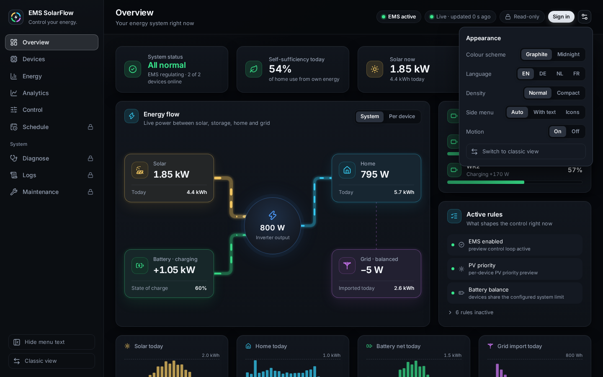
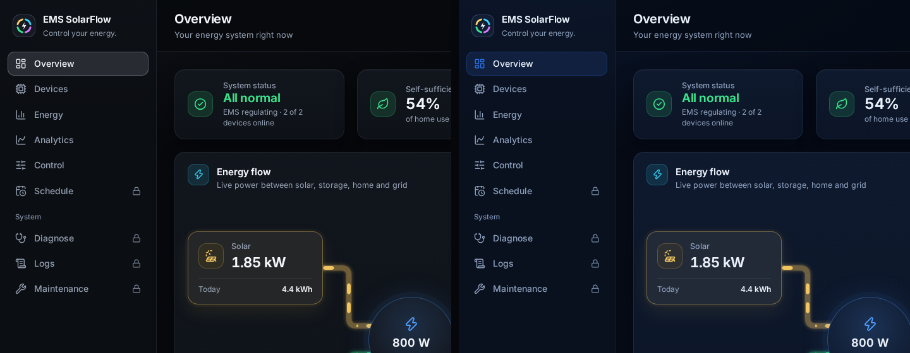
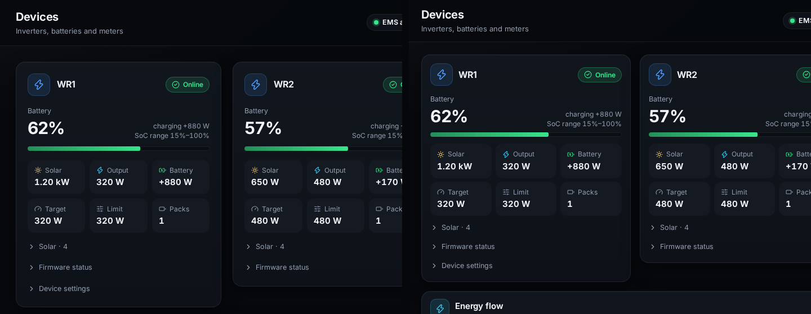

# Appearance and language

## Purpose

Make the dashboard read well where it is used: in your language, in the colour
scheme and density that suit the screen, with the side menu as wide as you
want it.

## When to use this workflow

- You want the dashboard in German, Dutch or French.
- You set up a screen in one room and want it to look the same every time.
- A tablet should fit more on the screen at once.

## Prerequisites

- The dashboard open. No sign-in needed: these are choices of your browser, not
  settings of the EMS.

## Step-by-step instructions

### 1 — Open the Appearance menu

**What you select:** the settings button at the right end of the top bar.

**What you see:** **Appearance** with five choices. On a phone, the language
and the colour scheme are also under **More → Quick settings**.

| Choice | Values |
| --- | --- |
| **Colour scheme** | **Graphite** (the default, neutral near-black) or **Midnight** (deep navy) |
| **Language** | **EN**, **DE**, **NL**, **FR** — numbers and dates follow the language |
| **Density** | **Normal** or **Compact** |
| **Side menu** | **Auto** (text beside the icons on a desktop, icons only below 1024 px), **With text** or **Icons** |
| **Motion** | The moving dashes in the energy flow, and on a phone the sheet sliding in, **On** or **Off** |

**Hide menu text** at the foot of the side menu switches the text beside the
icons as well, and the choice is kept like the one in the menu.

### 2 — Choose a colour scheme

Left **Graphite**, right **Midnight**. Only the surfaces and the accent colour
change; nothing moves.
The colours of the energy types are the same in both, and the same as in the
Admin Console: solar is the warm one, battery the green one, output the cyan
one and grid the violet one, and a blocked write stays red. The charts follow
the scheme at once.

### 3 — Choose a density

Left **Normal**, right **Compact**. Compact takes less room around and between
everything, so more fits on the screen at once — a tablet is the usual place
for it. Colour and text size stay the same.

### 4 — Choose a language

Select **DE**, **NL** or **FR**. Every page, menu and message changes at once,
and so do numbers and dates (`1,85 kW` in German). Values the EMS writes itself,
such as log lines and the diagnosis texts, stay in English.

## What happens in the background

- Each choice is stored by the browser you made it in, under the dashboard's
  address. A tablet in the hall and a laptop at the desk can each have their
  own. They are not installation state and change nothing on the EMS.
- The Admin Console is a separate address, so its choices are separate too.
- The Classic dashboard keeps its own appearance; changing one never changes
  the other.
- If the installation has animation switched off (`dashboard.animation_mode`),
  **Motion** cannot turn it back on, and the menu says *Animation is switched
  off for this installation.* A system that asks for reduced motion gets none
  either.

## Expected result

The dashboard opens in your language, colour scheme, density and menu width
every time, in this browser.

## Warnings and common problems

| Symptom | Meaning | What to do |
| --- | --- | --- |
| Another browser shows the default again | The choices belong to the browser they were made in | Choose them there too |
| The dashes in the flow do not move | **Motion** is off, the installation has animation switched off, or the system asks for reduced motion | Check **Appearance → Motion** |
| The address opens the Classic dashboard | Demo mode, `?ui=classic`, or a browser too old for Modern | See [The deprecated Classic dashboard](index.md#the-deprecated-classic-dashboard) |

## Recovery or next steps

- The pages and the menu → [Overview and navigation](overview.md)
- The bar at the bottom on a phone → [On a phone](overview.md#on-a-phone)
- The installation-wide animation setting →
  [Configuration](../../technical/configuration.md)
