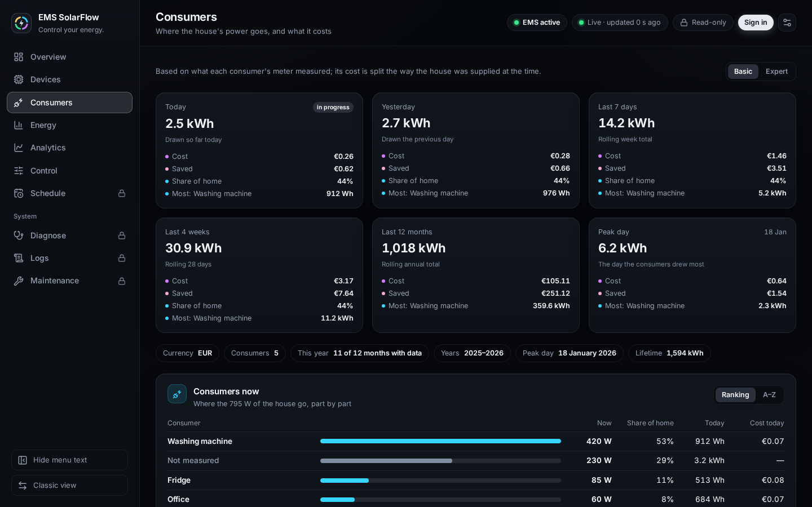

# Consumers

## Purpose

See where the house's power goes: what each metered consumer — a washing
machine, a heat pump, a plug with a meter — draws right now, what it drew over a
day, a week or a year, and what that cost or saved.

## When to use this workflow

When a consumer is metered and you want to know its share of the house, or
whether it ran on your own energy or on the grid.

## Prerequisites

- At least one consumer in the EMS. A consumer comes in over MQTT: map a meter
  as **Consumer** in the Admin console's [MQTT mapping](../admin/mqtt-mapping.md)
  and choose **Save and add to the EMS**, or let a bridge publish
  `ems-consumer/<id>/power` (see
  [External devices](../supported-setups.md#external-devices-read-only)).
- No sign-in needed for this page.

## What you see

The page is built like the [Energy](energy.md) page and reads the same way:
**Basic** and **Expert** above it are one choice for both pages.

### 1 — Periods

**Today**, **Yesterday**, the **Last 7 days**, the **Last 4 weeks**, the
**Last 12 months** and the **Peak day**, the day the consumers drew most
together. Each card names what the consumers drew, what it cost, what it
saved, their share of the home use and the consumer that drew most; **Expert**
adds the parts from the grid and from your own supply and how many consumers
drew. Below the cards: the currency, the number of consumers, this year's months
with data, the years, the peak day and the lifetime.

The share of the home use is left out where the home use was measured over
less of the period than the consumers were, rather than read as all of it.

### 2 — Consumers now

One row per consumer: a bar for its power now, the power itself, its share of
the house, its energy today and what that cost. All bars share one scale, the
largest part at full length, so thirty consumers still compare at a glance.
**Ranking** lists the highest draw first, **A–Z** by name; the dashboard
remembers the choice, and the energy table below follows it too. A consumer that
stopped reporting says **Offline** and shows a dash rather than 0 W.

**Not measured** is the part of the home use no consumer measured: the house
load the grid meter sees, minus every consumer. It is never negative; a consumer
read a moment apart from the meter can briefly sum past the house.

### 3 — This year by month, the years and the lifetime

A bar per month, stacked: the five consumers that drew most this year each in
their colour, every other consumer in one **Other** band on top; the month
running is hatched, a month without data dashed. A click on a month lists what
each consumer drew in it and what that cost, the most first, and its period
facts; **Table** shows the year month by month. Beside it, each calendar year
and the lifetime with the same facts as the cards.

A consumer keeps one colour in every chart on the dashboard: the colours go in
the order of what each drew over its lifetime. There are six; beyond six they
repeat, and a chart that names two of one colour gives the one that drew less
another, so the six that drew most always keep theirs.

### 4 — The power chart

The five consumers that drew most over the last seven days, each a band,
stacked on the rest of the house: **Other** when more consumers share it, **Not measured** when every
consumer has its own band. Together they make the home use. **1 h**, **6 h**,
**24 h** and **7 d**, from the dashboard's own history; it
[zooms](../../dashboard.md#zooming-a-chart) like every chart and has a
**Table**.

### 5 — Energy and costs per consumer

For **Today**, **Yesterday**, the **Last 7 days**, the **Last 4 weeks**, the
**Last 12 months** and the **Lifetime**: each consumer's energy, the part it drew from your own
supply and the part from the grid, what that cost, what it saved, and its share
of the home use. **Not measured** and the home use itself close the table.

A consumer is priced by how the house was supplied while it drew. If the grid
covered 40 % of the house at that moment, 40 % of the consumer's energy cost the
configured price and 60 % counts as saved at the same price. The note under
the table names the price.

A consumer that is gone keeps its values: the table names it with the day it
last drew, *Freezer (until 12 Apr 2026)*.

### 6 — The energy flow on the Overview

With consumers in the EMS, the energy flow on the
[Overview](overview.md#3--energy-flow) draws a line from **Home use** to them:

- **System** draws one **Consumers** block, everything every consumer draws now,
  with their energy today.
- **Per device** names the two consumers drawing most now and gives the rest of
  the house to **Other**, so the three add up to the home use.

Every one of them opens this page.

The **Energy** page carries the same table under its periods, and
**Analytics** has a **Consumers** view of the five that drew most and the rest,
from InfluxDB.

## Renaming or replacing a consumer

A consumer's values belong to its device, not to its name. Renamed, or moved to
another broker, it keeps what it drew, under its new name in every period. When
you save such a change, or add a consumer that would continue values recorded
before — under its own device id, or under a removed consumer of the same name —
the Admin console asks what to do with them:

- **Carry them along** / **Take them over** — the consumer counts on from them.
- **Begin anew** — it starts at zero; the old values stay on this page as a
  former consumer.

See [MQTT mapping](../admin/mqtt-mapping.md#renaming-a-consumer).

## What a consumer does not do

A consumer is read only. It changes no setpoint, takes no part in the control
and leaves the energy statistics measured when it falls silent: the grid meter
already saw what it draws.

## Recovery or next steps

- **The page says there are no consumers** — none is in the EMS yet; see
  *Prerequisites*.
- **A consumer shows Offline** — its meter has sent nothing for a minute. Check
  the meter, and the mapping's status in the Admin console.
- **Not measured is 0 W while consumers run** — the consumers add up to more
  than the house; check that each is behind the grid meter and that no meter
  counts twice.
