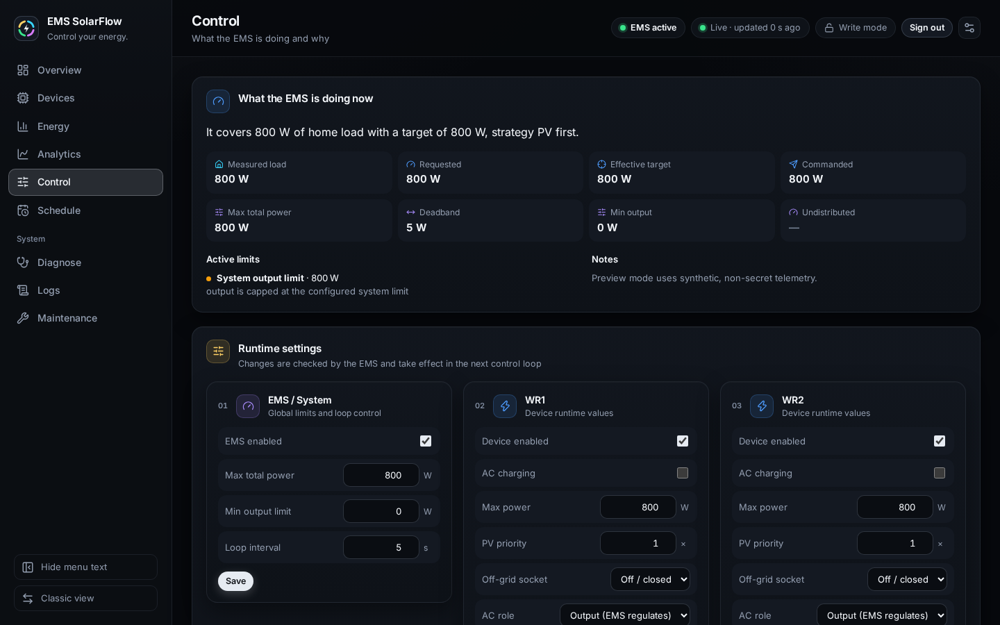
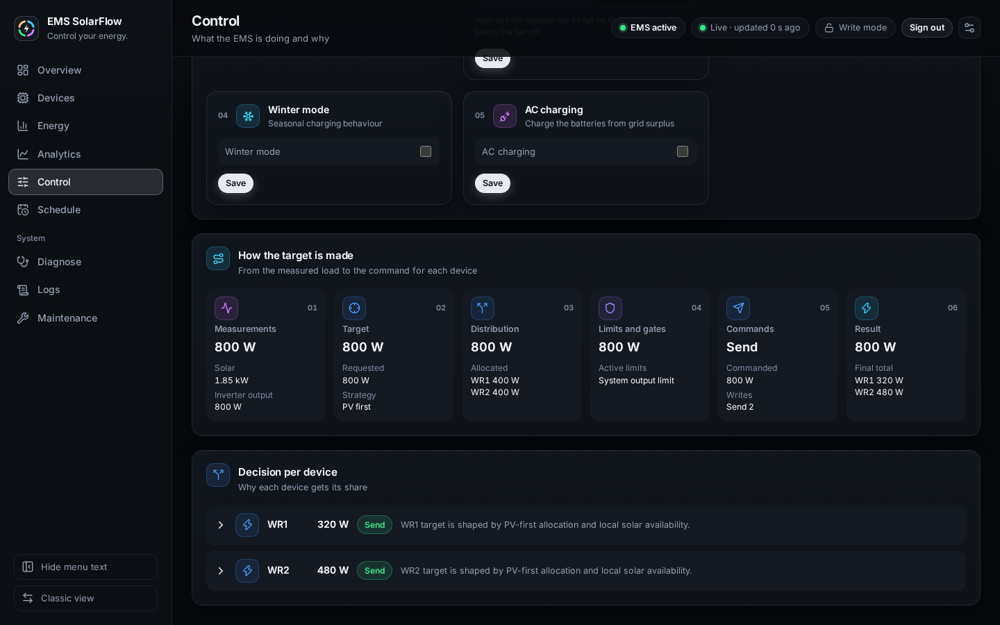
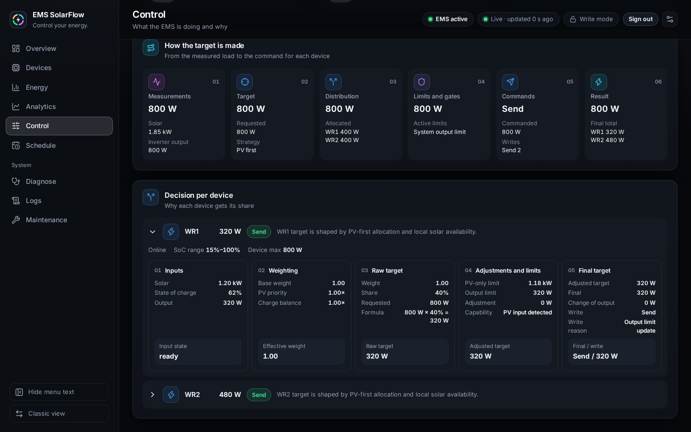
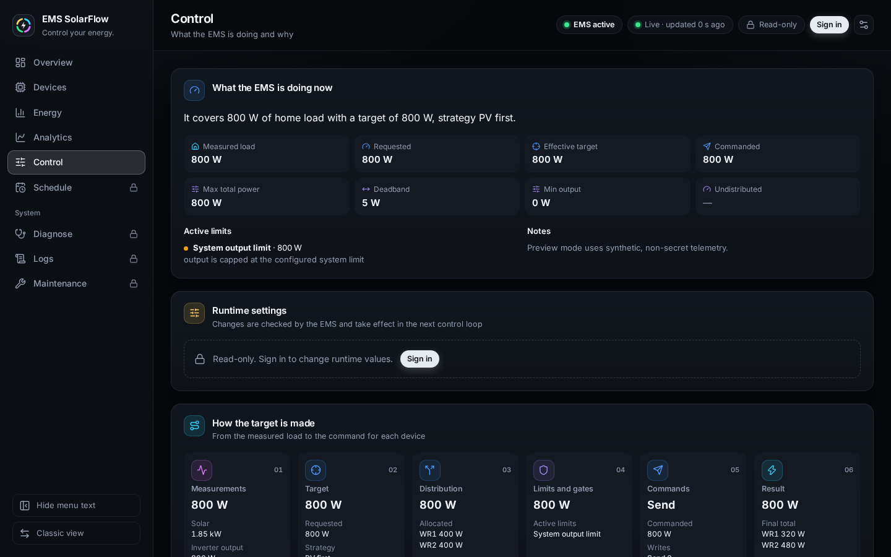

# Control pipeline

> **Video:** [Energy Control Loop](https://www.youtube.com/watch?v=pkzMWn6v6Vw)

## Purpose

Answer the question "why did the EMS write *that* value?" — stage by stage, from
the measurements it started with to the write it finally made or held back.

## When to use this workflow

- Output is not what you expected.
- A device is not contributing.
- You changed a setting and want to see where it takes effect.
- Before reporting a control problem — this page *is* the evidence.

## Prerequisites

- The EMS running and the dashboard open.
- Reading the page needs no sign-in. The **Runtime settings** card on the same
  page does — see [Runtime settings](runtime-settings.md).

## How to read it

The **Control** page — *What the EMS is doing and why* — has four cards, top to
bottom:

1. **What the EMS is doing now** — the decision of the last control cycle in
   one sentence and eight figures.
2. **Runtime settings** — the values you can change, see
   [Runtime settings](runtime-settings.md).
3. **How the target is made** — six stages, one decision for the whole
   installation.
4. **Decision per device** — how that decision was split and adjusted for each
   inverter, in five stages.

## What the EMS is doing now

The sentence reads, for example, *It covers 800 W of home load with a target of
800 W, strategy PV first.* With control switched off it says *Control is
switched off. The EMS writes nothing; every inverter keeps its last output
limit.*

| Figure | Meaning |
| --- | --- |
| **Measured load** | Home load after filtering and deadbands — not the raw meter reading |
| **Requested** | The requested total (`commanded_total_w` plus filtered load) |
| **Effective target** | The system target after limits |
| **Commanded** | The value being commanded |
| **Max total power** | The configured ceiling for the whole installation |
| **Deadband** | Changes smaller than this are not written |
| **Min output** | The floor below which output is not commanded |
| **Undistributed** | Target no device could take within its limits |

**Active limits** names each limit that binds, with its value and the reason,
for example *System output limit · 800 W — output is capped at the configured
system limit*. *Not active this cycle* lists the limits that did not bind.
**Notes** carries what the control cycle reported besides.

**Filtered, not raw.** The EMS deliberately does not chase every meter twitch.
Filtering, deadbands and ramps keep the hardware from being commanded to
oscillate. A measured load that lags a sudden spike by a moment is correct
behaviour.

## How the target is made

*From the measured load to the command for each device.* Read left to right;
each stage's result, the large figure, feeds the next.

### 01 — Measurements

Result: the measured load. Figures: **Solar** and **Inverter output**, what the
inverters are delivering now.

### 02 — Target

Result: the effective target. Figures: **Requested** and **Strategy**, the
allocation strategy — for example *PV first*, *Battery discharge*, *AC
charging* or *Night idle at minimum SoC*.

### 03 — Distribution

Result: the allocated total. Figure: **Allocated**, the split per device, for
example `WR1 400 W` and `WR2 400 W`.

This is where a device "not contributing" is usually explained. PV-first
allocation prefers the inverter that has its own solar input.

### 04 — Limits and gates

Result: what may actually be commanded. Figure: **Active limits**, the limit
that binds, for example *System output limit*.

If the allocated total and this result differ, a limit or a gate is the reason —
and this stage names it.

### 05 — Commands

Result: the write decision — **Send**, **No write**, **Blocked**, **Inferred**
or **No devices**. Figures: **Commanded** and **Writes**, for example `Send 2`.

**No write is also a decision.** If the new value is inside the deadband, the
EMS deliberately writes nothing. That is not a failure.

### 06 — Result

Result: the final total. Figure: **Final total**, the final value per device.

## Decision per device

*Why each device gets its share.* Each inverter has a row with its target, a
write status — **Send**, **No write**, **Blocked** or **Inferred** — and a
sentence. For a device the EMS holds back, the sentence says why, for example
*AC input mode is active; normal output writes are blocked*; otherwise it says
what decided the target, for example *WR1 target is shaped by PV-first
allocation and local solar availability.*

Click a row to open it. A line names the state, the **SoC range**, the **Device
max** and, where known, the **Capacity** weight, and five stages follow. A stage
whose result is red is one that blocks the device.

### 01 — Inputs

**Solar**, **State of charge** and **Output** from this inverter. Result:
**Input state** — `ready` when the device's data is usable.

A device that is offline gets a red result here and is left out of the write
decision. The EMS does not command on stale data.

### 02 — Weighting

| Figure | Meaning |
| --- | --- |
| **Base weight** | Starting weight |
| **PV priority** | The PV-priority multiplier for this device |
| **Charge balance** | The battery-balance multiplier |
| **Effective weight** (result) | The weight used for the split |

### 03 — Raw target

**Weight**, **Share** (this device's percentage), **Requested**, and a
**Formula** such as `800 W × 40% = 320 W`. Result: **Raw target**.

The formula is the arithmetic, spelled out. If a device's share surprises you,
this is where to look.

### 04 — Adjustments and limits

| Figure | Meaning |
| --- | --- |
| **PV-only limit** | Cap derived from this device's own solar |
| **Output limit** | The device's output limit |
| **Adjustment** | The difference between the raw and the final target |
| **Limited by** | The limit that bound, where one did |
| **Capability** | Detected capability, for example *PV input detected* |
| **Adjusted target** (result) | After the limits |

The result turns red only when the EMS reports that the device cannot export
this cycle: its telemetry shows no way out, it is in AC input mode, the
full-charge assist holds it, discharge is switched off for it, or winter mode
holds its solar for charging. **Capability** then names why. A limit that binds,
such as the PV-only limit, does not turn it red.

### 05 — Final target

| Figure | Meaning |
| --- | --- |
| **Adjusted target** / **Final** | Before and after the final step |
| **Change of output** | The final target against what the device delivers now |
| **Write** | **Send**, **No write**, **Blocked** or **Inferred** |
| **Write reason** | Why, for example *Output limit update* or *Change is inside the deadband* |
| **Final / write** (result) | The decision and the value |

## Deadbands, ramps and limits

| Mechanism | What it does | Why |
| --- | --- | --- |
| **Deadband** | Suppresses writes for changes below a threshold | Stops pointless writes and hardware wear |
| **Ramp** | Limits how fast a value may move per cycle | Avoids abrupt steps |
| **`min_output_limit`** | Floor below which output is not commanded | Some hardware behaves poorly at tiny values |
| **System output limit** | Cap for the whole installation | Your configured ceiling |
| **Per-device limit** | Cap for one inverter | Device rating or your choice |

These are why a target and an output differ for a few cycles. A lasting
difference is something else — read stage 04 to see which limit binds.

## When the EMS deliberately does not write

| Reason | Where you see it |
| --- | --- |
| Change is inside the deadband | Stage 05 **Commands**, and **Write reason** per device |
| Telemetry is stale | Per-device stage 01, **Input state** |
| A write gate is off, or `dry_run` or simulation mode | Stage 05 **Commands**, and **Write** and **Write reason** per device |
| Night / minSoc idle | **Strategy** *Night idle at minimum SoC*, and **Night idle** under **Active rules** on the Overview |
| Device disabled | Per-device stage 01 |

**Stale data blocks writes on purpose.** Commanding hardware from old
measurements is worse than not commanding it.

## Dry run, simulation, and MQTT confirmation

- **`dry_run`** — the EMS computes everything and writes nothing. The page still
  fills in, so you can check a configuration safely before going live. See
  [Safety](../safety.md).
- **Simulation / replay** — synthetic or recorded input; hardware writes are
  forced off.
- **MQTT confirmation** — for an MQTT-controlled device, **publishing a command is
  not success**. A publish is only a transport step; the EMS reports a command
  effective only after **telemetry confirmation** that the device took the value.
  Over the cloud broker that confirmation typically arrives a few seconds later —
  see [MQTT](../admin/mqtt.md#what-to-expect-from-the-cloud-path). A command shown
  as sent but not yet confirmed is exactly that, and the dashboard does not
  pretend otherwise.

## Read-only view

Without a session the whole page is readable — it is diagnostic information,
not a control surface. Only the **Runtime settings** card asks you to sign in.

## What happens in the background

- Every value here comes from the EMS's own control cycle. The dashboard does
  not recompute anything.
- One control cycle runs per loop interval, in the order shown.
- Write eligibility is decided by the EMS write gates and capability detection.

## Expected result

For any cycle you can say: what the EMS measured, what it targeted, how it
split that, what limited it, whether it wrote, and why.

## Warnings and common problems

| Symptom | Meaning | What to do |
| --- | --- | --- |
| Target ≠ Output for long | A limit binds | Stage 04 names it |
| One device gets nothing | PV-first allocation, or it is not ready | Stage 03 and the device's stage 01 |
| **No write** | Deadband, or nothing to change | **Write reason** per device |
| **Blocked** | A gate is off, the device is offline, or dry run/simulation | [Safety](../safety.md) |
| Values oscillate | Likely a second controller | Nothing else may write `outputLimit` |
| Command sent, hardware unchanged | Awaiting MQTT confirmation, or the write had no effect | [MQTT](../admin/mqtt.md) |

## Recovery or next steps

- Per-device detail → [Devices](devices.md)
- Change a limit live → [Runtime settings](runtime-settings.md)
- Capture the same data for a report →
  [Diagnostics](diagnostics.md) (the **Control** diagnosis, `diagnose --control`)
- The maths → [Control logic](../../technical/control-logic.md) ·
  [Control flow](../../technical/control-flow.md)
