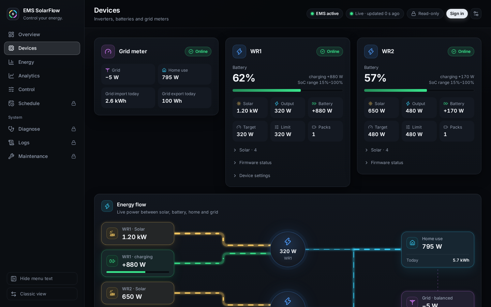
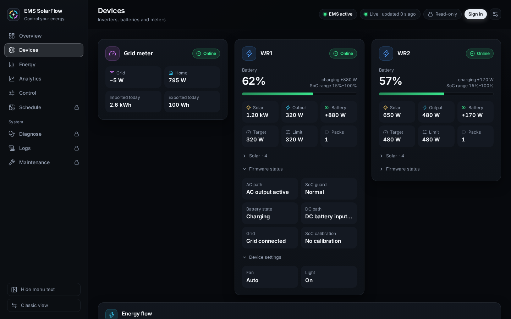
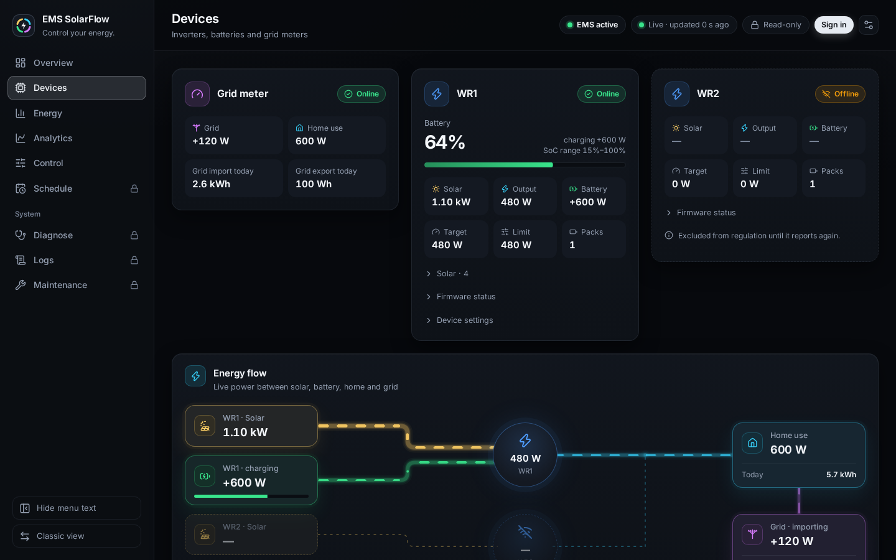

# Device cards

## Purpose

Read one inverter's live state: what it is producing, storing and delivering,
what the EMS wants from it, what its firmware reports, and — if the EMS does
not control it — why not.

## When to use this workflow

- One device behaves differently from the others.
- A device stopped contributing.
- You want to confirm a transport change took effect.
- You want to know whether the EMS may write to a device.

## Prerequisites

- The EMS running and the dashboard open. No sign-in needed to read.

## What you see

The **Devices** page — *Inverters, batteries and meters* — has the grid
meter's card first, then one card per inverter, the energy flow drawn per
device, and a power chart for the last hours.

### 1 — An inverter card's header

The device's EMS name (`WR1`, `INV_1`, …) and a status:

| Status | Meaning |
| --- | --- |
| **Online** | Reporting fresh telemetry |
| **Offline** | Not reporting, or older than the stale threshold |
| **Disabled** | Switched off in the configuration; the EMS does not control it |

A device the EMS only reads carries **Telemetry only** under its name.

### 2 — Battery

The state of charge as a large figure and a bar, with *charging +880 W*,
*discharging* or *idle* beside it and the configured **SoC range** underneath.
A read-only device that reports no charge level — an external inverter without
a battery — shows no battery, and the average state of charge leaves it out.

### 3 — The facts

| Fact | Meaning |
| --- | --- |
| **Solar** | Solar input into this inverter |
| **Output** | AC power this inverter delivers |
| **Battery** | `+` charging, `−` discharging |
| **Grid** | The grid power the device measures itself, where it has a meter (an E3/DC, for example) |
| **Target** | What the EMS wants this device to deliver |
| **Charge** | Instead of **Target** while the EMS charges this device from AC |
| **Limit** | The output limit in force |
| **Packs** | The number of battery packs |
| **AC input limit** | The AC charge limit, where the device reports one |

**Target against Output** is the useful comparison. They should meet within a
ramp. A lasting gap means something limits the device — the
[Control pipeline](control.md) names which stage.

### 4 — The folded sections

Under the facts, sections you open by clicking their name:

- **Solar · 4** — the power on each solar input, **PV 1** to **PV 4**, when the
  inverter has more than one.
- **Firmware status** — what the device itself reports, translated into words:

  | Field | Example values |
  | --- | --- |
  | **AC path** | `AC output active`, `AC charge active`, `AC output standby` |
  | **SoC guard** | `Normal`, `Max SoC reached`, `Min SoC protection` |
  | **Battery state** | `Charging`, `Discharging`, `Standby` |
  | **DC path** | `DC battery output path`, `DC battery input path`, `DC standby` |
  | **Grid** | `Grid connected`, `Grid disconnected` |
  | **SoC calibration** | `No calibration`, `Calibration running` |

  A value the dashboard does not know is shown as `Unknown (value 9)`.
- **Device settings** — light, fan, buzzer and battery heating as the inverter
  reports them, for each one it has. **On → Off** means the value set in the
  [runtime settings](runtime-settings.md) has not reached the inverter yet. See
  [Device settings](../../technical/runtime-state.md#device-settings).

With [battery full-charge assist](../../battery-full-charge-assist.md) on, a
battery-backed device also carries a **Full-charge assist** block: its state
(*Assist scheduled*, *Assist window active*, *Assist active*, *Assist overdue*,
*Restore pending*, …), a sentence on what the EMS does next, and **Last full
charge**, **Next due** and the restore steps.

### 5 — The grid meter, flow and history

The **Grid meter** card shows **Grid** (negative while exporting), **Home**, and
**Imported today** and **Exported today**. If the meter does not answer, its
status reads **Offline** and the card says *The grid meter does not answer.*

Below the cards, the **Energy flow** shows each inverter's solar and battery
running into it and its output joining the line into the home. The chart
underneath, **Power, last 24 h**, plots solar, inverter output and battery from
the local SQLite history; **All devices** chooses one device, the buttons
**1 h**, **6 h**, **24 h** or **7 d**, and **Table** lists the values. The battery
is drawn below zero while charging and above zero while discharging, and it
zooms, the same way as the chart on the [Overview](overview.md#5--today-and-the-power-chart).

## Connection and control readiness

Which transport a device uses is configured in the Admin Console — see
[Device management](../admin/device-management.md). It decides what the EMS can
write, and so what changes on the card:

| Transport | What to expect |
| --- | --- |
| **Local API** | Lowest latency; full state reconciliation |
| **Local MQTT** | Low latency, no cloud dependency; power control only |
| **Zendure MQTT (cloud)** | Higher, less predictable latency; power control only |

**MQTT control devices take the power command only** — output, and a charge from
surplus where the model and its **AC charging** switch allow it (see
[AC charging from surplus](../../ac-charging.md)). State reconciliation
(`minSoc`, `socSet`, `smartMode`, `gridOffMode`, full-charge assist), the device
settings and the manual AC role are API-only, so those values do not change for
an MQTT-controlled device.

## Read-only and write-blocked devices

A device can be shown but not written to. The reasons, and where to fix them:

| Reason | What the card shows | Fix |
| --- | --- | --- |
| You are not signed in | Nothing different: the top bar reads **Read-only**; the EMS still controls normally | Nothing — this is display only |
| Device disabled | **Disabled**, *Disabled in the configuration; the EMS does not control it.* | Re-enable in [Device management](../admin/device-management.md) |
| Telemetry stale | **Offline**, *Excluded from regulation until it reports again.* | Restore the transport |
| No output control | **Telemetry only**, *Read-only device: the EMS shows its values and never writes to it.* | [Why a device is read-only](../admin/device-management.md#why-a-device-is-read-only) |
| External device | **Telemetry only**, read over MQTT by design | [External devices over MQTT](../external-devices.md) |
| Write gate off | The [Control pipeline](control.md) shows the write blocked | [MQTT write gates](../admin/mqtt.md#write-safety-gates) |
| Dry run / simulation | The EMS deliberately writes nothing | Configuration choice |

> The **Read-only** pill in the top bar describes *your browser session*, not
> the EMS. The EMS keeps controlling your hardware whether or not you are signed
> in.

## Offline and stale devices

**What you see:** the device's status turns **Offline**, its measurements read
`—`, its battery is no longer shown, and the card says *Excluded from regulation
until it reports again.* On the Overview, **System status** reads *1 device(s)
offline* and **Active rules** lists **Offline devices**, naming it.

**What the EMS does:** it does **not** guess. A device whose telemetry is stale
is left out of the write decision instead of being commanded on old data. The
other devices carry the load, so grid import usually rises — in the screenshot
above, **Grid** `+120 W` instead of the usual near-zero.

**What to check, in order:**

1. Is the device powered and on the network?
2. For MQTT: is it still publishing to its broker? See
   [Maintenance → Device telemetry](../admin/mqtt.md#3--check-the-result)
   for age and metric counts.
3. For Local API: is the device's local API still enabled?
4. Run the **Hardware** diagnosis — see [Diagnostics](diagnostics.md).

## Several inverters

With more than one inverter, the EMS **allocates** the system target across
them rather than driving each one on its own:

- **PV first**: a device with its own solar input is preferred, so solar is
  used where it is produced.
- **PV priority** (`pv_priority_factor`) weights that preference.
- **Battery balance** adjusts each device's weight with a charge-balance
  multiplier, which is why **Active rules** may list it.

The split is the **Distribution** stage of the
[Control pipeline](control.md#03--distribution), and **Decision per device**
explains each share. A device contributing less than you expect is usually
correct behaviour, not a fault — check the allocation before changing anything.

## What happens in the background

- All values come from EMS telemetry. The dashboard renders; it does not measure.
- Firmware status is what the device reports, not an EMS interpretation.
- Whether a device may be written to is decided by the EMS write gates and
  capability detection, never by the browser.

## Expected result

For each device you can state: online or not, what it produces and delivers,
whether it is on target, and if not, which limit is responsible.

## Warnings and common problems

| Symptom | Meaning | What to do |
| --- | --- | --- |
| Output stays below Target | A limit or ramp is active | [Control pipeline](control.md) |
| Device online but Output `0 W` | The allocation gave it nothing, or it is disabled | Check the distribution and the enabled state |
| Values are dashes, battery gone | Offline | See above |
| Values look right but the hardware disagrees | Possibly a second controller | Nothing else may write `outputLimit` |
| Firmware fields all standby | Device not in an energy path | See [observed firmware behavior](../../observed-firmware-no-energy-path.md) |

## Recovery or next steps

- Why this value → [Control pipeline](control.md)
- Change limits or the enabled state → [Runtime settings](runtime-settings.md)
- Change transport or identity →
  [Device management](../admin/device-management.md)
- Evidence for a report → [Diagnostics](diagnostics.md)
