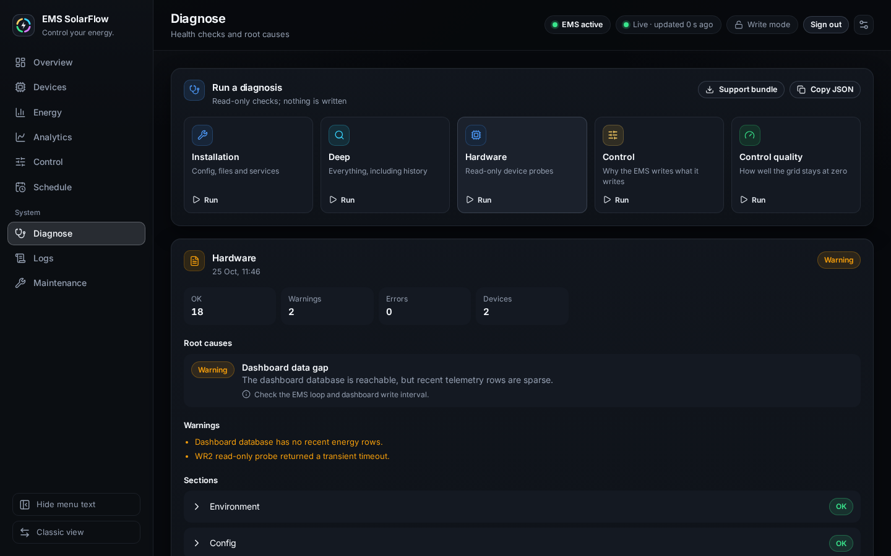
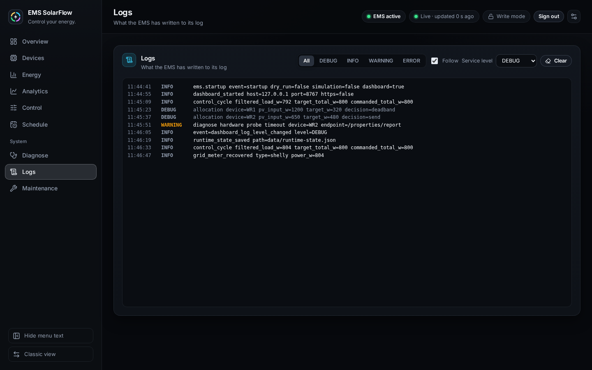
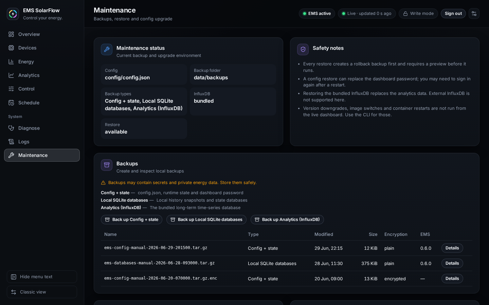

# Diagnostics, logs and maintenance

## Purpose

Run EMS diagnostics from the browser, read recent service logs, and create or
restore a backup — without a shell.

## When to use this workflow

- Something is wrong and you want evidence.
- You need a support bundle for an issue report.
- You want a quick backup before changing something.

## Prerequisites

- A dashboard **sign-in**. The three pages here, under **System** in the side
  menu, are operator-only; signed out they say *Sign in to see this page.* with
  a **Sign in** button.

## Diagnose



**What you see:** **Run a diagnosis** — *Read-only checks; nothing is written* —
with one card per diagnosis and the **Support bundle** button.

### 1 — Pick a diagnosis

| Card | What it checks | CLI equivalent |
| --- | --- | --- |
| **Installation** | Config, files and services | `diagnose` |
| **Deep** | Everything, including history | `diagnose --deep` |
| **Hardware** | Read-only device probes | `diagnose --hardware` |
| **Control** | Why the EMS writes what it writes | `diagnose --control` |
| **Control quality** | How well the grid stays at zero | `diagnose --control-quality` |

### 2 — Run

**What you select:** **Run** on the card.

**What it changes:** **nothing. Every diagnosis is read-only.** No config,
runtime state or hardware write happens.

**Expected result:** a report card named after the diagnosis, with its time and
an overall status (**OK**, **Warning**, **Error**), the counts **OK**,
**Warnings**, **Errors** and **Devices**, the **Root causes** with what to check
next, the global errors and warnings, and **Sections** you open one by one.

**If it differs:** **Hardware** needs the devices to be reachable; a failure
there is itself the finding. *A diagnosis is already running. Try again in a
moment.* means one is still running.

### 3 — Export

| Button | What it does |
| --- | --- |
| **Copy JSON** | Copies the report as JSON — a versioned public contract, stable across releases. It appears once a report is shown |
| **Support bundle** | Downloads the full bundle as `ems-support-bundle.zip` |

The bundle contains a fixed file list: `diagnosis.json`,
`control-diagnostics.json`, `control-quality.json`, `redacted-config.json`,
`runtime-state.json`, `bundle-metadata.json`, plus `.txt` variants.

> **The config in the bundle is redacted, but the bundle still describes your
> installation.** Before attaching one to a public issue, remove serial numbers,
> API keys, MQTT credentials, tokens, backup passwords, public IPs, personal
> hostnames and exact private paths. See
> [Diagnostics and recovery](../admin/diagnostics-recovery.md#support-bundles).

## Logs



**What you see:** **Logs** — *What the EMS has written to its log* — one line per
entry with its time, level and message, coloured by level.

**What you select:**

- The level filter — **All**, **DEBUG**, **INFO**, **WARNING** or **ERROR**.
- **Follow** keeps the newest line in view.
- **Service level** — what the EMS writes from now on.
- **Clear** empties this view; the EMS keeps its log.

**What it changes:** the filter and **Clear** are display only. Changing the
**Service level** changes what the EMS emits from here on: raise it to
**DEBUG** to see lines that are otherwise not written.

**If it differs:** **the buffer is in memory.** It shows *recent* output, not
the full history, and it does not survive an EMS restart. For anything older,
read the container logs:

```bash
docker compose logs ems
```

EMS logs are structured `event=...` lines, which is why they filter and grep
cleanly.

## Maintenance



**What you see:** **Maintenance** — *Backups, restore and config upgrade* — in
five cards:

| Card | What it does |
| --- | --- |
| **Maintenance status** | The config path, the backup folder, the backup types, InfluxDB (*bundled*, *external* or off) and whether restore is *available* here or *CLI only* |
| **Safety notes** | What this page does and does not do |
| **Backups** | **Back up Config + state**, **Back up Local SQLite databases** and **Back up Analytics (InfluxDB)**; the list of backups with name, type, date, size, encryption and EMS version, and **Details** for each |
| **Restore** | Choose a backup, enter a password for an encrypted one, **Preview restore**, then **Confirm restore** |
| **Config upgrade** | **Check config** lists the added keys, migrated values, new and refreshed comments and a layout change; **Apply with backup** writes them |

### Back up

1. Select one of the three **Back up …** buttons.
2. The card says *Creating … backup…*, then *Created …* with the file name, and
   the backup appears in the list.
3. **Details** shows where a backup came from — purpose, date, source EMS
   version and revision, format, encryption — and its contents. The details of
   an encrypted backup stay locked here; the restore preview opens them with
   the password.

### Restore

1. Choose the backup under **Backup**. For an encrypted one, enter its password.
2. Select **Preview restore**. The preview lists each file and what happens to
   it, and says whether a restart and a new sign-in are needed.
3. Select **Confirm restore**, and confirm once more in the dialog. A rollback
   backup is taken first.
4. Restart the EMS when the page asks for it.

### Config upgrade

1. Select **Check config**. *Config is up to date.* means there is nothing to do.
2. Otherwise read what would change, then select **Apply with backup** — or
   **Refresh comments with backup** when only comments change — and confirm.
3. Restart the EMS after applying.

### What it will not do

The **Safety notes** say it in full:

- Every restore **creates a rollback backup first** and requires a preview
  before it runs.
- A config restore can replace the dashboard password — **you may need to sign
  in again** after a restart.
- Restoring the bundled InfluxDB replaces the analytics data. **External
  InfluxDB is not supported here.**
- **Version downgrades, image switches and container restarts are not run from
  the live dashboard.** Use the CLI for those, or the
  [Admin Console](../admin/backup-restore.md).

> Backups may contain secrets and private energy data. Store them safely.

## Dashboard vs Admin Console vs CLI

Three surfaces, same underlying EMS/Core implementation.

| | Dashboard | Admin Console | CLI |
| --- | --- | --- | --- |
| Diagnostics | Yes, read-only | Yes, read-only | Yes, full |
| Support bundle | Yes | — | Yes |
| Logs | Recent, in-memory | — | Full, via Docker |
| Backup / restore | Yes | Yes | Yes |
| Config upgrade | Check and apply | Yes | Yes |
| EMS image change | **No** | Guided Upgrade | Yes |
| Add or remove a device | No | Yes | Config edit |

Pick the dashboard for a quick look while watching live values; the Admin Console
for guided, previewed changes; the CLI for anything offline or scripted.

## What happens in the background

- Diagnostics come from the EMS-owned diagnostics service — the same one the CLI
  and Admin Console use. One implementation, one answer.
- Backup and restore use the normal EMS backup archives and the normal restore
  rules. Only one backup, restore or config upgrade runs at a time.
- Every action here is checked on the server for a session and a CSRF token.

## Expected result

You can produce a shareable, sanitizable evidence bundle and a fresh backup from
the browser, and you know which operations deliberately are not available here.

## Warnings and common problems

| Symptom | Meaning | What to do |
| --- | --- | --- |
| *Sign in to see this page.* | Operator-only, no session | Sign in — [Runtime settings](runtime-settings.md#1--sign-in) |
| Logs look cut short | In-memory buffer | `docker compose logs ems` |
| The Hardware diagnosis fails | Devices unreachable | That *is* the finding — [Devices](devices.md) |
| Restore reads *CLI only* | Restore is not available from this dashboard | Use `python3 emsctl.py backup restore <archive>` |
| *Another backup, restore or config upgrade is still running.* | One maintenance action at a time | Try again when it has finished |
| InfluxDB reads *Off*, or *external (no backup)* | Analytics is off, or its InfluxDB is not one this page backs up | Expected |

## Recovery or next steps

- Guided recovery for a failed workflow →
  [Diagnostics and recovery](../admin/diagnostics-recovery.md)
- Full backup workflow → [Backup and restore](../admin/backup-restore.md)
- Command-level detail → [CLI reference](../../cli.md) ·
  [Troubleshooting reference](../../technical/troubleshooting-reference.md)
- Report hardware behaviour → [Supported setups](../supported-setups.md)
