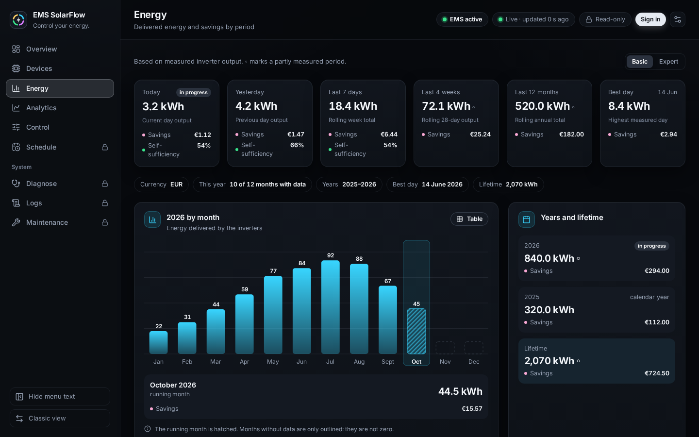
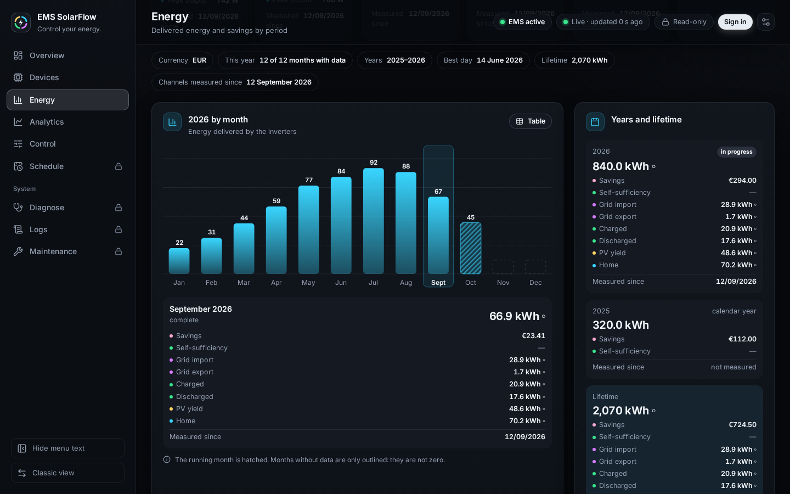
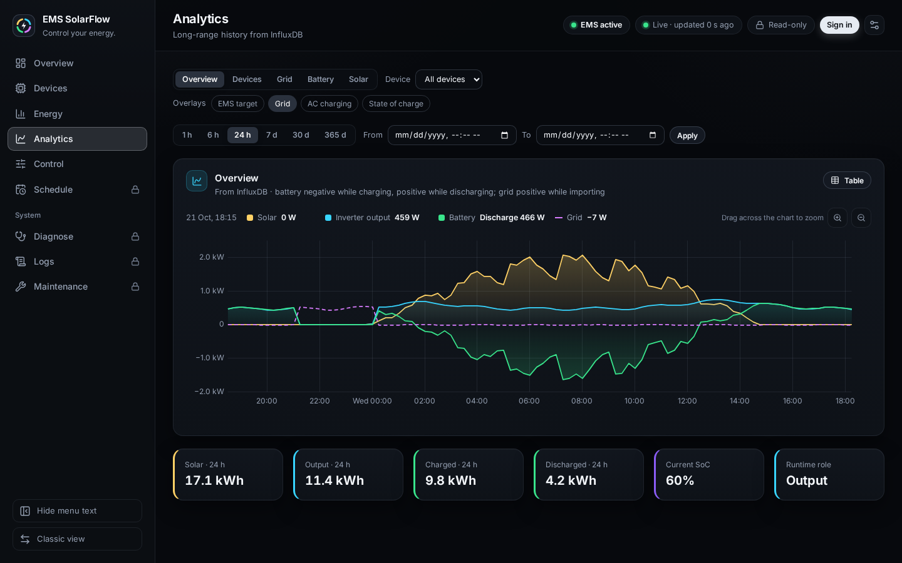

# Energy and analytics

## Purpose

See how much energy was actually delivered over time, and — if you set up
long-range analytics — look further back than the local history keeps.

## When to use this workflow

- "How much did the system deliver today?"
- Comparing days, weeks, months or years.
- Checking whether a change actually improved anything.

## Prerequisites

- The EMS running and the dashboard open. No sign-in needed.
- For the **Analytics** page only: InfluxDB configured. Everything else works
  without it.

## Two different history sources

This distinction matters, because the pages answer different questions.

| | Source | Always available | Range | Where |
| --- | --- | --- | --- | --- |
| **Operational history** | Local SQLite | **Yes** | Short — `1 h` to `7 d`, and what the store keeps | The power charts on **Overview** and **Devices** |
| **Long-range analytics** | InfluxDB | **Only if configured** | Up to `365 d` | **Analytics** |

The **Energy** page sums up delivered energy from the local statistics and does
not depend on InfluxDB.

Details: [Two history sources](../../dashboard.md#two-history-sources-sqlite-operational-vs-influxdb-analytics).

## The Energy page

**What you see:** *Based on measured inverter output.* above six period cards —
**Today** (*in progress*), **Yesterday**, **Last 7 days**, **Last 4 weeks**,
**Last 12 months** and **Best day** — then a strip with the currency, how many
months of this year have data, the years, the best day and the lifetime total.
Below it, **2026 by month** draws each month as a bar, and **Years and
lifetime** lists each year and the lifetime total.

**What it means:** this is **delivered AC energy, measured at the inverter
output**. It is not a modelled or estimated figure, and it is not a utility
bill. The figures are for the whole installation, not per device.

**What it changes:** nothing. Reading is read-only.

**If it differs:**

- **A period reads zero or is missing** → the EMS was not running, or telemetry
  was not arriving, for that period. Gaps stay gaps; nothing is interpolated.
- **Numbers look lower than your meter** → this counts inverter output only. It
  does not include what your solar fed to the house through another path. Grid
  import and export are their own figures, see below.

### Months

Each month of the year is a bar. The running month is hatched; a month without
data is only outlined, because it is not zero. Click a bar, or select it with
the keyboard, to see that month underneath: its energy, savings and
self-sufficiency, and in **Expert** every channel. **Table** lists all twelve
months with the same figures as columns; a table wider than the screen scrolls
sideways.

### Basic and Expert

The **Basic** / **Expert** switch at the top right decides how much each card
shows. The browser remembers it, and it changes nothing on the system.

| | What a card shows |
| --- | --- |
| **Basic** | Energy, savings, and self-sufficiency where the period is fully measured |
| **Expert** | The same, plus grid import and export, charged and discharged, PV yield, home, peak output and since when the channels are measured |

**Expert** applies everywhere on the page: the period cards, the month detail
and table, each year and the lifetime total carry the same rows in the same
order, and the strip adds **Channels measured since**.

**Grid import** is energy drawn from the grid, **Grid export** energy fed into
it. **Charged** and **Discharged** are the two directions of the battery. They
are measured separately, so a day with both reports both — a single netted
figure would hide half of what happened.

**Home** is what the house drew at the grid connection point. If the EMS
charges the battery from the grid — winter mode, full-charge assist — that
charging is part of this figure, because the meter cannot tell it apart from a
washing machine.

Where a period contains energy charged from AC, the card carries an **AC
charged** row. It has no savings attached on purpose: savings price avoided
import, and energy put into a battery has avoided nothing yet — the discharge
that does is already counted.

**Self-sufficiency** is the share of home consumption that did not come from
the grid. It appears for a period the channels measured from beginning to end,
with no day inside it missing; otherwise it would divide a half-measured number
by a whole one, and the row shows `—`. A sample whose grid meter did not answer
counts for nothing: an unreachable meter reads as 0 W, and taking that at face
value would report perfect self-sufficiency for a system that simply lost sight
of the grid.

A single failed read is not a gap. The EMS keeps calculating with a device's
last reading for as long as it is current, and the statistics count it over
exactly the same window (`telemetry_max_age_seconds`), so one network hiccup does
not mark the day — let alone the month and the year that contain it. Commanding
that device stops immediately, on the first failed read; that is a separate
decision, because sending a value and measuring one are not the same risk.

If the grid meter does not answer, or a device has been silent past that window,
every figure on the page stops for as long as that lasts — the delivered energy
and the savings estimate with them. A meter that never answered reads as 0 W and
a silent device keeps reporting its last value, and counting either would be
inventing energy. They stop together on purpose: taking the meter's reading
while ignoring the device's would divide two numbers measured at different
moments. The Overview names an offline device under **Active rules**;
repairing it, removing it, or **disabling** it is what starts the figures
again — a device you have switched off for the season is a decision, not a gap,
so a disabled one does not hold the statistics. While it stays silent it also
drops out of the totals, because a device that is off delivers nothing.

Time inside a period that was not measured — a restart, an outage, a day the
EMS did not run — marks the figures with `◦` instead of hiding the number.
Everything stops and resumes together, so the percentage describes the measured
part of the period. Withholding it for every restart would mean you never see
one for a month, a year or the lifetime.

### Since when a figure exists

Grid and battery energy are measured from the day this version started running.
For periods that begin before that day, the page does not print a zero:

| What you see | What it means |
| --- | --- |
| `78 Wh` | Below a kilowatt-hour the figure is in watt-hours, so a small or freshly started total is readable |
| `28.9 kWh ◦` | The period is only partly measured; the figure covers the measured part |
| `not measured` | The period lies entirely before the channels existed |
| **Measured since** `12/09/2026` | The first day the channels were measured |

The inverter output and the savings estimate are older than the channels, so a
card can show a full year's output next to channels marked `◦`. That is not a
defect: it is the difference between what was measured then and what is
measured now.

### Reading production, consumption, battery and grid

The [Overview](overview.md) gives you the instantaneous picture; the Energy page
gives you the accumulated one.

| Question | Where |
| --- | --- |
| How much am I producing *right now*? | Overview → **Solar now** |
| How much have I delivered *today*? | Energy → **Today** |
| Am I importing or exporting right now? | Overview → the **Grid** box of the energy flow |
| How much did I import or export *today*? | Overview → **Grid import today**, or Energy → **Expert** → **Grid import** / **Grid export** |
| How much did the battery take and give back? | Energy → **Expert** → **Charged** / **Discharged** |
| Is the battery charging or discharging? | Overview → **Storage** |
| How did any of these move over the last day? | Overview → **Power today** |
| How did they move over months? | **Analytics** — needs InfluxDB |

## The Analytics page

**What you see:** two rows of controls, the chart, and the KPI cards.

1. **View** — **Overview**, **Devices**, **Grid**, **Battery** or **Solar**.
   Each keeps the one chart and changes its series and the KPI cards. **Device**
   chooses one inverter instead of **All devices**.
2. **Overlays** — **EMS target**, **Grid**, **AC charging** and **State of
   charge** add a series on top of the view; the state of charge gets its own
   percent scale on the right.
3. **Range** — **1 h**, **6 h**, **24 h**, **7 d**, **30 d** or **365 d**, or a
   custom range with **From**, **To** and **Apply**.
4. The chart names its source, *From InfluxDB*, and **Table** lists the values.
   It zooms like every chart here; on Analytics a zoom asks InfluxDB for just the
   zoomed window, so the detail gets finer the further you zoom in, and the page
   stops refreshing until **Reset zoom** or **Esc**.
5. The KPI cards integrate the energy in the loaded window and name it, for
   example **Solar · 24 h**. **Current SoC** and **Runtime role** come from the
   live values.

**What it changes:** nothing.

**If analytics is not configured:** the page shows **Long-range analytics** with
*InfluxDB analytics is not configured* — an explicit empty state, not an error
and not a chart of zeros. *InfluxDB analytics is not reachable* and *The InfluxDB
analytics schema is incomplete* name the other two cases, with the fix the
server suggests; the range buttons stay, so another range can be tried.

> **When analytics is not set up, there is no long-range history to show.** The
> dashboard says so rather than implying data exists. The power charts on the
> Overview and Devices pages keep working, because they come from the local
> SQLite store.

Enabling it: [Analytics / InfluxDB](../../technical/influxdb.md).

## Aggregation intervals

Longer ranges are aggregated into coarser buckets so a chart stays readable. A
7-day view is not sampled at the same resolution as a 1-hour view. Short spikes
visible at `1 h` can be averaged away at `7 d` — that is aggregation, not lost
data. Zooming in on Analytics asks for the finer resolution again.

## Missing or incomplete data

| Cause | What you see | Is it a bug? |
| --- | --- | --- |
| The EMS was stopped | A hatched gap in the chart | No |
| Device silent past `telemetry_max_age_seconds` | Every figure pauses, the period is marked `◦` | No |
| Analytics not configured | Analytics shows its empty state | No |
| InfluxDB configured but unreachable | *InfluxDB analytics is not reachable* | Check the InfluxDB service |
| History retention passed | The chart says *The local history keeps 48 h; older data is in Analytics.* | No — use Analytics for long ranges |

Gaps are shown as gaps. The EMS does not invent data for a period it did not
observe.

## What happens in the background

- Energy figures come from measurements the EMS recorded itself: the inverter
  output, and the grid, battery, solar and home readings integrated over the
  time between samples. They are the EMS's own measurement, not a billing
  figure, and they will not match a utility meter to the digit.
- Operational history is written to a local SQLite store; analytics ingestion
  into InfluxDB is a separate optional path.
- Analytics refreshes every 30 s while it is on screen; reading either never
  writes anything.

## Expected result

You can state how much the system delivered over a period, and you can tell the
difference between "it delivered nothing" and "nothing was recorded".

## Warnings and common problems

| Symptom | Meaning | What to do |
| --- | --- | --- |
| Analytics shows *not configured* | InfluxDB not configured | Expected. [Enable it](../../technical/influxdb.md) if you want long ranges |
| A power chart says *No history in this range yet.* | No operational history yet | Give the EMS time to record |
| Totals seem too low | This is inverter output, not household consumption | Compare with the right figure |
| Two sources disagree slightly | Different resolutions and ingestion paths | Expected at coarse aggregation |

## Recovery or next steps

- Live values → [Overview](overview.md)
- Why output was limited during a period → [Control pipeline](control.md)
- Set up long-range analytics → [Analytics / InfluxDB](../../technical/influxdb.md)
