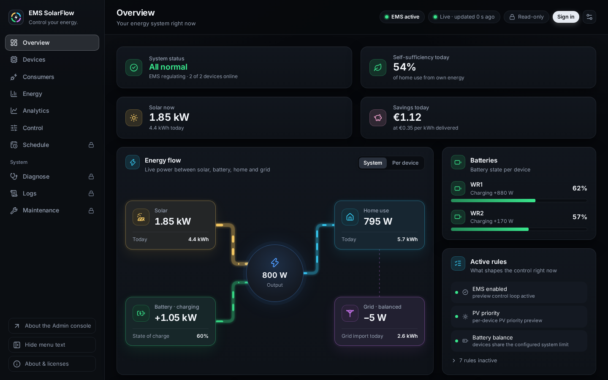

# EMS Dashboard — step-by-step guides

The live operating UI (**EMS SolarFlow**, *"Control your energy."*): the
**Dashboard** pages of the app at `http://<host>:8090`, served by the Admin
Console. It shows what the EMS is measuring, what it decided and why, and, once
you sign in, lets you change a small set of runtime values, set up schedules and
use the operator tools.

The EMS keeps its own copy of the dashboard at port `8080`. Opened there
while an Admin Console answers on this host, it says where the app is and,
once this browser reaches the console too, goes there after five seconds, to
the same page; **Stay on this address** keeps this browser on port 8080, as a
tablet on the wall that only shows the dashboard may. Otherwise, as without an
Admin Console (a [Docker Bootstrap](../docker-bootstrap.md) installation) or
while it is down, port 8080 is the dashboard, with **Maintenance** and
**Diagnose** in its menu and **About the Admin console** at the foot of the
menu.



## Choose your guide

| You want to | Read |
| --- | --- |
| Understand the top bar, the menu and the Overview page | [Overview and navigation](overview.md) |
| Read a single inverter's state | [Devices](devices.md) |
| See where the house's power goes, and what each consumer cost | [Consumers](consumers.md) |
| See how much energy was delivered, or look further back | [Energy and analytics](energy.md) |
| Understand *why* the EMS wrote that value | [Control pipeline](control.md) |
| Change a live setting, or plan one with a schedule | [Runtime settings and schedules](runtime-settings.md) |
| Collect evidence, read logs, back up | [Diagnostics and maintenance](diagnostics.md) |
| Change the colour scheme, the language or the density | [Appearance and language](appearance.md) |

## The pages

The side menu lists the pages in two groups, in this order:

```text
Overview · Devices · Consumers · Energy · Analytics · Control · Schedule
System: Diagnose · Logs · Maintenance
```

| Page | What it shows |
| --- | --- |
| **Overview** | *Your energy system right now*: system status, self-sufficiency, solar and savings, the energy flow, the batteries, the active rules, today's energy and the power chart |
| **Devices** | *Inverters, batteries and grid meters*: the grid meter first, then one card per inverter, the energy flow per device and the power history |
| **Consumers** | *Where the house's power goes, and what it costs*: each metered consumer now, stacked over time, and its energy, cost and share by period |
| **Energy** | *Delivered energy and savings by period*: periods, months, years and the lifetime, in **Basic** or **Expert** |
| **Analytics** | *Long-range history from InfluxDB*, when InfluxDB is set up |
| **Control** | *What the EMS is doing and why*: the current decision, the runtime settings, the six stages of the control pipeline and the decision per device |
| **Schedule** | *Switch points the EMS applies by itself* |
| **Diagnose** | *Health checks and root causes* |
| **Logs** | *What the EMS has written to its log* |
| **Maintenance** | *Backups, restore and config upgrade* |

A lock beside Schedule, Diagnose, Logs and Maintenance means they need you to
be signed in. Signed out, they show *"Sign in to see this page."* with a
**Sign in** button instead of empty panels. On a phone the menu becomes a bar
at the bottom, see [Overview and navigation](overview.md#on-a-phone).

The foot of the side menu, and **More** on a phone, hold **About & licenses**.
It shows the version and commit, the source code of exactly
that version, the project's license (GNU AGPL v3 or later, without any
warranty), the note that this is an independent community project and not a
Zendure product with links to its Discussions and issues on GitHub, the
invitation to report a device that works (or does not) with links to the
report form and to the [supported setups](../supported-setups.md), and the
license of every component the page is built from.

## Read-only by default

The dashboard is a view onto the EMS, not a second controller.

- Without signing in it is **read-only**. The top bar shows a **Read-only**
  pill and a **Sign in** button.
- After signing in the pill reads **Write mode** and the button **Sign out**.
  The runtime settings on the Control page and the Schedule, Diagnose, Logs
  and Maintenance pages become usable.
- The password is the **same one as the Admin Console's**, stored in
  `config/dashboard-auth.json`. If none is set, the sign-in dialog says
  *"No dashboard password is set. Set one with: python3 emsctl.py dashboard
  set-password"*.
- Every write is checked on the server for a session **and** a CSRF token. A
  visible button is never what authorizes a write.

Reading the dashboard never changes anything on the EMS, signed in or not.

## Browsers and old addresses

The dashboard needs Chrome or Edge 114, Firefox 125 or Safari 17 (iOS and
iPadOS 17) or newer. An older browser shows a page that says so, in English,
German, Dutch and French.

The previous design, **Classic**, has been removed. An old bookmark of
`/classic/` or `/modern/` opens the dashboard at its address.

## Related

- [Admin Console guides](../admin/index.md) — install, upgrade, devices, backups.
- [Live Dashboard reference](../../dashboard.md) — configuration, API, HTTPS,
  session lifetime, history sources.
- [Schedules](../../scheduler.md) — how the switch points work.
- [Safety](../safety.md) — before enabling live hardware writes.
- [Control logic (technical)](../../technical/control-logic.md) — the maths behind
  the Control page.
