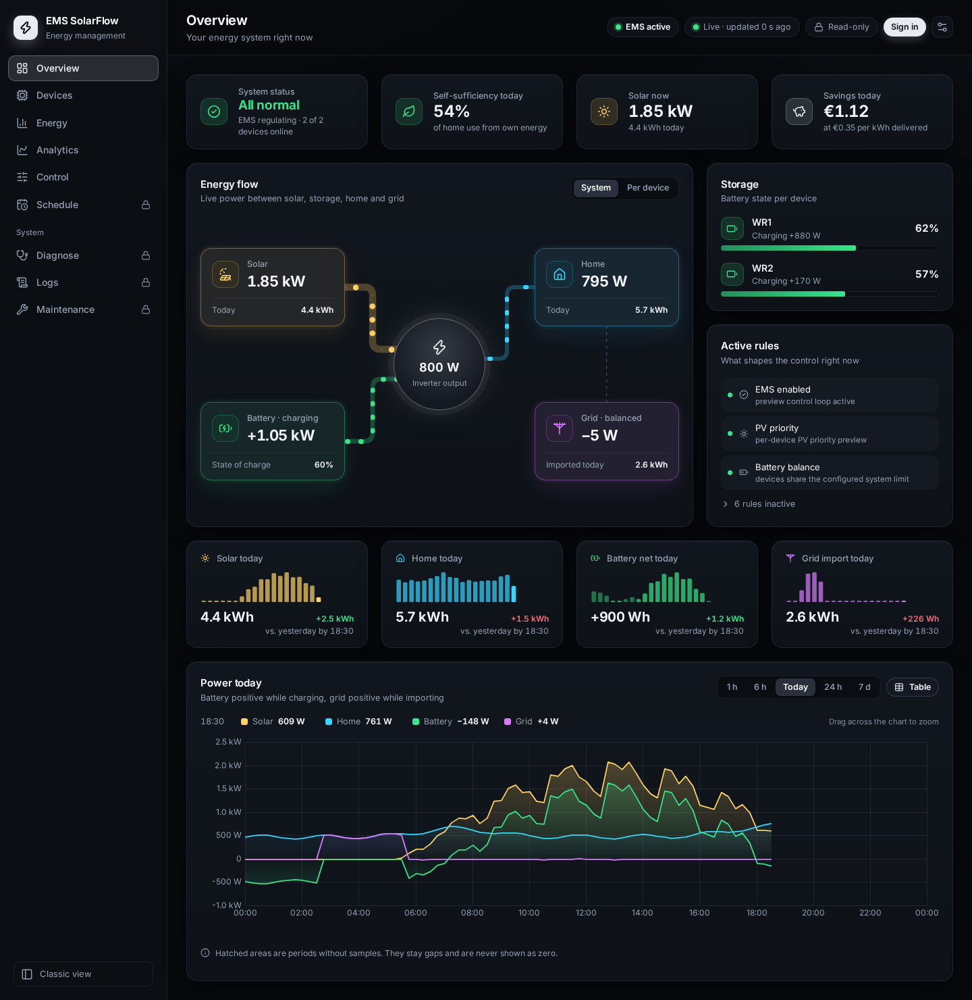
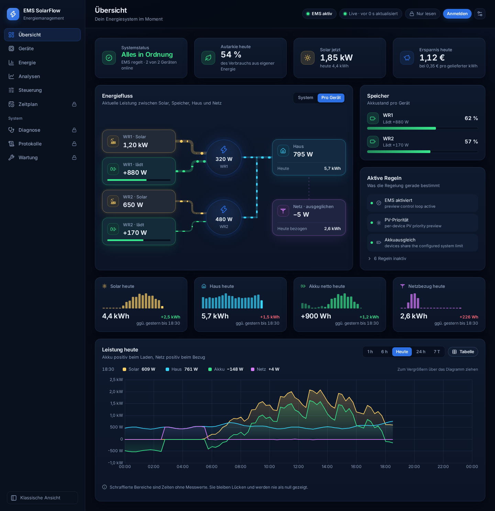
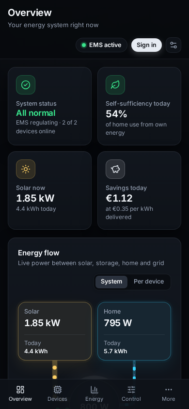
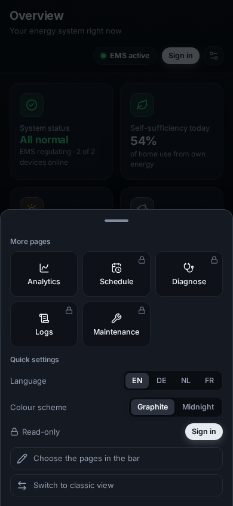

# The Modern dashboard

## Purpose

The dashboard has two views of the same installation. **Classic** is the
cockpit the other guides in this section describe. **Modern** is a newer
layout at `/modern/` on the same port: the same data, the same password and
the same runtime settings, arranged in a sidebar with one page per topic, in
English, German, Dutch or French.

Both views read the same API and write through the same checks. Nothing you
do in one is hidden from the other, and switching between them changes nothing
on the EMS.

## When to use this workflow

- You want the newer layout, or the dashboard in your own language.
- You want to see the energy flow per inverter next to the totals.
- You set up a screen in one room and want it to open in one view every time.

## Prerequisites

- EMS running and the dashboard open. No login needed to read.

## What you see

| Page | What it shows |
| --- | --- |
| **Overview** | the system status, the energy flow, the batteries, the active rules, today's energy and the power chart |
| **Devices** | one card per inverter and battery, and the grid meter |
| **Energy** | delivered energy for today, yesterday, the last 7 days, 4 weeks and 12 months, the best day, each month, each year and the lifetime, with savings and self-sufficiency; **Expert** adds every energy channel and since when it is measured |
| **Analytics** | the time-series views Classic's Analytics tab offers, over 1 hour to 365 days |
| **Control** | the control pipeline, each device's decision and the runtime settings |
| **Schedule** | the scheduler's rules, with a preview the EMS checks before a rule can be saved |
| **Diagnose**, **Logs**, **Maintenance** | the operator tools |

Schedule, Diagnose, Logs and Maintenance need you to be signed in. Signed out,
they say so instead of showing empty panels. The **Sign in** button in the top
bar uses the same password as Classic and the Admin Console.

## Switching between the two

- In Classic, the header has a **New dashboard** link.
- In Modern, the foot of the sidebar has **Classic view** (on a phone, under
  **More**).

Modern is the default: a browser that has never chosen opens Modern at the
dashboard's address. The browser remembers the choice: opening the address
again takes you to the view you used last. Adding `?ui=classic` or `?ui=modern` to the
address sets the choice explicitly, which is useful for a bookmark or for a
screen that stays on in one room. Each browser keeps its own choice, so a
tablet in the hall can show Modern while a laptop shows Classic.

Two cases open Classic whatever the choice: demo mode (`?demo=1`), which only
Classic has, and a browser too old for Modern. Modern needs Chrome or Edge 114,
Firefox 125 or Safari 17 (iPadOS 17) or newer; an older browser keeps working
with Classic.

## The energy flow

The flow on the Overview page has two modes, chosen with the switch above it:

- **System** -- one line each for PV, battery, home and grid, totalled over all
  devices.
- **Per device** -- one row per inverter with its own PV, battery and output,
  so you can see which device does what. The inverters' lines join into one
  line into the home, which grows as each inverter adds its share.

The choice is remembered. In both modes the inverters' line runs to the home and the grid's line meets
the home on its own, the way the meter sees the house. An inverter that
charges from the grid turns its line the grid's colour and runs it from the
home back to the inverter. In the System view that line carries the
inverters' output minus their charge: it turns round once the charge is the
larger, and it rests while the two are about even. On a phone the home and the grid sit side by side
at the bottom, and the inverters' line runs down into the home.

The lines are drawn as glowing pipes in the colour of their energy. The
thickness of a pipe follows the power on it, and the moving dashes show its
direction; a stronger flow moves faster and shines brighter.

## Energy by month, and charts you can zoom

On the **Energy** page every month of the year is a bar. Click a bar (or
select it with the keyboard) to see that month's figures underneath: energy,
savings and self-sufficiency, and in **Expert** the grid import and export,
the battery's charged and discharged energy, the PV yield, the home's use and
since when those channels are measured. **Table** lists all twelve months
with the same figures as columns, so in **Expert** every channel too; a table
wider than the screen scrolls sideways.

Every chart with a time axis zooms: drag across the stretch you want to look
at, turn the mouse wheel over the chart, or use the **+** and **−** buttons.
**Reset zoom** or **Esc** brings the whole range back. A zoomed chart keeps its
zoom while new data arrives. On **Analytics** a zoom asks InfluxDB for just
the zoomed window, so the detail gets finer the further you zoom in, and the
page stops refreshing until you go back.

The history charts name where their data comes from (the local SQLite history
or InfluxDB). When InfluxDB analytics is not set up, not reachable or its
schema is incomplete, Analytics says which, with the fix the server suggests,
and keeps the range buttons so another range can be tried.

## Today compared with yesterday

The tiles for solar, home, battery and grid import show today's energy so far,
hour by hour, and compare it with **yesterday up to the same time of day**. At
two in the afternoon, today's solar is compared with yesterday's solar until
two in the afternoon, not with the whole of yesterday. When the history for
yesterday is not there yet, the tile says so instead of showing a comparison.

Each bar is one hour. The dashed line at the top of the bars is the figure
written above it, so a bar that reaches the line stands for that much energy
in its hour; the hours 00, 06, 12, 18 and 24 are marked underneath.

## Appearance

The **Appearance** button in the top bar holds five choices:

| | |
| --- | --- |
| **Colour scheme** | **Graphite** (the default, neutral near-black) or **Midnight** (deep navy) |
| **Language** | English, Deutsch, Nederlands, Français -- numbers and dates follow the language |
| **Density** | **Normal** or **Compact** |
| **Side menu** | **Auto** (text beside the icons on a desktop, icons only below 1024 px), **With text** or **Icons** |
| **Motion** | the moving dashes in the energy flow, and on a phone the sheet sliding in, on or off |

The colours of the energy types are the same in both schemes and in Classic:
PV is the warm one, battery the green one, output the cyan one and grid the
violet one.

The button at the foot of the side menu switches its text on and off as
well, and remembers the choice like the menu above.

Modern's choices are separate from Classic's palette, style and density menus;
changing one never changes the other. Like Classic's, they belong to the
browser you made them in. If the installation has animation switched off, the
motion setting cannot turn it back on.

## On a phone

On a narrow screen the sidebar gives way to a bar at the bottom with four
pages -- Overview, Devices, Energy and Control until you choose others -- and
**More** for the rest.

- **More** opens a sheet from the bottom edge with the other pages, the
  language, the colour scheme, signing in or out and the switch to Classic. A
  lock marks the pages that need you to be signed in. Tap outside the sheet,
  tap or swipe down its handle, or press Esc to close it.
- On a page that is not in the bar, the fifth button shows that page's name,
  so the bar always says where you are. Tapping it opens the sheet.
- **Choose the pages in the bar**, in the sheet, picks the four. Tap two
  pages to swap them: a page under **More** with one in the bar takes its
  place, and two pages in the bar change their order. **Default pages** brings
  back the original four. The browser remembers the choice.

## Expected result

The dashboard opens in the view you chose, in your language and colour scheme,
and shows the same values as the other view.

## Warnings and common problems

| Symptom | Meaning | What to do |
| --- | --- | --- |
| The address opens the other view | The choice is stored per browser, and this browser has a different one | Use the switch, or open the address with `?ui=modern` or `?ui=classic` |
| The choice is forgotten after closing the browser | The browser does not keep site data | Bookmark the address with `?ui=modern` or `?ui=classic` |
| `?ui=modern` still opens Classic | The address is in demo mode, or the browser is too old for Modern | Leave out `demo=1`, or update the browser |
| A tile says "no comparison yet" | There is no history for yesterday up to this time | It fills in once the dashboard has a day of history |
| The dashes in the flow do not move | Motion is off here, the installation has animation switched off, or the system asks for reduced motion | Check **Appearance → Motion** |

## Recovery or next steps

- Back to the Classic cockpit → [Overview and navigation](overview.md)
- What each setting does; both views write the same values →
  [Runtime settings](runtime-settings.md)
- Before enabling live hardware writes → [Safety](../safety.md)
