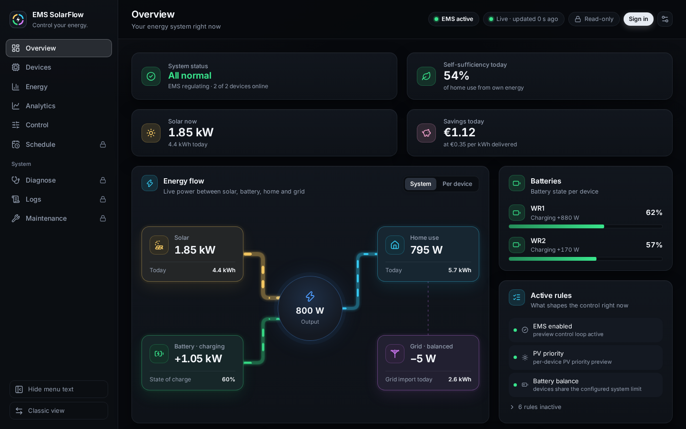
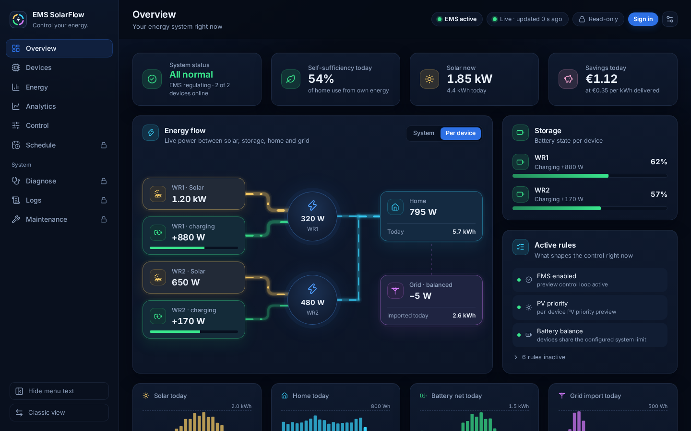
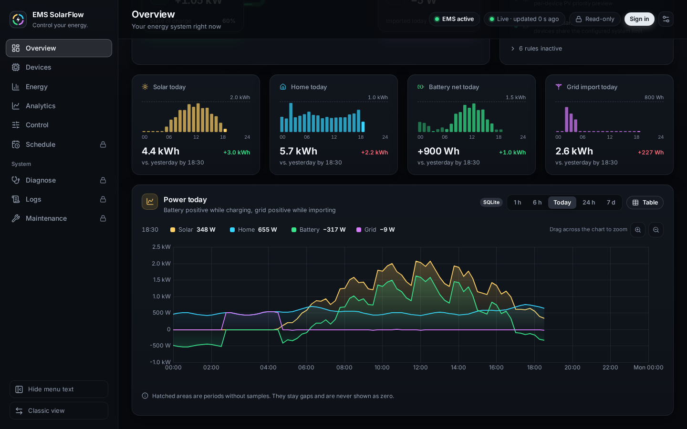
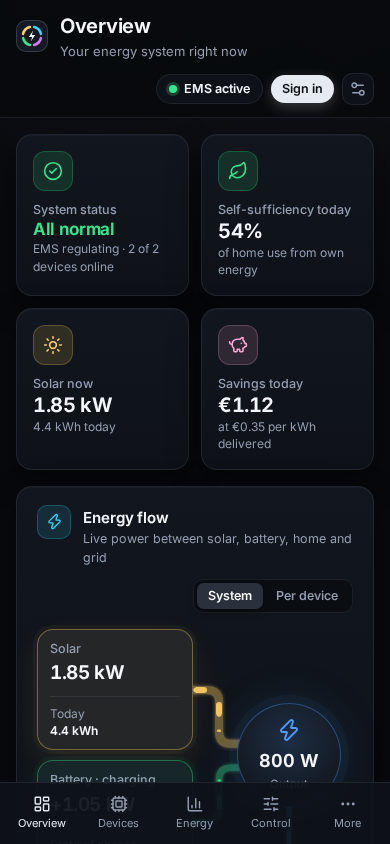
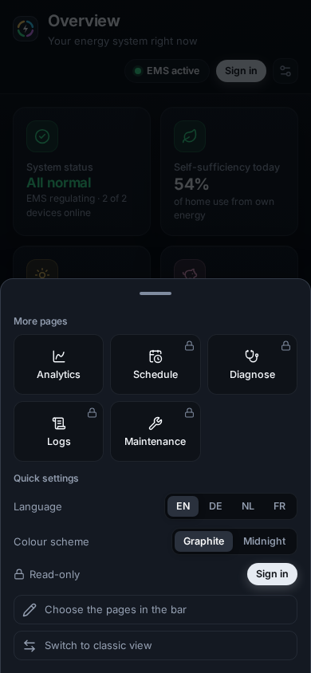

# Overview and navigation

## Purpose

Read the whole system at a glance: what is being produced, used, stored and
exchanged with the grid right now, how today compares with yesterday, and which
EMS behaviours are active.

## When to use this workflow

Every day. **Overview** is the page to leave open.

## Prerequisites

- The EMS running, and the dashboard reachable at `http://<host>:8080`.
- No sign-in needed for this page.

## What you see

### 1 — The top bar

| Element | Meaning |
| --- | --- |
| Page title and subtitle | Here **Overview** — *Your energy system right now* |
| **EMS active** / **EMS paused** | Whether the control loop is switched on; *Waiting for data* before the first snapshot |
| **Live · updated 4 s ago** | How the values arrive and how old the newest is. **Live** is the event stream; **Polling** a fallback that asks every 2 s; **Reconnecting**, **Offline** or **Stale** mean the values are not current |
| **Read-only** / **Write mode** | Whether this browser is signed in, see [Runtime settings](runtime-settings.md#1--sign-in) |
| **Sign in** / **Sign out** | Starts or ends the session; the dashboard stays readable either way |
| The settings button at the right end | The **Appearance** menu, see [Appearance and language](appearance.md) |

### 2 — The four status tiles

| Tile | What it shows |
| --- | --- |
| **System status** | *All normal* and *EMS regulating · 2 of 2 devices online*, or what is wrong: *EMS paused*, *No new data*, *Grid meter offline*, *All devices offline*, *1 device(s) offline* |
| **Self-sufficiency today** | The share *of home use from own energy* so far today |
| **Solar now** | The solar power of all inverters, and today's solar energy underneath |
| **Savings today** | The estimated savings, *at €0.35 per kWh delivered* (the configured price) |

A `◦` after a figure marks a day that was only partly measured.

### 3 — Energy flow

A live diagram of where the power goes: **Solar** and **Battery** into the
inverters, **Inverter output** to **Home**, and **Grid** meeting the home on its
own, the way the meter sees the house. Each box carries its power and a figure
for today; the battery says *charging*, *discharging* or *idle*, the grid
*importing*, *exporting* or *balanced*.

The lines are glowing pipes in the colour of their energy. A pipe grows
thicker with the power on it, and the moving dashes show its direction. An
inverter that charges from the grid turns its line the grid's colour and runs
it from the home back to the inverter; in **System** that line carries the
inverters' output minus their charge, so it turns round once the charge is the
larger and rests while the two are about even.

The switch above the diagram chooses how it is drawn, and the browser
remembers the choice:

- **System** — one box each for solar, battery, home and grid, totalled over
  all devices.
- **Per device** — one row per inverter with its own solar, battery and output.
  The inverters' lines join into one line into the home.

### 4 — Storage and Active rules

**Storage** lists the battery of each device with its state of charge and
whether it is charging, discharging or idle.

**Active rules** lists the EMS behaviours that shape the control right now,
each with a one-line reason. The rules that are off fold away under
*"6 rules inactive"*; open it to see them with their reasons.

| Rule | Active means |
| --- | --- |
| EMS enabled | The control loop is running |
| SoC limit | A device reports a SoC limit that constrains it |
| Output limit | A device output limit is present |
| Winter mode | The configured winter month and the runtime winter switch are both on |
| Full-charge assist | A device is in full-charge assist |
| PV priority | A per-device PV priority factor differs from 1.0 |
| Battery balance | A device's effective target differs from its allocated share |
| Night idle | All controllable devices are parked at the minimum output floor |
| Offline devices | At least one configured device is offline — it names which |

This card is the fastest way to explain unexpected behaviour: if output is
capped, one of these says why.

### 5 — Today and the power chart

The four tiles **Solar today**, **Home today**, **Battery net today** and
**Grid import today** show today's energy so far, hour by hour, and compare it
with **yesterday up to the same time of day**: at two in the afternoon, today's
solar is compared with yesterday's until two in the afternoon. The comparison
is green where today is better and red where it is worse. Each bar is one hour;
the dashed line is the figure written above it. Without a history for
yesterday the tile says *no comparison yet*.

**Power today** charts solar, home, battery and grid from midnight. The badge
names the source, **SQLite**, the local history that is always there. The
buttons choose **1 h**, **6 h**, **Today**, **24 h** or **7 d**; **Table**
lists the values instead. Battery is positive while charging and grid positive
while importing. Hatched areas are periods without samples; they stay gaps and
are never shown as zero.

Drag across the chart to zoom, turn the mouse wheel over it, or use the zoom
buttons; **Reset zoom** or **Esc** brings the whole range back. The today chart
zooms within today. Longer-range history is on [Analytics](energy.md#the-analytics-page).

## On a phone

On a narrow screen the side menu gives way to a bar at the bottom with four
pages — **Overview**, **Devices**, **Energy** and **Control** until you choose
others — and **More** for the rest. The tiles stack in two columns. In the
energy flow the home and the grid sit side by side at the bottom, and the
inverters' line runs down into the home. Nothing is left out.

1. Tap **More**. A sheet opens from the bottom with the other pages, the
   **Quick settings** (language, colour scheme, sign in or out) and **Switch to
   classic view**. A lock marks the pages that need a sign-in.
2. On a page that is not in the bar, the fifth button shows that page's name,
   so the bar always says where you are.
3. To change the bar, tap **Choose the pages in the bar** and tap two pages to
   swap them: a page under **More** takes the place of one in the bar, and two
   pages in the bar change their order. **Default pages** brings back the
   original four, **Done** closes the editor. The browser remembers the choice.
4. Tap outside the sheet, swipe its handle down, or press Esc to close it.

## What happens in the background

- The dashboard receives a telemetry snapshot from the EMS over an event stream
  and falls back to asking every 2 s if the stream fails. It computes no
  control decision itself — everything shown comes from the EMS.
- The today tiles and the power chart read the local history once a minute
  while the page is visible.
- Reading the dashboard never writes anything.

## Expected result

Within a few seconds you can tell: is solar producing, is the house covered,
is the battery charging or discharging, is anything imported, and is a rule
limiting the system.

## Warnings and common problems

| Symptom | Meaning | What to do |
| --- | --- | --- |
| The pill reads **Stale** and **System status** *No new data* | No new snapshot for three loop intervals (at least 30 s) | Check the EMS is running; see [Diagnostics](diagnostics.md) |
| **System status** reads *Grid meter offline* | The grid meter did not answer; the EMS holds its target, and the flow marks the grid *meter offline* | [Troubleshooting](../troubleshooting.md) |
| A device is missing from the flow | Offline or disabled | [Devices](devices.md) |
| Grid import stays high | The EMS is not covering the load | The [Control pipeline](control.md) says which stage capped it |
| **Active rules** lists *Offline devices* | A configured device is not reporting | [Devices](devices.md#offline-and-stale-devices) |
| A tile says *no comparison yet* | There is no history for yesterday up to this time | It fills in after a day of history |
| The dashes in the flow do not move | Motion is off here, the installation has animation switched off, or the system asks for reduced motion | [Appearance and language](appearance.md) |

## Recovery or next steps

- Per-device detail → [Devices](devices.md)
- Why the EMS chose that output → [Control pipeline](control.md)
- Totals over time → [Energy and analytics](energy.md)
- Change a live value → [Runtime settings](runtime-settings.md)
