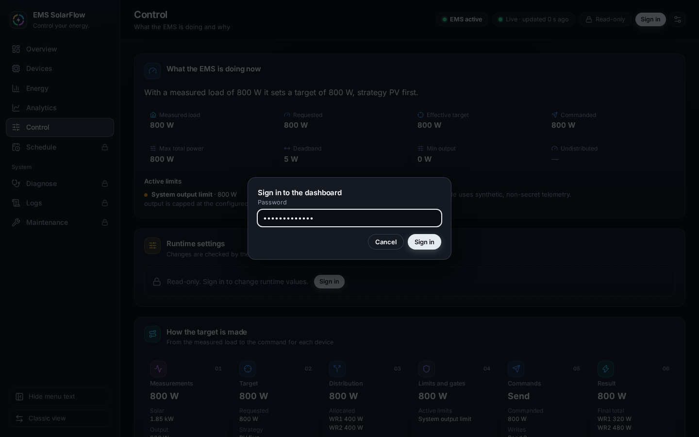
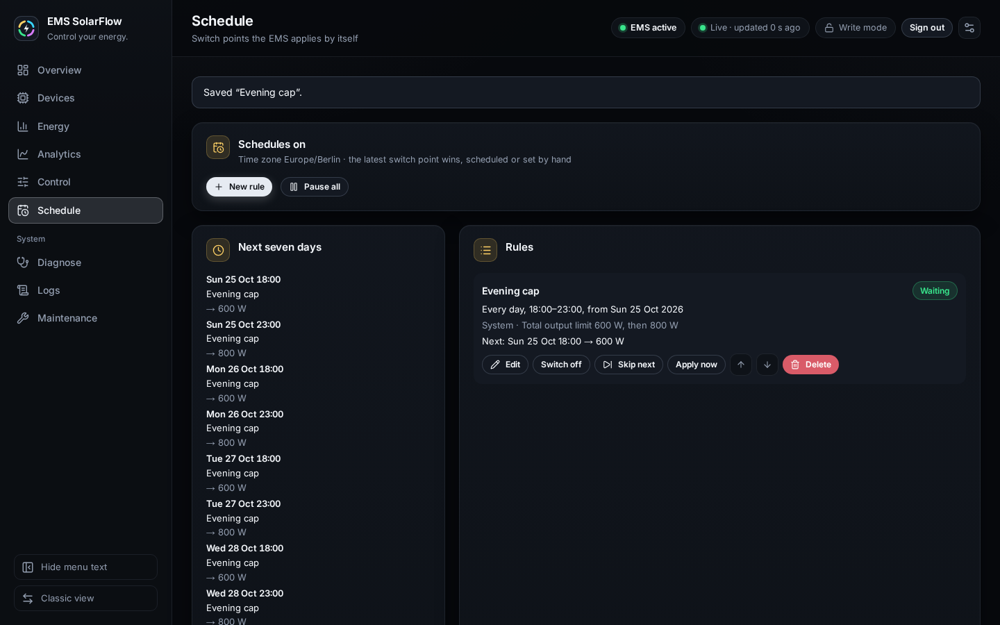

# Runtime settings and schedules

## Purpose

Change a small set of operating values live, from the browser, without editing
`config.json` or restarting the EMS — now, or at set times with a schedule.

## When to use this workflow

- Cap or raise total output for a while.
- Take one inverter out of regulation temporarily.
- Turn winter mode or AC charging from surplus on or off.
- Try a different loop interval or PV priority.
- Switch an inverter to AC charging from the grid, and set its charge power.
- Do any of these at a set time, every evening or only in winter.

For anything structural — adding a device, changing a transport, changing the
grid meter — use the Admin Console instead:
[Device management](../admin/device-management.md).

## Prerequisites

- A dashboard **sign-in**. The password is the same one the Admin Console uses,
  stored in `config/dashboard-auth.json`.
- If no password is set yet, the card says so instead of showing a form.

## Step-by-step instructions

### 1 — Sign in

**What you see when signed out:** on the **Control** page the **Runtime
settings** card reads *Read-only. Sign in to change runtime values.* **No form
fields are shown at all** — the dashboard does not show a disabled form and
hope you do not press it.

**What you select:** **Sign in**, in the card or in the top bar.

**What you enter:** the shared EMS/Admin password in **Sign in to the
dashboard**, then **Sign in**.

**Expected result:** the top bar's pill changes from **Read-only** to **Write
mode**, the button to **Sign out**, and the runtime settings appear.

**If it differs:**

- *No dashboard password is set* means none exists yet. Create one in the Admin
  Console ([First start](../admin/first-start.md)) or with
  `python3 emsctl.py dashboard set-password`.
- *Wrong password.* — try again. *Too many sign-in attempts. Wait a minute, then
  try again.* — the server slows down repeated attempts.

### 2 — Find the runtime settings

**Where:** the **Control** page, in the **Runtime settings** card — *Changes are
checked by the EMS and take effect in the next control loop* — between **What
the EMS is doing now** and the control pipeline, so the effect of a change is
on the same page.

### 3 — The cards

| # | Card | Subtitle | Fields |
| --- | --- | --- | --- |
| 01 | **EMS / System** | Global limits and loop control | **EMS enabled**, **Max total power** (W), **Min output limit** (W), **Loop interval** (s) |
| 02, 03, … | One per device (**WR1**, **WR2**, …) | Device runtime values | **Device enabled**, **AC charging**, **Max power** (W), **PV priority** (×), **Off-grid socket**, **AC role**, **AC charge power** (W), and **Light**, **Fan**, **Buzzer** and **Battery heating** where the inverter has them |
| next | **Winter mode** | Seasonal charging behaviour | **Winter mode** |
| last | **AC charging** | Charge the batteries from grid surplus | **AC charging** |

Each card has its own **Save** button.

**AC charging** on the **AC charging** card switches charging from surplus on
or off for the whole installation; the **AC charging** switch on a device card
allows or forbids it for that device. A device charges from surplus only while
both are on and its model can charge from AC — see
[AC charging from surplus](../../ac-charging.md).

**Off-grid socket** is **Off / closed**, **Eco** or **Standard**.

**AC role** is the same setting as `emsctl.py device WR1 ac-mode`:
**Output (EMS regulates)** is normal operation; **AC charging (input)** takes the
inverter out of output regulation and lets it charge from the grid at the **AC
charge power**. **Role set by** names the last writer (`dashboard`, `emsctl`).
A device controlled over MQTT shows *Not settable over MQTT* instead of the role
and the charge power: the manual role is not available over MQTT. That is all it
says. The EMS still regulates such a device through its power command — its
output, and a charge from surplus where its model can charge from AC and its
**AC charging** switch allows it.

**Light**, **Fan**, **Buzzer** and **Battery heating** are the inverter's own
settings, the same as `emsctl.py device WR1 light` and its siblings, each with
a line of help under it. A card shows one only where the inverter has it: a
local-API device whose model has the setting and whose report carries it; one
set earlier that the inverter no longer shows stays on the card with only its
value and **Device decides**, so it can be handed back. **Device decides**
leaves it to the inverter and the Zendure app, which is where every setting
starts; any other value is kept on the inverter by the EMS. Details:
[Device settings](../../technical/runtime-state.md#device-settings).

### 4 — Save

**What you select:** **Save** on the card you changed.

**What it changes:** only the fields you changed on that card are written to
`data/runtime-state.json` through the EMS-owned runtime writer, and the control
loop picks them up on its next cycle. A value someone else changed in the
meantime (emsctl, another tab, a schedule) is left alone. The cards read the
current values again every 30 seconds; a field you are editing keeps your
value.

Turning the EMS or a device off, switching a device to AC charging or back,
and changing the off-grid socket or a device setting ask first: a dialog says
what happens, for example *Turn the EMS off? It stops writing to every inverter;
each keeps its last output limit until the EMS is on again.*, and **Save change**
confirms it.

**Expected result:** *Saved* beside the button, and the change shows in the
[control pipeline](control.md) on the same page within a loop interval. With
nothing changed it says *Nothing to save: no value was changed.*; a dialog you
cancel leaves *Not saved.*

**If it differs:** the card shows the server's error and **nothing is
written**. Out-of-range values are refused rather than clamped silently.

### 5 — Verify

Do not take the form's word for it. Look further down the page:

- **Max total power** → **Max total power** and **Active limits** in **What the
  EMS is doing now**.
- **PV priority** → stage 02 **Weighting** under **Decision per device**.
- **Device enabled** off → that device's row under **Decision per device**.
- **Min output limit** → **Min output**, and stage 04 **Adjustments and
  limits** per device.

## Schedules

The **Schedule** page — *Switch points the EMS applies by itself* — sets the
same runtime values at set times. It needs a sign-in. The card on top says
**Schedules on** or **Schedules paused**, names the EMS's time zone, and says
that *the latest switch point wins, scheduled or set by hand*.

1. Select **New rule**. The editor has four steps:
   1. **What** — a **Name**, the **Action** (total or device output limit, PV
      priority, off-grid socket, charging from the grid or from surplus, winter
      mode, EMS or device control, light, fan, buzzer, battery heating, minimum
      output limit), what it **Applies to**, and **Set to**.
   2. **When** — **At a time**, or **From – to** with a **Then set to** value
      for the end of the window. A *to* earlier than *from* ends the next day.
   3. **Repeat** — **Once**, **Every day**, **Weekdays (Mon–Fri)**, **Every
      month** and more, or **Custom…**, with **Only in** to limit it to
      months (**Oct–Mar** for a winter rule) and **Ends**.
   4. **Check** — the EMS reads the draft while you type and lists its next
      switch points. **Save rule** stays off until the EMS accepts the rule; if
      it does not, it says *Cannot be saved* and why.
2. Select **Save rule**. The rule appears under **Rules** as the sentence the
   EMS reads it as, with its next switch point and a state — **Waiting**,
   **Paused**, **Finished**, **Device gone**, **Refused** or **Broken**.
3. **Next seven days** lists every switch point coming up.

Each rule has **Edit**, **Switch off** / **Switch on**, **Skip next**, **Apply
now**, arrows to change its order, and **Delete**. **Pause all** stops every
rule until **Resume**. *Clock not trusted; nothing fires until it is* means the
EMS does not trust its clock yet and fires nothing. How rules fire and interact
with values set by hand: [Schedules](../../scheduler.md).

## What is live, what is persisted, what needs a restart

| Change | Live? | Persisted? | Restart? |
| --- | --- | --- | --- |
| EMS enabled | Yes, next cycle | Yes, runtime state | No |
| Max total power | Yes | Yes | No |
| Min output limit | Yes | Yes | No |
| Loop interval | Yes | Yes | No |
| Device enabled | Yes | Yes | No |
| Device max power | Yes | Yes | No |
| PV priority | Yes | Yes | No |
| Off-grid socket | Yes | Yes | No |
| Light, fan, buzzer, battery heating | Yes | Yes | No |
| Winter mode | Yes | Yes | No |
| AC charging (installation and device) | Yes | Yes | No |
| Schedule rules | Yes, at their switch points | Yes, `schedules.json` | No |
| Adding or removing a device | — | — | **Admin Console + restart** |
| Grid meter type or address | — | — | **Admin Console + restart** |
| Write gates, transports | — | — | **Admin Console / config** |

**Everything here is live and persisted.** That is the point of these settings:
if it needs a restart, it is not here.

## Runtime state vs config.json

These are two different files with two different jobs.

| | `config/config.json` | `data/runtime-state.json` |
| --- | --- | --- |
| What | Static installation configuration | Mutable operator state |
| Owner | Admin Console apply / config path | EMS runtime writer, `emsctl.py`, the dashboard, the scheduler |
| Contains | Devices, transports, grid meter, write gates, features | Live overrides such as those above |
| Changing it | Usually needs an EMS restart | Takes effect next cycle |

They overlap on a whitelisted set of keys. When the Admin Console applies a
maintenance change, it mirrors those keys into runtime state so the two converge
— **config → runtime, one direction only**.

> A config-only edit that is not mirrored will not change a running system by
> itself. If you changed something in the Admin Console and nothing happened,
> check whether it needs a restart.

Reference: [Runtime state](../../technical/runtime-state.md) ·
[Configuration](../../technical/configuration.md).

## Safe defaults and safety

- Runtime settings **cannot enable a hardware write path that configuration has
  not already allowed.** Write gates, transports and per-device
  `write_output_limit` live in configuration, not here.
- Turning **EMS enabled** off stops regulation. It does not reset your hardware
  to a safe state by itself — decide deliberately.
- Lowering **Max total power** takes effect on the next cycle, subject to the
  normal ramp.
- Before enabling live writes at all, read [Safety](../safety.md).

## Security

- The runtime settings are shown **only** to a signed-in session.
- Every write is checked on the server for a session **and** a CSRF token. A
  button being visible in your browser is never what authorizes a write.
- The dashboard is a local-network tool. Do not expose it to the internet — see
  [Security hardening](../../dashboard.md#security-hardening).
- Sessions expire; you may be asked to sign in again. The dashboard stays
  readable either way, and a page that needs a sign-in says so.

## What happens in the background

- The dashboard sends the change; the EMS validates it and writes it through its
  own runtime writer. The browser never edits state directly.
- Validation happens on the server. A refused value is not written.
- The control loop reads the updated runtime state on its next cycle; the
  scheduler applies a due switch point through the same writer.

## Expected result

The value you set is stored, survives a restart, and visibly changes the control
decision within one loop interval. A fresh **Guided setup**
([Set up a new system](../admin-setup.md)) resets all of these values to the new
config at the next EMS start: a device you switched off is active again, and AC
role goes back to Output with no AC charge power (see
[runtime state](../../technical/runtime-state.md#fresh-setup-reset)). In the
Admin's Maintenance, **Put live values back**, and an Apply that changes the same
setting, write the config value over it right away, for every value here except
**AC role** and **AC charge power**, which have no config value and stay as you
set them.

## Warnings and common problems

| Symptom | Meaning | What to do |
| --- | --- | --- |
| No fields, only *Read-only. Sign in to change runtime values.* | Not signed in | Sign in |
| *Read-only. No dashboard password is set …* | No password configured | Set a password, see step 1 |
| The top bar reads *Write mode · runtime state unavailable, retrying* | The runtime state did not answer; the dashboard asks again | Wait, then check `docker compose logs ems` |
| An error on save | The value is out of range or refused | Nothing was written; correct it |
| Saved but nothing changed | Wait one loop interval, then check the pipeline | [Control pipeline](control.md) |
| Value reverts | Something else writes runtime state | Check `emsctl.py`, another dashboard tab, a schedule rule, a second controller |
| Device still not regulating | Enabled here, but blocked by config | [Devices](devices.md#read-only-and-write-blocked-devices) |

## Recovery or next steps

- Confirm the effect → [Control pipeline](control.md)
- Structural changes → [Device management](../admin/device-management.md)
- Same edits from the shell → [CLI reference](../../cli.md)
- How schedules work → [Schedules](../../scheduler.md)
- Before going live → [Safety](../safety.md)
